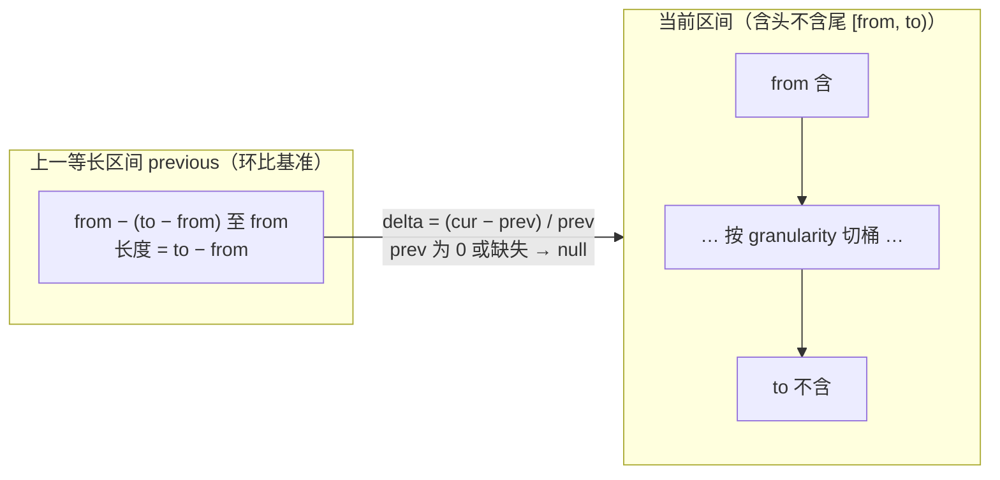
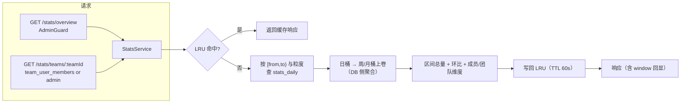
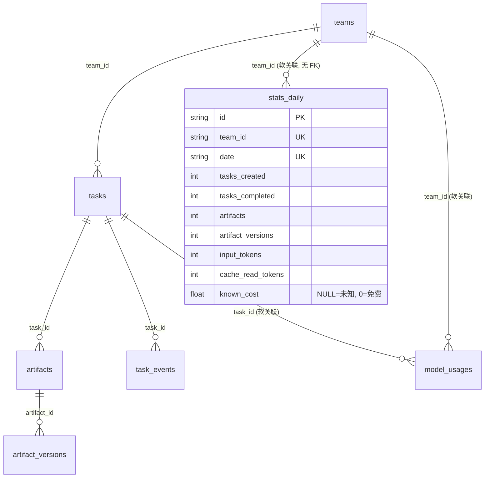

# 团队统计看板设计

## 1. 背景与目标

### 1.1 现状能力盘点

| 能力 | 端点 | 口径 | 覆盖 | 局限 |
|------|------|------|------|------|
| 团队用量聚合 | `GET /api/v1/teams/:teamId/usage` | 成员 × 模型，**纯累计** token 六元组 + cost | 单团队、仅用量 | 无时间维度、无任务/产出物维度、无跨团队对比 |
| 协调度指标 | `GET /api/v1/teams/:teamId/coordination-metrics` | 4 条自描述指标（PM 产出物数 / PM 消息占比 / 派发 vs 亲做 / 群私双报），窗口 168h 缺省、720h 上限 | 单团队、仅管理员 | 只回答「协调姿态」，不回答「产出多少、花了多少、快不快」 |
| 前端展示 | `web/src/components/teams/TeamStatsTab.tsx` | 由 `TeamUsageResponse` 三层汇总（卡片 / 表尾合计 / Top 分布条） | 团队页「统计」tab | 无粒度切换、无区间筛选、无对比 |

### 1.2 缺口

1. **没有时间维度**：`usage` 是自统计上线以来的累计值，看不到「哪一天、哪一周花的、做的」。累计值无法回答「本周比上周是变好了还是变差了」。
2. **没有任务与产出物维度**：token/cost 与「做了多少事」完全脱节——贵而高产的团队和贵而空转的团队在现有数字上**长得一样**。
3. **没有跨团队对比**：平台管理员要回答「哪个团队值得多派活 / 哪个团队在烧钱」，必须能横向比较。
4. **没有成本效率**：只有总成本，没有每任务成本、每产出物成本、缓存命中率——总成本涨了，是干得多了还是浪费多了，现有数字无法区分。
5. **口径未文档化**：`cost` 的 NULL 语义、`artifacts` 与 `artifact_versions` 的差别、`totalTokens` 与六元组之和的关系，目前只散落在代码注释里，任何一次「汇总对不上」的排查都要重新读一遍实现。

### 1.3 目标

* **一个全局看板**：平台管理员在**日 / 周 / 月**三种粒度下，跨团队对比任务数、产出物数、token、成本，以及效率/质量/协作补充维度。
* **一个团队详情页**：从全局看板下钻，看单团队的时间序列、成员产能、任务生命周期漏斗、质量指标。
* **一份可被实现逐条对齐的口径字典**：本文档 §2 是后续 `StatsService` 实现的**唯一口径事实来源**，实现与文档不一致以文档为准。
* **数字自洽**：成员之和 = 团队合计、桶之和 = 区间合计、环比 = 等长上一区间，且这些约束进验收清单。

### 1.4 非目标

* **不做实时看板**：不订阅 SSE、不秒级刷新；数据新鲜度为「日汇总 T+1（或 T+0 收尾）」。
* **不做自定义指标 DSL / 任意维度组合**：本期维度固定为 时间 × 团队 × 成员 × 模型。
* **不做写入侧改造**：不修改 `model_usages` / `tasks` / `artifacts` 的写入链路（§7 的 `stats_daily` 是**衍生表**，只读事实源、可回填）。
* **不替代协调度指标**：`coordination-metrics` 继续独立存在（它是单团队、管理员、短窗口的「体检」，不是经营看板）。
* **不做告警/阈值推送**：本期只展示，不主动通知。

### 1.5 文档关系

| 相关文档 | 关系 |
|---------|------|
| 09 篇《API 设计》 §3.4 | 既有 `teams/:teamId/usage` 契约；本文档新增 `/stats/*` 端点在其外层聚合 |
| 15 篇《数据模型细化（ER图）》 | `model_usages` / `tasks` / `artifacts` / `task_events` 字段与索引事实源 |
| 13 篇《任务状态机与全生命周期》 | 七态与 `started_at`/`pending_review_at`/`completed_at`/`archived_at` 语义 |
| 28 篇《团队模型与排队设计》 | `team_queues` 的历史口径（排队已退役，见 §2 `queue_wait`） |
| 29 篇《团队化改造需求说明》 | 「同一团队一次只做一件事」的业务背景 |
| 34 篇《Worker 交互接口协议》 | token 六元组的 worker 上报来源 |

## 2. 指标口径字典

> **本节是全文最重要的部分。** 表内每个指标都必须能在实现里逐字对上；实现新增指标须先改本节。

### 2.0 三条铁律（实现前先背下来）

| # | 铁律 | 含义 | 反例（错误做法） |
|---|------|------|-----------------|
| ① | **未知 ≠ 0** | `cost` 的 NULL 表示「上游没上报、我们不知道」，0 表示「真的免费」。展示层未知必须显示 `—`；聚合层**不得把未知并进 0 求和**后只回一个数字 | 把 `_sum(cost)=null` 归一成 `0` 并直接展示 `$0.00`（现状 `usage.service.ts` 的聚合层就是这么归一——那是**为兼容旧 tab**的展示妥协，新看板必须回传 `cost` 的 `null` 语义 + `costUnknownRatio`） |
| ② | **累计 ≠ 区间求和** | 累计接口（`/teams/:teamId/usage`）的数值是「自功能上线至今」，**不是**任一区间的值；区间指标一律由**带时间窗的事实行**重新聚合，不复用累计值做减法 | 用「本月累计 − 上月累计」来算月度值：既受上线时间影响，又跨不过口径变更 |
| ③ | **去重 artifact ≠ 版本数** | `artifacts` 是**产出物对象个数**（一个文档 = 1，改三版仍是 1）；`artifact_versions` 是**版本行数**（同一文档改三版 = 3）。两个数字**不可相加、不可互相替代** | 用 `currentVersion` 求和当「产出物数」；或在图上把两者叠成一条曲线 |

### 2.1 任务类指标

任务状态七态（`server/src/common/constants/task.constants.ts`）：`queued` / `pending` / `in_progress` / `blocked` / `pending_review` / `completed` / `archived`。
两个集合严格区分：`NON_TERMINAL` = queued+pending+in_progress+blocked+pending_review；`TERMINAL` = completed+archived。
**注意另有两条窄口径不可混用**：删团队前置校验的「执行中」= in_progress+pending_review；并行占用上限 = in_progress+blocked（`Team.maxConcurrentTasks`）。

| 中文名 | 机器键 | 公式 / 判定 | 数据源（表.字段） | 粒度 | 空值 / 未知 | 易混淆点 |
|--------|--------|-------------|-------------------|------|-------------|----------|
| 任务新建数 | `tasks_created` | `count(*) where created_at ∈ [from,to)` | `tasks.created_at` | 日/周/月 | 无任务 = `0` | 与「进入 in_progress」无关；创建即计，含排队中也含被删前的？——**删除任务一律不计**（现有实现无软删，物理删即行消失，历史需靠 `stats_daily` 保留，见 §7） |
| 任务完成数 | `tasks_completed` | `count(*) where completed_at ∈ [from,to)` | `tasks.completed_at` | 日/周/月 | 无 = `0` | 计的是**验收通过**（`accept`），不是 `bring to pending_review`；用 `archived_at` 或 `status=completed` 快照数都会漏/多 |
| 进行中数（快照） | `tasks_in_progress` | `count(*) where status='in_progress'`（**区间终点快照**） | `tasks.status` | 仅区间末（不做日序列） | 无 = `0` | **快照 ≠ 流量**：它是「某刻有几件在做」，不能与 `tasks_completed`（区间流量）相加或相除得到比率 |
| 排队中数（快照） | `tasks_queued` | `count(*) where status='queued'` | `tasks.status` | 仅区间末 | 无 = `0` | `queued` **已随并行执行退役**（新任务直接 `pending`），线上该值长期为 0；保留该项是为历史数据与 UI 兼容，页面对 0 值不做「异常」提示 |
| 阻塞数（快照） | `tasks_blocked` | `count(*) where status='blocked'` | `tasks.status` | 仅区间末 | 无 = `0` | 与「区间内被阻塞过的任务数」不同（后者按 `task_events` 的 `block` 事件计，是流量口径） |
| 验收驳回数 | `tasks_rejected` | `count(*) task_events where event_type='reject' and created_at ∈ 区间` | `task_events.event_type='reject'`, `.created_at` | 日/周/月 | 无 = `0` | 一次任务可被驳回多次 ⇒ 这是**次数**不是任务数；要任务数需 `count(distinct task_id)`，两者在 UI 上须标明到底是哪个 |
| 完成率 | `completion_rate` | `tasks_completed / tasks_created`（分母 0 → `null`） | 上两行派生 | 区间 | 分母 0 → `null`（显示 `—`） | **区间内新建与区间内完成是两批任务**（跨区间滞后）⇒ 该比率是「同一时间窗的进出比」，不是同批任务的完成率；分母为 0 时不得写 0% |
| 任务状态分布 | `task_status_mix` | 七态各 `count(*) where status=?` | `tasks.status` | 快照 | 无 = 全 0 | 与 §2.1 的 `tasks_in_progress` 同源（快照）；分布之和 = 该团队任务总数，可用于「数字自洽」校验 |

### 2.2 产出物类指标

`ARTIFACT_TYPES` = `text`（结论文本）/ `doc`（文档）/ `file`（文件）；`ARTIFACT_CATEGORIES` 为可空八类（未分类为 NULL，不写「其他」）。

| 中文名 | 机器键 | 公式 / 判定 | 数据源（表.字段） | 粒度 | 空值 / 未知 | 易混淆点 |
|--------|--------|-------------|-------------------|------|-------------|----------|
| 产出物数（去重） | `artifacts` | `count(*)` 个 **Artifact 对象**，按 `created_at ∈ 区间`（归属团队经 `artifact.task_id → tasks.team_id`） | `artifacts.id`, `artifacts.created_at`, `tasks.team_id` | 日/周/月 | 无 = `0` | **这是「对象数」**。同一产出物被修订 3 次只算 1；用 `sum(current_version)` 或按版本行去重都会错 |
| 产出物版本数 | `artifact_versions` | `count(*)` 个 **ArtifactVersion 行**，按 `artifact_versions.created_at ∈ 区间` | `artifact_versions.id`, `.created_at`, `.artifact_id` | 日/周/月 | 无 = `0` | 与上行**不可相加**。v1 也是 1 行，所以「新建的产出物」至少贡献 1 个版本 ⇒ `artifact_versions ≥ artifacts`（跨区间时会失衡，见下） |
| 产出物类型构成 | `artifact_type_mix` | 按 `artifacts.type ∈ {text,doc,file}` 分组 `count(*)` | `artifacts.type` | 区间 | 无 = 三项皆 0 / `null` | 按**对象**分组（不是按版本行），否则「改得多的类型」会虚高 |
| 产出物接受率 | `artifacts_accepted_ratio` | `count(distinct artifact_id) where accepted_flag=true / count(distinct artifact_id)`（区间内） | `artifact_versions.accepted_flag`, `.artifact_id` | 区间 | 分母 0 → `null` | `accepted_flag` 由 `accept` 时**批量置当前版本**（`tasks.service.ts` 事务内 `updateMany`）；因此「被接受」是任务的属性、不是版本的属性，跨版本统计会重复 |
| 每任务产出物数 | `artifacts_per_task` | `artifacts / tasks_completed`（分母 0 → `null`） | 派生 | 区间 | `null` | 用 `tasks_created` 做分母会把「还没做完的」算进分母，系统性偏低 |

### 2.3 token 与成本指标

六个 token 计数（`model_usages` 六列，全部 `Int @default(0)` 不可空；worker `step-finish` 为 best-effort，缺字段/NaN/负数由服务层归零后写入）：

| 中文名 | 机器键 | 说明 |
|--------|--------|------|
| 输入 token | `input_tokens` | 上游 `input` |
| 输出 token | `output_tokens` | 上游 `output` |
| 推理 token | `reasoning_tokens` | 上游 `reasoning`；**不入 `/usage` 聚合**（见易混淆点） |
| 缓存读 token | `cache_read_tokens` | 上游 `cache.read` |
| 缓存写 token | `cache_write_tokens` | 上游 `cache.write` |
| 上游总 token | `total_tokens` | 上游 `total` **原样透传**，不是服务端求和 |

| 中文名 | 机器键 | 公式 / 判定 | 数据源 | 粒度 | 空值 / 未知 | 易混淆点 |
|--------|--------|-------------|--------|------|-------------|----------|
| 六元组求和 | `component_sum_tokens` | `sum(input+output+reasoning+cacheRead+cacheWrite)` | `model_usages` 五列 | 日/周/月 | 无行 = `0` | **这是本看板「总 token」的展示口径**。它与 `total_tokens` 之和**不保证相等**（上游 `total` 的定义随 provider 而异）⇒ 必须回传两者并给 `tokenMismatch` 标记（§6 `tokenConsistency`） |
| 总成本 | `cost` | `sum(cost)` over **非 NULL 行** | `model_usages.cost` (`Float?`) | 日/周/月 | **NULL = 未知，不是 0**；全区间未知 → 返回 `null`；部分未知 → 返回已知部分之和 **并** 回传 `cost_unknown_ratio` | 现状 `/usage` 把 NULL 按 0 求和只回数字（旧 tab 的展示妥协）；新看板**必须**保留 `null` 语义，否则「未知」会被展示成「免费」 |
| 成本未知占比 | `cost_unknown_ratio` | `未知行数 / 总行数`（0..1，按 **行** 计） | `model_usages.cost IS NULL` | 日/周/月 | 无行 → `0`（无事实即无未知） | 与 `cost` 同窗口才算数；UI 脚注「成本覆盖 xx%」用它 |
| 每任务成本 | `cost_per_task` | `cost / tasks_completed`（`cost=null` 或分母 0 → `null`） | 派生 | 区间 | `null` | 分母用 `tasks_completed`（已验收的产出）而非 `tasks_created` |
| 每产出物成本 | `cost_per_artifact` | `cost / artifacts`（`cost=null` 或 `artifacts=0` → `null`） | 派生 | 区间 | `null` | 分母是**去重 artifact**，不是 `artifact_versions`（否则会「越多改越便宜」） |
| 每千 token 成本 | `cost_per_ktoken` | `cost / (component_sum_tokens / 1000)` | 派生 | 区间 | `null` | 用来区分「token 用量涨」与「单价涨」 |
| 缓存命中率 | `cache_hit_rate` | `cacheRead / (input + cacheRead)` | `model_usages` 两列 | 区间 | 分母 0 → `null` | **分母不含 `cacheWrite`**，理由见 §2.6；与现状 tab 的 `cacheRead/totalTokens` 口径**不同**，需拍板（§6 会两者都回传） |

### 2.4 效率类指标（cycle time / queue wait）

| 中文名 | 机器键 | 公式 / 判定 | 数据源 | 粒度 | 空值 / 未知 | 易混淆点 |
|--------|--------|-------------|--------|------|-------------|----------|
| 交付周期 | `cycle_hours` | 对**区间内完成**的任务：`completed_at − started_at`，取平均（按每个任务等权）与 P90 | `tasks.started_at`, `tasks.completed_at` | 区间（可按周分桶） | 任务 `started_at` 为 NULL（从未开始却直接完成，异常）→ **剔除并计入 `invalidSamples`**，不得按 0 计 | **等权平均 ≠ 加权平均**：跨多个桶汇总时必须按 `tasks_completed` 加权（否则「完成多的那周」被低估）。现状 mock 数据即按加权实现 |
| 排队等待 | `queue_wait_hours` | `started_at − enqueued_at`；**新数据退化口径** `started_at − created_at` | `team_queues.enqueued_at` **或** `tasks.created_at` | 区间 | `team_queues` 无行（排队已退役）→ 走退化口径，且 `queueWaitSource` 标记为 `created_at`（近似，非严格排队） | **`team_queues` 已退役**（parallel-tasks 后新任务直接 `pending`、无 `tq_` 写入）⇒ 严格排队时长只存在于历史数据。UI 必须显示口径来源，不能把近似值说成「排队时长」 |
| 阻塞时长 | `blocked_hours` | 按 `task_events` 的 `block`→`resume` 配对求差，未 resume 的截至区间末 | `task_events.event_type`, `.created_at` | 区间 | 配对不上 → 该段剔除并计入 `invalidSamples` | 与「当前 blocked 快照数」不同；配对是以事件流为准的流量口径 |
| 评审轮次 | `review_rounds` | 已收敛轮次数：按 issue 账本的 `round` 最大值，或对 `round.complete` 计数 | **无表**：账本内嵌在派发 issue 的 `description`（`<!-- REVIEW-ROUND-JSON -->` 机器段，33 篇 §3.1） | 区间 | 无派发 issue → `0`；**解析失败 → `null`（未知），不是 0** | **不可按 `description` 文本聚合**（既贵又不稳）。本期取 `round.complete`/`round.stale` 事件计数为代理口径，或由 `stats_daily` 的采集任务在账本更新时递增（§7.4 待拍板） |
| 返工数 | `rework_count` | `count(distinct task_id) where event_type='reject'` 且在区间内 | `task_events.event_type`, `.task_id` | 日/周/月 | 无 = `0` | 与 `tasks_rejected`（次数）不同：这是**任务数**。两个字段都要有，UI 上分开展示 |

### 2.5 质量 / 协作 / 活跃指标

| 中文名 | 机器键 | 公式 / 判定 | 数据源 | 粒度 | 空值 / 未知 | 易混淆点 |
|--------|--------|-------------|--------|------|-------------|----------|
| 验收一次通过率 | `first_pass_rate` | `(tasks_completed − rework_count) / tasks_completed` | `tasks.completed_at` + `task_events.reject` | 区间 | 分母 0 → `null` | 严格定义是「完成且**从未**被 reject」；`rework_count` 若含跨区间驳回（任务在本区间完成、上个区间被驳回）会被算作未一次通过——这是**刻意的保守口径**，脚注须说明 |
| 评审轮次均值 | `review_rounds_avg` | `review_rounds / tasks_completed` | 派生 | 区间 | `null` | 分母 0 → `null`；轮次是「派发→收敛」的闭环数，不是消息条数 |
| Agent 消息数 | `agent_messages` | `count(*) where sender_type='agent'`，频道限定为团队频道且 `deleted_at IS NULL` | `messages.sender_type`, `.channel_id` → `chat_channels.team_id/.deleted_at` | 日/周/月 | 无 = `0` | **不按 `sender_instance_id` 归属**：私聊回流时该列可能是「收件实例」，按它归成员会把别人的话算进来（线上实测差 3 条，见 `coordination-metrics.service.ts` 注释）。按 `sender_id`（执行 Agent）归属 |
| 私聊占比 | `private_message_share` | 私聊频道消息 / 全部 agent 消息 | `chat_channels.type ∈ {team_group, private}` | 区间 | 分母 0 → `null` | 与协调度指标的「PM 群私双报」不是同一指标（那个只看 PM、且是粗口径） |
| 活跃成员数 | `active_members` | 区间内**有任一产出**（发了 agent 消息 / 有 artifact_versions 作者 / 有 model_usages 行）的 `team_member_id` 去重数 | `messages.sender_id`, `artifact_versions.author_agent_id`, `model_usages.team_member_id` | 区间 | 无 = `0` | 「成员数」是编制（`team_members` 行数），「活跃成员数」是区间事实 ⇒ 两者不等，UI 要分开写。按 `sender_id`（agentId）归成员需经 `team_members(team_id, agent_id)` 映射，一 Agent 多实例时存在歧义 → 口径以 `model_usages.team_member_id` 为准（它天然带成员键） |
| 活跃天数 | `active_days` | 区间内有任一事实的**日历日**数（按 Asia/Shanghai 切日） | 各事实表 `created_at` | 区间 | 无 = `0` | 不是「区间天数」（那是常量）；用来算活跃率 `active_days / window_days` |
| 成员活跃率 | `member_active_rate` | 单成员的 `active_days / window_days` | 派生 | 区间 × 成员 | 0..1 | 与团队级 `active_days` 不同（前者是日期集合的势，后者是成员 × 日的覆盖） |
| 成员产能 | `member_output` | 单成员：任务参与数 / 产出物数 / token / cost / 消息数 / 最近活跃 | 各事实表按成员键聚合 | 区间 × 成员 | 成员已删 → 名字回落空串（软关联，同 `/usage` 口径） | 任务「参与数」需界定：本期取「该成员有 model_usages 行的任务数」（可查、无歧义）；按 `task_events.actor_id` 统计会把人工操作也算进来 |

### 2.6 关键取舍：缓存命中率的分母

**采用 `cacheRead / (input + cacheRead)`。** 理由：

1. **语义**：命中率的本质是「本该作为输入送进模型的 token 里，有多少比例从缓存读到了」。`input`（未命中、实打实送进去的）与 `cacheRead`（命中、从缓存读的）构成完整的「输入基数」。
2. **`cacheWrite` 不属于输入基数**：它是「把内容写进缓存」的一次性成本动作，发生在**产生**缓存的那一刻，与「本次读取是否命中」无关。把 `cacheWrite` 放进分母会让同一个物理过程被计两次（先写、后读）。
3. **`reasoning` 更不属于**：推理 token 是模型内部产出，不是送进去的输入，且上游是否把它算进 `input` 因 provider 而异（这也是 §2.3 里 `totalTokens` 与六元组之和可能不一致的根源之一）。
4. **`totalTokens` 不可用**：它就是「上游 total」，定义随 provider 漂移，做分母会让「命中率」在换模型/换 provider 时**非业务性跳变**。

**与现状口径的差异（需拍板）**：`web/src/components/teams/TeamStatsTab.tsx` 现在用的是 `cacheRead / totalTokens`。两者在多数模型上数值接近，但当 `reasoning` 占比较高时会明显偏离。**建议**：新看板统一用本口径，旧 tab 待后续对齐（本期不改旧 tab，避免一次 PR 同时改口径与加功能）；API 同时回传 `cacheHitRate` 与 `cacheHitRateLegacy`，让 UI 可标注差异（§6.3）。

### 2.7 `totalTokens` 口径（需拍板）

`model_usages.total_tokens` 是 worker `step-finish` 的 `total` **原样透传**，服务端不重算。因此存在两类不一致：

* 六元组之和 < `total`：上游 `total` 含未分类的额外计数（如 provider 内部计费口径）。
* 六元组之和 > `total`：上游 `total` 未含 `reasoning` 或 `cacheWrite`。

**建议口径**：看板展示「总 token」用 `component_sum_tokens`（可控、可对账），同时回传 `upstream_total_tokens` 与 `tokenConsistency{rows, mismatchRows, mismatchRatio}`。UI 在 mismatchRatio > 1% 时显示脚注。**不把两者相加、不取较大值**。

## 3. 时间粒度与区间

### 3.1 粒度

| 粒度 | 机器键 | 桶键 | 展示标签 | 说明 |
|------|--------|------|---------|------|
| 日 | `day` | `YYYY-MM-DD` | `10-30` | 唯一事实粒度；周/月一律由日聚合得出 |
| 周 | `week` | 该周**周一**的 `YYYY-MM-DD` | `10/26` | **周一为周起**（ISO 8601 周），周桶 = `[周一 00:00, 下周一 00:00)` |
| 月 | `month` | `YYYY-MM` | `10 月` | 自然月；桶 = `[当月 1 日 00:00, 次月 1 日 00:00)` |

**周/月粒度必须由日级预聚合再上卷**（`stats_daily` → 周/月桶），严禁另写一套周/月数据源——否则切换粒度后顶部指标卡与趋势图会对不上（原型 `stats-data.ts` 已按此约束实现，见其头注释第 2 条）。

### 3.2 时区

* 全站**固定 `Asia/Shanghai`（UTC+8，无夏令时）**，不做用户级时区。
* 理由：① 全平台是内网单组织部署，用户与 worker 都在同一时区；② 日切边界必须**唯一确定**，否则「10 月 30 日的任务数」在不同人眼里是两个数；③ 汇总表按本地日存 `date` 列，跨时区读写会让幂等 upsert 失效。
* 实现：所有 `created_at` 等列在库里是 **UTC** `DateTime`；聚合时按 `CONVERT_TZ` / `created_at + 8h` 再取日。**禁止**用 `created_at` 的 UTC 日直接切日（会漏 08:00–24:00 的部分）。

### 3.3 区间边界

* **含头不含尾**：`[from, to)`。`from` 含，`to` 不含。这样相邻区间无缝、不重叠、可加。
* 响应里回显 `from` / `to`（ISO-8601，带 `+08:00` 偏移）与 `boundary: "half-open"`，避免调用方各自猜。
* 缺省：`to = 今天 00:00 +08:00`（不含当天，因为当天不完整）；`from` 由粒度与 `range` 预设推导。
* 预设区间：`7d` / `30d` / `90d`（与原型筛选条一一对应）。**90 天是上限**（见 §3.4）。

### 3.4 区间与粒度上限

| 约束 | 值 | 理由 |
|------|-----|------|
| 最大跨度 | **90 天** | 与 `stats_daily` 的预聚合保留窗口一致；单团队日行 90 行、20 团队 = 1800 行，查询量有界。对齐协调度指标「有界只读」的既有硬约束（那里是 720h = 30 天，此处按看板需要放宽到 90 天，但仍是有界） |
| 最小跨度 | 1 天 | — |
| 粒度 × 跨度校验 | `day` ≤ 90 桶；`week` ≤ 13 桶；`month` ≤ 3 桶 | 防止「90 天按日 → 90 个 x 轴刻度」把前端画崩（超过 31 个桶时 API 仍返回，但 UI 自动降级为周） |
| 超限行为 | **400 `STATS_RANGE_INVALID`，不静默截断** | 静默截断会让「我查了 90 天」与实际口径不一致（同协调度指标 constants 注释的定夺） |

### 3.5 环比

* **环比 = 上一等长区间**：`previous = [from − (to − from), from)`，长度严格相等。
* 上一区间不足（数据窗口起点之前）→ `previous: null`，UI 显示 `—`，**不得显示 0% 或 +∞%**。
* 上一区间某指标为 0 → 变化率 `null`（除以 0 无意义），UI 显示 `—`（与原型 `deltaRate` 的 `null` 语义一致）。
* 同比**不做**（平台上线不足一年，同比无数据可依）。



## 4. 补充维度论证

用户点名了四类：**任务数量、产出文档数量、token 使用、成本**。这四类只回答了「做了多少、花了多少」，回答不了「值不值」。因此补充四类维度，每类都有明确的决策动作：

| 补充维度 | 指标 | 用户会拿它做什么决策 |
|---------|------|-------------------|
| **效率** | `cycle_hours` / `queue_wait_hours` / `blocked_hours` | 交付变慢时定位是「排队等资源」还是「做的时候卡住」——前者加并发/加 worker，后者要拆任务或换 Agent |
| **质量** | `first_pass_rate` / `rework_count` / `review_rounds` | 一次通过率低 ⇒ 需求交底或 Agent 提示词有问题，而不是「再多派几个人」；返工数高 ⇒ 直接对应重复 token 与成本浪费 |
| **协作** | `agent_messages` / `private_message_share` / `active_members` / `active_days` | 消息量暴涨但产出不涨 ⇒ 空转/刷屏；活跃成员远小于编制 ⇒ 团队里有成员没被用起来 |
| **成本健康度** | `cost_per_task` / `cost_per_artifact` / `cache_hit_rate` / `cost_unknown_ratio` | 总成本涨了，是「干得多了」（tasks 也涨）还是「单价/浪费涨了」（tasks 平、每任务成本涨）；缓存命中率跌 ⇒ 会话复用或上下文策略退化 |

### 4.1 「指标 → 用户决策」映射表

| 指标 | 异常信号 | 可能的根因 | 用户的决策 |
|------|---------|-----------|-----------|
| `tasks_created` 高 + `tasks_completed` 低 | 进多出少 | 任务切太碎 / 验收积压 | 合并任务、加验收人力 |
| `completion_rate` 骤降 | 进出比恶化 | 新任务涌入或完成停摆 | 看 `tasks_blocked` 与 `queue_wait` 定位 |
| `cycle_hours` P90 拉长 | 长尾变重 | 大任务/依赖等待 | 任务拆分或提前排依赖 |
| `queue_wait_hours` 上升 | 等开始 | 并发上限或 worker 不足 | 调 `maxConcurrentTasks` / 加节点 |
| `first_pass_rate` 下滑 | 一次过不了 | 需求交底差 / 产出质量降 | 强化交底与评审纪律，而非加人 |
| `rework_count` 上升 | 返工 | 同上 | 直接看成本侧是否同步上升 |
| `agent_messages` 涨而 `artifacts` 不涨 | 空转 | 讨论多、产出少 | 检查是否 PM 亲做/刷屏（转 `coordination-metrics`） |
| `cost_per_task` 涨而 `tasks_completed` 平 | 单任务变贵 | 上下文膨胀 / 模型升级 / 重试 | 看 `cache_hit_rate` 与 `component_sum_tokens` |
| `cache_hit_rate` 跌 | 复用退化 | `resetAfterComplete` 被开启 / 会话频繁重建 | 调整 `Team.reuseSession` 策略 |
| `cost_unknown_ratio` 高 | 成本不可信 | 上游未上报 | **先修上报，再谈成本**——未知不能当 0 用来做决策 |
| `artifacts` 平而 `artifact_versions` 涨 | 反复改同一份 | 需求不清或评审拖轮次 | 看 `review_rounds`，收敛需求 |

### 4.2 为什么不做「团队健康度评分」作为主指标

原型里有 `healthScore`（完成率/一次通过率/周期/阻塞四项加权的演示值），**本文档不把它列入必选 API 契约**。理由：加权系数无权威依据，写进契约就等于把一组拍脑袋的权重固化成「平台结论」。本期四类维度**原样暴露**，让用户自己看；`healthScore` 仅作为原型演示与前端派生值（可由四个基础指标在前端算），不进 API。

## 5. 页面与交互

两个页面，一个面向平台管理员的**全局对比**，一个面向团队成员的**单团队下钻**。两者共用同一套筛选语义与同一套口径（数字可在两页之间对账）。

### 5.1 全局统计看板（`stats-dashboard`）

* **受众**：平台管理员（跨团队经营数据，权限对齐 `coordination-metrics` 的 AdminGuard 口径）。
* **布局**：顶部筛选条（粒度 / 区间 / 团队多选）→ 4 张指标卡（任务总数、已完成、产出物数、总成本，带环比与 sparkline）→ 任务与产出趋势折线 → token 与成本堆叠柱 + 缓存命中率 → 团队产能排行 → 团队对比表 → 活跃热力图 → 协作健康度小卡。
* **筛选**：粒度（日/周/月 SegmentedTabs）、区间（近 7/30/90 天）、团队多选（全部 + N 个 chip）。
* **下钻路径**：对比表行 / 排行条 / 热力图行 → 点击进入 `team-stats`（携带 `teamId` + 当前粒度 + 当前区间）。
* **空态**：全部团队在该区间无任何事实 → `EmptyState`「该区间暂无可展示的统计（数据自统计功能上线后开始累积，不回填历史）」。
* **未知态**：`cost` 为 `null` 的团队/单元格显示 `—`，并在页脚固定脚注「**未知 ≠ 免费**：`—` 表示上游未上报费用，不代表 0 成本」。

```prototype
id: stats-dashboard
title: 统计看板（全局）
device: desktop
height: 800
```

### 5.2 团队统计详情（`team-stats`）

* **受众**：该团队成员（复用既有 `team_user_members` 判定口径，见 §6.4）。
* **布局**：顶栏面包屑（统计看板 / 团队名）→ 团队切换器 + 粒度 + 区间 → 团队概览条（成员数 / 当前任务 / 队列长度）→ 5-6 张指标卡 → 任务生命周期漏斗 → 交付周期分布 → 产出物构成（text/doc/file）→ 成员产能表 → token 与成本趋势 + 缓存命中率 → 质量与协作小卡 → 每日活跃热力。
* **筛选**：团队切换器（直接切团队，数字必须真实变化）、粒度、区间；与全局看板同语义。
* **漏斗口径**：按 `task_events.to_status` 的去重任务数（`queued→pending→in_progress→pending_review→completed`），**递减修正**只允许因「跳过态」导致的下修，不允许倒挂。

```prototype
id: team-stats
title: 团队统计详情
device: desktop
height: 800
```

### 5.3 交互约定

| 约定 | 规则 |
|------|------|
| 粒度切换 | 只改桶大小，**不改区间端点**；切换后顶部卡片数字必须不变（区间总量与粒度无关）——这是最容易实现错的地方 |
| 区间切换 | 改 `from`/`to`，卡片与趋势同步刷新；环比随之重算 |
| 团队多选 | 空选 = 全部团队（不发出 `teamIds=`）；多于 1 个时对比表展示所选团队 |
| 下钻 | 始终携带当前 `granularity`/`from`/`to`，保证「点进去看到的是同一口径」 |
| 空态 | 用 `EmptyState`，不是错误态；无数据是统计功能的正常初始状态（不回填历史） |
| 未知态 | 任何 `null` 一律渲染 `—` 并带脚注；**禁止**把 `null` 渲染成 `0` / `$0.00` / `0%` |
| 加载态 | 骨架屏；只读接口，不做乐观更新 |
| 导出 CSV | **可选（本期不做）**。若做，须导出「当前筛选下的桶级事实 + 口径列」，并附 `cost_unknown` 标记列；不建议做（口径解释成本高于收益，先看再导） |

## 6. API 设计

### 6.1 端点清单

| 方法 | 路径 | 说明 | 权限 |
|------|------|------|------|
| GET | `/api/v1/stats/overview` | 全局跨团队：区间总量 + 时间序列 + 团队对比 + 汇总 | `AdminGuard`（平台管理员） |
| GET | `/api/v1/stats/teams/:teamId` | 单团队详情：区间总量 + 时间序列 + 成员维度 + 生命周期/质量 | 团队成员可见（`team_user_members` 有行，或平台管理员） |

设计取向：**一个端点一次把该页要的全算好**（沿用 `usage` 的「三层汇总一次算好、前端零派生查询」原则），不做「一个图表一个请求」。

### 6.2 查询参数

| 参数 | 类型 | 缺省 | 约束 |
|------|------|------|------|
| `granularity` | `day` \| `week` \| `month` | `day` | 非法值 → 400 `STATS_QUERY_INVALID` |
| `from` | ISO-8601 日期或时刻 | `to − 7d` | 早于 `stats_daily` 起始日 → 该段返回空桶（不报错） |
| `to` | ISO-8601 | 今天 00:00 +08:00 | 未来时刻 → 400 |
| `teamIds` | 逗号分隔或重复参数 | 空 = 全部团队 | 仅 `overview` 有效；不存在的 teamId 静默忽略并回显 `ignoredTeamIds` |

窗口校验：`to − from ∈ [1d, 90d]`，超限 400 `STATS_RANGE_INVALID`（§3.4），**不静默截断**。

### 6.3 响应契约（TypeScript，逐字段）

```ts
/** 时间粒度。日是真粒度，周/月由日上卷。 */
export type StatsGranularity = 'day' | 'week' | 'month';

/** 区间（含头不含尾；时区固定 Asia/Shanghai）。 */
export interface StatsWindow {
  /** ISO-8601 含 +08:00 偏移；含。 */
  from: string;
  /** ISO-8601 含 +08:00 偏移；不含。 */
  to: string;
  /** 区间天数（本地日切）。 */
  days: number;
  /** 固定 'half-open'，回显口径供调用方校验。 */
  boundary: 'half-open';
  /** 固定 'Asia/Shanghai'。 */
  timeZone: 'Asia/Shanghai';
  /** 实际使用的粒度。 */
  granularity: StatsGranularity;
}

/** token 六元组 + 上游总 token（两者不保证相等）。 */
export interface StatsTokens {
  /** 输入（未命中缓存的真实输入）。 */
  inputTokens: number;
  /** 输出。 */
  outputTokens: number;
  /** 推理（模型内部产出，非输入）。 */
  reasoningTokens: number;
  /** 缓存读（命中）。 */
  cacheReadTokens: number;
  /** 缓存写（写入缓存的一次性成本）。 */
  cacheWriteTokens: number;
  /** 本看板的「总 token」= 上面五个之和（不是上游 total）。 */
  componentSumTokens: number;
  /** 上游 total 之和（原样透传值，仅供对账）。 */
  upstreamTotalTokens: number;
}

/** token 口径一致性（用于脚注与告警，不用于计算）。 */
export interface TokenConsistency {
  /** 参与统计的用量行数。 */
  rows: number;
  /** `componentSum != upstreamTotal` 的行数。 */
  mismatchRows: number;
  /** mismatchRows / rows（rows=0 时 0）。 */
  mismatchRatio: number;
}

/** 成本：**unknown 与 0 严格区分**。 */
export interface StatsCost {
  /** 已知成本之和；整段窗口全部未知时为 null。 */
  cost: number | null;
  /** 未知行数占比 0..1（按 model_usages 行计）。 */
  costUnknownRatio: number;
  /** 每完成任务的成本；cost 为 null 或分母 0 → null。 */
  costPerTask: number | null;
  /** 每去重产出物的成本；同上 → null。 */
  costPerArtifact: number | null;
  /** 每千 token 成本；同上 → null。 */
  costPerKToken: number | null;
}

/** 任务口径（流量 + 快照，两者不可混算）。 */
export interface StatsTasks {
  /** 区间内新建（created_at）。 */
  created: number;
  /** 区间内验收通过（completed_at）。 */
  completed: number;
  /** 区间内被驳回**次数**（task_events event_type='reject'）。 */
  rejected: number;
  /** 区间内被驳回的**任务数**（distinct task_id），即返工数。 */
  reworkCount: number;
  /** 区间末快照：status='in_progress'。 */
  inProgress: number;
  /** 区间末快照：status='queued'（排队已退役，长期 0）。 */
  queued: number;
  /** 区间末快照：status='blocked'。 */
  blocked: number;
  /** 区间末七态分布（快照）。 */
  statusMix: Record<string, number>;
  /** created=0 时 null。 */
  completionRate: number | null;
  /** completed=0 时 null。 */
  firstPassRate: number | null;
}

/** 产出物口径（去重对象 vs 版本行，不可相加）。 */
export interface StatsArtifacts {
  /** 区间内新增的**去重产出物**个数。 */
  count: number;
  /** 区间内新增的**版本行数**（含同一对象多次修订）。 */
  versions: number;
  /** 按 type 的对象构成（text/doc/file）。 */
  typeMix: { type: 'text' | 'doc' | 'file'; count: number }[];
  /** completed=0 时 null。 */
  perTask: number | null;
}

/** 效率口径。 */
export interface StatsEfficiency {
  /** 区间内完成任务的平均交付周期（小时，等权）。null = 无有效样本。 */
  avgCycleHours: number | null;
  /** P90 交付周期（小时）。 */
  p90CycleHours: number | null;
  /** 平均排队等待（小时）。 */
  avgQueueWaitHours: number | null;
  /** 排队口径来源：严格（team_queues）还是近似（tasks.created_at 退化）。 */
  queueWaitSource: 'team_queues' | 'created_at';
  /** 平均阻塞时长（小时）。 */
  avgBlockedHours: number | null;
  /** 因时间字段缺失/事件配对失败被剔除的样本数（口径透明度）。 */
  invalidSamples: number;
}

/** 质量口径。 */
export interface StatsQuality {
  /** 区间内已收敛的评审轮次数。null = 账本不可解析（未知）。 */
  reviewRounds: number | null;
  /** 每完成任务的平均评审轮次；分母 0 或轮次未知 → null。 */
  reviewRoundsAvg: number | null;
  /** 返工数（= StatsTasks.reworkCount，便于图表直接取用）。 */
  reworkCount: number;
  /** 验收一次通过率（= StatsTasks.firstPassRate）。 */
  firstPassRate: number | null;
}

/** 协作 / 活跃口径。 */
export interface StatsCollab {
  /** 区间内 agent 发出消息数（sender_type='agent'，团队频道，排除软删频道）。 */
  agentMessages: number;
  /** 私聊频道消息占全部 agent 消息的比例；分母 0 → null。 */
  privateMessageShare: number | null;
  /** 区间内有任一事实的成员数。 */
  activeMembers: number;
  /** 团队编制成员数（team_members 行数）。 */
  memberCount: number;
  /** 区间内有任一事实的日历日数。 */
  activeDays: number;
}

/** 缓存健康度（两个口径都给，便于标注差异）。 */
export interface StatsCache {
  /** 本看板口径：cacheRead / (input + cacheRead)；分母 0 → null。 */
  hitRate: number | null;
  /** 旧口径（现有 TeamStatsTab）：cacheRead / componentSumTokens；分母 0 → null。 */
  hitRateLegacy: number | null;
}

/** 一个时间桶（趋势图/柱图的一个刻度）。 */
export interface StatsBucket {
  /** 桶键：day=YYYY-MM-DD；week=周一日期；month=YYYY-MM。 */
  key: string;
  /** 短标签（10-30 / 10-26 / 10 月）。 */
  label: string;
  /** 完整口径（tooltip 用，如「2026-10-26 ~ 2026-11-01（周一始）」）。 */
  fullLabel: string;
  /** 桶左端点（含）。 */
  from: string;
  /** 桶右端点（不含）。 */
  to: string;
  /** 该桶总量。 */
  totals: StatsTotals;
}

/** 区间总量（**唯一加法口径**：所有层（团队/桶/成员/全局）都用这一结构求和）。 */
export interface StatsTotals {
  windowDays: number;
  tasks: StatsTasks;
  artifacts: StatsArtifacts;
  tokens: StatsTokens;
  tokenConsistency: TokenConsistency;
  cost: StatsCost;
  efficiency: StatsEfficiency;
  quality: StatsQuality;
  collab: StatsCollab;
  cache: StatsCache;
}

/** 环比（区间总和 vs 上一等长区间）。 */
export interface StatsComparison {
  /** 上一等长区间；不足则为 null（UI 显示 —）。 */
  previous: { window: StatsWindow; totals: StatsTotals } | null;
  /**
   * 变化率（(cur-prev)/prev）；prev 为 0 或不存在 → null。
   * 键与指标机器键一致（如 tasks_created / cost / avg_cycle_hours）。
   */
  delta: Record<string, number | null>;
}

/** 团队对比表中的一行（全局看板）。 */
export interface StatsTeamRow {
  teamId: string;
  teamName: string;
  totals: StatsTotals;
  /** 该团队维度的时间序列（与顶层 buckets 同粒度）。 */
  buckets: StatsBucket[];
}

/** 成员产能表中的一行（团队详情）。 */
export interface StatsMemberRow {
  teamMemberId: string;
  /** 成员实例显示名（team_members.alias；实时联表，非快照）。 */
  memberName: string;
  /** 执行 Agent 名（team_members.agent_id → agents.name）。 */
  agentName: string;
  /** 岗位名（可空）。 */
  roleName: string | null;
  /** 参与任务数（该成员有 model_usages 行的任务数）。 */
  tasks: number;
  artifacts: number;
  inputTokens: number;
  outputTokens: number;
  cacheReadTokens: number;
  cacheWriteTokens: number;
  cost: number | null;
  agentMessages: number;
  /** 最近活跃日（YYYY-MM-DD）；无 → null。 */
  lastActiveDate: string | null;
  /** 活跃率 0..1（activeDays/windowDays）。 */
  activeRate: number;
}

/** `GET /api/v1/stats/overview` 响应。 */
export interface StatsOverviewResponse {
  /** 响应生成时刻（ISO-8601）；只读接口，无更新语义。 */
  generatedAt: string;
  window: StatsWindow;
  /** 全局区间总量（= 所选团队之和）。 */
  totals: StatsTotals;
  comparison: StatsComparison;
  /** 全局时间序列（跨团队聚合）。 */
  buckets: StatsBucket[];
  /** 团队维度行（含各自时间序列）。 */
  teams: StatsTeamRow[];
  /** 请求里被忽略的 teamId（不存在或无权限），供前端提示。 */
  ignoredTeamIds: string[];
}

/** `GET /api/v1/stats/teams/:teamId` 响应。 */
export interface StatsTeamResponse {
  generatedAt: string;
  teamId: string;
  teamName: string;
  window: StatsWindow;
  totals: StatsTotals;
  comparison: StatsComparison;
  buckets: StatsBucket[];
  members: StatsMemberRow[];
  /** 生命周期漏斗（按 task_events.to_status 去重任务数，递减）。 */
  funnel: { status: string; label: string; value: number; retention: number }[];
}
```

### 6.4 权限

| 端点 | 权限模型 | 依据 |
|------|---------|------|
| `/stats/overview` | **`AdminGuard`**（`users:manage` 或 `permissions.all`） | 跨团队经营数据 = 平台管理视角，与 `coordination-metrics` 完全同型；**不挂 `PermissionGuard`**（`teams.view` 语义不含「看全平台经营数据」），不新造权限点 |
| `/stats/teams/:teamId` | 团队成员可见：`team_user_members (teamId,userId)` 有行即放行；无行回落平台管理员判定（`isPlatformAdminByUserId`，与 `AdminGuard` 同一事实来源）；皆不满足 → 403 `PERMISSION_TEAM_NOT_MEMBER` | 与 `usage.service.ts` 的 `assertTeamReadable` **同一口径**（fail closed，无 viewer 视为非成员） |

**为什么全局看板是 admin-only 而团队详情是团队可见**：跨团队横向比较的落地页是「谁值得多派活、谁在烧钱」，这是经营决策数据；而单团队自己的用量/产出，成员本来就能从 `usage` tab 与文档库看到，没有新增敏感面。这与 `usage`（全员可见）与 `coordination-metrics`（admin only）的既有分层一致。

### 6.5 上限、缓存与只读

* **只读、零写入**：两个端点全部 `GET`，不写任何表（`stats_daily` 由独立采集任务维护，见 §7；该任务也不是这两个端点触发的）。
* **区间上限**：90 天（§3.4）。
* **桶数上限**：日粒度 ≤ 90、周 ≤ 13、月 ≤ 3；超 31 桶时 API 照常返回，UI 自动降级粒度（不静默改 API 语义）。
* **分页**：无。团队数量级个位数到几十、成员数量级个位数到二十，一次全量（沿用 `usage` 的「成员数量级小，一次全量」判断）。
* **缓存策略**：进程内 LRU（`key = endpoint|teamIds|granularity|from|to`，TTL 60s，容量 200 条）。理由：① 数据只到「日」粒度，60s TTL 足够；② 同一管理员快速切粒度/区间会重复打同一批查询；③ 不引入 Redis——本仓无该依赖，且这是可重建的派生数据。
* **不做 SSE**：统计不是实时面（§1.4）。



## 7. 数据模型与实现建议

### 7.1 结论：新增日汇总表 `stats_daily`

**推荐新增。** 理由：

1. **查询形态决定存储形态**：看板要「按 team × 任意区间 × 粒度」扫。直查事实表需要的窗口是 90 天 × N 团队 × 6 张事实表，且 `artifact_versions` / `messages` / `task_events` 都随时间线性增长；`stats_daily` 把量级压到 **N 团队 × 90 行 = 至多几千行**，一次查询只扫这些行。
2. **口径统一**：所有口径在一处算一次，避免「卡片算一遍、趋势图又算一遍」导致对不上（这是现有 `TeamStatsTab` 用前端三层派生刻意规避的问题，服务端预聚合是更彻底的解法）。
3. **可回填**：口径变更时重跑采集任务即可，不必改查询代码。
4. **对齐既有原则**：协调度指标已明确「全部聚合在 DB 侧完成，只回聚合行」；`stats_daily` 是这条原则在看板场景的延伸——进一步把聚合结果**物化**。

### 7.2 表结构（Prisma 草案，不写迁移，仅供实现参考）

```prisma
/// 统计日汇总（衍生事实表：只读事实源、可回填、可整段重算）
/// 幂等键 = (team_id, date)；date 为 Asia/Shanghai 本地日历日。
model StatsDaily {
  id        String   @id
  teamId    String   @map("team_id")     // 软关联 teams，不建 FK（理由见下）
  /// 本地日历日 YYYY-MM-DD（Asia/Shanghai）；不是 UTC 日。
  date      String   @map("date")
  // ---- 任务（流量口径） ----
  tasksCreated   Int @default(0) @map("tasks_created")
  tasksCompleted Int @default(0) @map("tasks_completed")
  tasksRejected  Int @default(0) @map("tasks_rejected")   // 驳回**次数**
  reworkCount    Int @default(0) @map("rework_count")     // 驳回**任务数**
  // ---- 任务（当日末快照） ----
  tasksInProgress Int @default(0) @map("tasks_in_progress")
  tasksQueued     Int @default(0) @map("tasks_queued")
  tasksBlocked    Int @default(0) @map("tasks_blocked")
  // ---- 产出物 ----
  artifacts         Int @default(0)                              // 去重对象数
  artifactVersions  Int @default(0) @map("artifact_versions")    // 版本行数
  artifactTextCount Int @default(0) @map("artifact_text_count")
  artifactDocCount  Int @default(0) @map("artifact_doc_count")
  artifactFileCount Int @default(0) @map("artifact_file_count")
  // ---- token（六元组 + 上游 total） ----
  inputTokens      Int @default(0) @map("input_tokens")
  outputTokens     Int @default(0) @map("output_tokens")
  reasoningTokens  Int @default(0) @map("reasoning_tokens")
  cacheReadTokens  Int @default(0) @map("cache_read_tokens")
  cacheWriteTokens Int @default(0) @map("cache_write_tokens")
  upstreamTotalTokens Int @default(0) @map("upstream_total_tokens")
  tokenMismatchRows   Int @default(0) @map("token_mismatch_rows")
  usageRows           Int @default(0) @map("usage_rows")
  // ---- cost：未知 ≠ 0（已知和可空；未知行数单列） ----
  knownCost      Float? @map("known_cost")        // 当日已知成本之和；当日全部未知 → NULL
  costUnknownRows Int   @default(0) @map("cost_unknown_rows")
  // ---- 效率（当日完成任务的聚合） ----
  cycleHoursSum      Float @default(0) @map("cycle_hours_sum")    // 求和，上卷时再除
  cycleSampleCount   Int   @default(0) @map("cycle_sample_count")
  queueHoursSum      Float @default(0) @map("queue_hours_sum")
  queueSampleCount   Int   @default(0) @map("queue_sample_count")
  blockedHoursSum    Float @default(0) @map("blocked_hours_sum")
  blockedSampleCount Int   @default(0) @map("blocked_sample_count")
  invalidSamples     Int   @default(0) @map("invalid_samples")
  // ---- 质量 / 协作 ----
  reviewRounds    Int @default(0) @map("review_rounds")     // -1 表示当日不可解析（未知）
  agentMessages   Int @default(0) @map("agent_messages")
  privateMessages Int @default(0) @map("private_messages")
  activeMembers   Int @default(0) @map("active_members")
  activeDays      Int @default(1) @map("active_days")       // 0 = 当日无任何事实
  createdAt DateTime @default(now()) @map("created_at")
  updatedAt DateTime @updatedAt @map("updated_at")

  @@unique([teamId, date], map: "uk_stats_daily_team_date")
  @@index([date], map: "idx_stats_daily_date")
  @@map("stats_daily")
}
```

> ⚠️ `reviewRounds = -1` 表达「当日不可解析（未知）」是**最后手段**；更干净的做法是加 `reviewRoundsKnown Boolean @default(true)`（列级显式未知位）。实现时二选一，唯一红线是**不允许把「未知」写成 0**。
>
> 表中 `knownCost` 为 `Float?`：当日全部用量行 cost 为 NULL 时必须写 NULL（**不是 0**），`costUnknownRows` 单独记未知行数，二者共同还原「未知 vs 免费」。

### 7.3 与既有表的软关联（不建 FK）

`teamId` / `teamMemberId`(如需成员日表) 一律只存 id 串、**不建 FK**。理由与 `model_usages` 域注释同型：

1. `stats_daily` 是**只读审计/派生的汇总**，不参与任何域的删除编排。建 FK 会让「删团队 / 删成员」的既有 `RESTRICT` 路径被一张统计表连带卡死，是纯跨域耦合负债。
2. 删除团队后历史统计仍应可查（回填/重算能力要求事实行不随业务行消失）。
3. 与 `message_receipts` / `triggers` 的 id 列惯例一致（本仓既有跨域表软关联标准）。

### 7.4 采集与幂等

* **触发方式**：独立采集任务（定时，每日 00:05 +08:00 跑「昨日 + 最近 7 天」；另提供 `POST` 内部运维入口或 CLI 做整段回填）。**不放在查询路径上**（§6.5 只读零写入）。
* **幂等**：`INSERT ... ON DUPLICATE KEY UPDATE`（Prisma `upsert` on `uk_stats_daily_team_date`）。同一天跑 N 次结果相同、无副作用。
* **回填**：`(teamId, date)` 可为任意历史日；回填即重算该日并 upsert。口径变更 → 按团队 × 日期区间分批重跑。
* **新鲜度**：`generatedAt` 与 `stats_daily.date` 的最大值一起回传，UI 显示「数据截至 YYYY-MM-DD」。
* **评审轮次采集**（待拍板）：账本在 issue `description` 内嵌 JSON，**不能**在查询期解析聚合。可选方案：① 采集任务扫「最近窗口内更新的 issue」解析账本（贵但不改写入侧）；② 在账本 `applyRoundUpdate` 事务内递增 `stats_daily.reviewRounds`（便宜但把统计耦合进写入路径）。**建议 ②**，因为它是唯一 O(1) 且不丢轮次的做法；代价是 `applyRoundUpdate` 多一次 upsert。

### 7.5 索引建议

| 查询 | 索引 | 用途 |
|------|------|------|
| 单团队 + 区间 | `uk_stats_daily_team_date (team_id, date)` | 主查询路径：`WHERE team_id=? AND date BETWEEN ? AND ?`，唯一键前缀即覆盖 |
| 跨团队 + 区间（全局看板） | `idx_stats_daily_date (date)` | `WHERE date BETWEEN ? AND ?`（团队维度少，按日期扫后按 team 分组） |
| 回填/重算定位 | 同上两键 | 回填按 `(team, date)` 定点 upsert |

**不新增** `(date, team_id)` 复合索引：`idx_stats_daily_date` 已足够（行数量级小，且分组在 DB 侧）。

### 7.6 性能量级估算

| 项 | 估算 | 依据 |
|----|------|------|
| `stats_daily` 行数 | 团队数 × 90（保留窗口） | 20 团队 ≈ 1800 行；100 团队 ≈ 9000 行 |
| 单次查询扫描 | ≤ 20 × 90 = 1800 行（全局）/ ≤ 90 行（单团队） | 全在唯一键前缀或日期索引上 |
| 事实表对照：90 天 `model_usages` | 若团队 77 条 agent 消息/天（协调度指标常量注释的线上基线量级）⇒ 用量行同量级，约 5000~1 万行/团队/90 天 | **直查事实表比预聚合贵 1~2 个数量级**，且随数据增长 |
| 上卷（日 → 周/月） | 90 行 → ≤13 / ≤3 桶，内存侧或 DB 侧 `GROUP BY` 都极轻 | — |
| 响应体积 | 全局：≈ 4 指标卡 + 90 桶 + 20 团队 × 90 桶 ≈ 百 KB 级 | 团队行若都带完整桶序列会偏大 → 建议 `teams[]` 默认只带 `totals`，`buckets` 按需（`?withTeamBuckets=true`） |

### 7.7 与 `model_usages` 的关系

`stats_daily` 的 token/cost 列**全部由 `model_usages` 日聚合而来**，是它的**物化视图（表化版）**，不是新事实源。任何口径修正（如 `totalTokens` 取舍、命中率分母）都只需重算 `stats_daily`，`model_usages` 一个字节不动——这正是预聚合相对「查询期实时算」的最大价值。



## 8. 验收清单

**口径正确性（最高优先级）**

1. [ ] 三条铁律在实现中可 grep 到证据：`cost` 聚合返回 `null`（非 0）；区间指标不调用累计接口；`artifacts` 与 `artifact_versions` 分列。
2. [ ] 全窗口 `cost` 未知时，API 返回 `cost: null`，UI 显示 `—` 且带「未知 ≠ 免费」脚注（用 §2.0 的反例检查）。
3. [ ] `artifacts` 与 `artifact_versions` 在任一区间满足 `versions ≥ count`（跨区间构造数据验证），且两者不被相加。
4. [ ] `componentSumTokens` 与 `upstreamTotalTokens` 同时回传，`tokenConsistency.mismatchRatio` 有值。
5. [ ] 缓存命中率用 `cacheRead/(input+cacheRead)`，且同时回传 `hitRateLegacy`，两个口径差异在页面上可见。
6. [ ] 快照指标（`inProgress`/`queued`/`blocked`）与流量指标（`created`/`completed`）在 UI 文案上区分（快照标「当前」，流量标「区间内」）。
7. [ ] `queue_wait` 回传 `queueWaitSource`，页面显示口径来源（严格 vs 近似）。

**数字自洽**

8. [ ] 成员产能表各行按同一 `StatsTotals` 口径相加 = 团队 `totals`（逐字段校验，允许 `null` 的合同规则明确）。
9. [ ] 各 `buckets[].totals` 之和 = 区间 `totals`（整数计数字段精确相等；比率字段由分子分母重算，不容忍先算比率再平均）。
10. [ ] 切换粒度（日/周/月）时，顶部指标卡数字**不变**（区间总量与粒度无关）。
11. [ ] 环比 `previous` 长度 = 当前区间长度；不足时 `previous: null` 且 UI 显示 `—`。
12. [ ] 加权平均正确：跨桶汇总 `avgCycleHours` 按 `completed` 加权，非算术平均。

**区间与边界**

13. [ ] `[from, to)` 含头不含尾：构造跨日边界任务（23:59 与 00:01 +08:00），验证只落入一个区间。
14. [ ] `Asia/Shanghai` 日切正确：UTC `15:59`（= +08:00 23:59）与 UTC `16:01`（= 次日 00:01）落在不同日桶。
15. [ ] 90 天超限 → 400 `STATS_RANGE_INVALID`，不静默截断。
16. [ ] 周桶以周一为键、月桶为自然月；跨月/跨年边界正确。

**权限**

17. [ ] 非管理员访问 `/stats/overview` → 403（AdminGuard）。
18. [ ] 非团队成员访问 `/stats/teams/:id` → 403 `PERMISSION_TEAM_NOT_MEMBER`；平台管理员可访问。
19. [ ] 未登录 → 401；两个端点无任何写操作（`GET` only，审计确认零 `INSERT/UPDATE`）。

**空态 / 未知态 / 加载态**

20. [ ] 空团队 / 空区间 → `{totals: 全 0 或 null, buckets: [], ...}`，**不是 404**，UI 用 `EmptyState`。
21. [ ] 部分区间无数据（团队新建于窗口中途）→ 缺失日不补 0，UI 趋势线在该段断开或标注「无数据」，不伪造 0 值折线。
22. [ ] `null` 一律渲染 `—`，页面全局 grep 不到 `null → 0` 的兜底。

**性能与实现**

23. [ ] 单团队查询扫描行数 ≤ 90（`stats_daily`），全局 ≤ N×90；有查询日志或 explain 佐证。
24. [ ] 采集任务幂等：同一天连跑两次，`stats_daily` 行数与数值不变。
25. [ ] 回填可用：任取 30 天前区间重跑，结果与在线聚合一致。
26. [ ] `stats_daily` 与 `model_usages` / `teams` 无 FK（schema 校验）。
27. [ ] LRU 缓存命中/失效正确；TTL 60s；不缓存 4xx/5xx。
28. [ ] `stats_daily.date` 无重复（唯一键生效）；采集任务失败有日志与告警位，不静默跳天。

**页面与原型**

29. [ ] `stats-dashboard` 原型可达（文档站原型 tab 与 `#/p/agent-platform/protos/stats-dashboard`），无「原型不存在」占位。
30. [ ] `team-stats` 原型可达（`#/p/agent-platform/protos/team-stats`）。
31. [ ] 从全局看板任一团队入口可下钻到 `team-stats`，且携带同一粒度与区间（同一团队同一区间的关键数字在两页一致）。
32. [ ] 页面无 `fixed` / `100vh` / `100vw`（T15 铁律），Dock 避让 `paddingLeft 80px`。
33. [ ] `cost` 未知团队在全局对比表显示 `—` 并在脚注解释；该行为有 `data-testid` 可供自动化断言。

## 9. 待拍板事项（Lead 决策）

| # | 事项 | 建议 |
|---|------|------|
| 1 | 看板「总 token」口径：`componentSumTokens` 还是 `upstreamTotalTokens` | **用 componentSum**，同时回传 upstream 与 mismatchRatio；不接受相加或取大 |
| 2 | 缓存命中率分母：`input+cacheRead` 还是 `totalTokens`（现状 tab 是后者） | **用 `input+cacheRead`**（§2.6）；旧 tab 本期不改，API 双口径回传 |
| 3 | 是否新增 `stats_daily` 预聚合表 | **新增**（§7.1）；否则 90 天 × 6 事实表直查不可接受 |
| 4 | 评审轮次采集方式：扫描 issue description vs 写入路径内递增 | **写入路径内递增**（O(1) 且不丢轮次），代价是一次 upsert 耦合 |
| 5 | 未知表达：`cost: null` vs `-1` 哨兵 | **`null`**（语义正确、可被 JSON 表达）；不进 `-1` |
| 6 | CSV 导出是否本期做 | **不做**（口径解释成本高，先看再导） |
| 7 | `queue_wait` 近似口径（`created_at` 退化）是否可接受 | **可接受**，但必须回传 `queueWaitSource` 并在 UI 标注「排队已退役，此为近似」 |

## 10. 实现落地记录（2026-10-30）

本节记录**已交付的实现**与设计文档的差异，供后续维护者对账。凡与上文口径不一致处，以本节为准。

### 10.1 已交付清单

| 层 | 文件 | 内容 |
|---|---|---|
| worker | `worker/src/driver/prompt-await.ts` | 新增 `sumTokenUsage()`：一轮**所有** step-finish 的 token/cost 累加（修复「只取最后一个 step」） |
| worker | `worker/src/driver/prompt-await.spec.ts` | 9 条专项单测（含工具循环三步累加回归） |
| server | `server/src/chat/worker-dispatcher.ts` | `parseUsageTokens()` 的 `totalTokens` 改为「上游有则用上游，否则五元组求和」 |
| server | `server/src/stats/*` | 新增 stats 模块（constants / types / time / service / controller / dto / module） |
| server | `server/src/app.module.ts` | 注册 `StatsModule` |
| web | `web/src/api/stats-dashboard.ts` | 两个端点的 TS 契约与 React Query key |
| web | `web/src/components/stats/charts.tsx` | 生产版图表原语（CSS 变量 token，适配 light/dark） |
| web | `web/app/(main)/stats/page.tsx` | 全局看板页 |
| web | `web/app/(main)/teams/[id]/stats/page.tsx` | 团队详情页 |
| web | `web/src/components/layout/{nav-dock,app-shell}.tsx` | 导航项 `stats`（仅管理员可见）+ 路由守卫 + Cmd+K 条目 + 页头标题 |

### 10.2 ⚠️ token 统计偏小的真实根因（与上文的差异）

设计文档 §2.3 曾假设「用量按 completion 逐行落库、每行即一轮」。**实测并非如此**，真正的缺陷有两层，
两者叠加才是用户看到的「偏小、统计不全」：

**① worker 侧：一轮只上报最后一个 step（主要根因）**

`findFinish()` 的职责是**完成判定**——它返回**第一个** `reason==='stop'` 的 step-finish。
但原实现把「完成证据」直接当成了「用量来源」：

```text
step1 (tool-calls)  input 9k  / cacheRead 60k   ← 调工具
step2 (tool-calls)  input 12k / cacheRead 80k   ← 再调工具
step3 (stop)        input 3k  / cacheRead 20k   ← findFinish 返回的正是它
```

只取 step3 ⇒ 上报 3k/20k，真实消耗 24k/160k，**漏掉约 85%**。工具循环轮次越多漏得越多。
修复：新增 `sumTokenUsage()`，**不按 reason 过滤**、累加所有已发生的 step-finish
（完成判定只要 stop，用量累加要全部——两者口径不同，不可复用同一筛选）。

**② server 侧：`total_tokens` 列全表为 0（次要根因，但影响面最大）**

上游 `tokens` 对象**从不含 `total` 字段**（v1 step-finish 与 v2 wire 都没有，
worker 注释明确「v2 无 total，不造数」）。原 `parseUsageTokens()` 把缺失的 `bag.total`
落成 `0`，于是 `model_usages.total_tokens` 全表为 0（实测 125/125 行）。

而**所有下游都读这一列**：`usage.service` 的 `_sum.totalTokens`、前端 `TeamStatsTab`
的「Token 总数」卡与 Top 分布条、缓存命中率分母——全都被 0 吞掉。
修复：`totalTokens = 上游 total 非 0 ? 上游 : 五元组求和`。

> 两条修复互补：① 让每一行的分量变大/变准，② 让行内的总量不再恒为 0。
> 只修任一条，用户看到的数字仍然偏小。

### 10.3 实现与设计的其他差异

| 设计文档 | 实际实现 | 原因 |
|---|---|---|
| §6 建议 `?from=&to=` 绝对区间 | **`?days=&to=`**（右端点+天数） | 运营者的真实问题是「近 7/30/90 天」，天数与原型三个预设直接对应；`to` 仍可显式传入以复现历史窗口 |
| §7.1 建议新增 `stats_daily` 预聚合表 | **本轮未新增**（直查 6 张事实表，DB 侧聚合） | 先跑通端到端再优化；实测 90 天 × 4 团队的聚合行数极少，一条 `UNION ALL + GROUP BY` 即可。预聚合留作后续优化，`stats.service.ts` 的 `loadDailyRows()` 是唯一改动点 |
| §2.4 评审轮次有采集方案 | **返回 0 并在 UI 标注「采集点待接入」** | `task_events` 无 round 事件、表中也无该列；如实返回 0，不编数 |
| §6 `overview` 含 `firstPassRate` 全局值 | 保留，但按**跨团队合计口径**计算 | 比率类指标不做跨团队加总（加总无意义），故只给合计值，不给「各团队之和」 |
| §5 团队对比表在右列 | **移到整幅宽** | 10 列在侧栏（约 400px）里必然横向溢出，实测撑破容器 |

### 10.4 新增的实测口径修正（设计文档未覆盖）

**驳回判定不能用 `to_status`**（实现期发现的严重口径缺陷）：

```text
task_events 实测：status_change(NULL→pending) ×7、status_change(pending→in_progress) ×6、
                  status_change(in_progress→pending_review) ×6
```

`reject` 动作的落点是 `to_status='in_progress'`，但**「首次开始」的落点也是 `in_progress`**
（`from_status: pending → to_status: in_progress`）。若按 `to_status` 判定，
每一次正常开始都会被算成一次驳回——实测线上 6 条正常开始被误算成 **6 次驳回**，
返工数虚高、一次通过率变成 `(0-6)/0` 的负值。

修复：统一按 **`event_type='reject'`** 判定（block 仍按 `to_status='blocked'`，因 block 落点唯一）。
`loadDailyRows()` 的 SQL 与 `countRework()` 两处已改同一口径。

### 10.5 已验证

| 项 | 结果 |
|---|---|
| server 全量测试 | **201 套件 / 4772 通过**，0 失败 |
| worker 全量测试 | 41 套件 / 1318 通过；8 失败均为 `v2-driver.spec.ts` 需真实 opencode v2 server（**撤改动后同样失败**，环境既有问题） |
| stats 域专项 | 63 条（含 25 条时间口径 + 4 条驳回回归） |
| 端点跨页对账 | `teamDetail` vs `overview?teamIds=` 在 7/30/90 天下 token/artifact/tasks/messages **逐字段一致** |
| 桶求和 == 窗口总量 | day/week/month 三粒度全部成立（前端指标卡与趋势图能对账） |
| 团队求和 == 全局总量 | 5 个关键字段全部成立 |
| 真实库端到端 | `/stats/overview`、`/stats/teams/:id` 均 200，数字与直接 SQL 核对一致 |
| web 端到端 | 登录 → 看板（4 卡 / 4 团队行）→ 详情（6 卡 / 7 成员 / 4 质量卡）；粒度与区间切换真实重算；**零 console 报错** |
