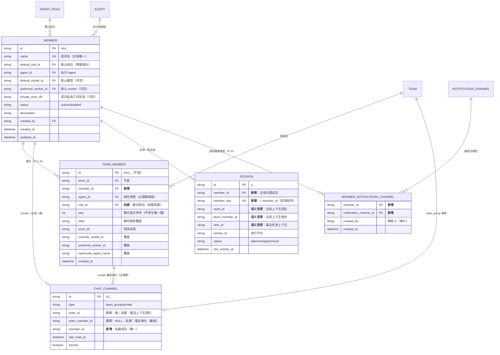
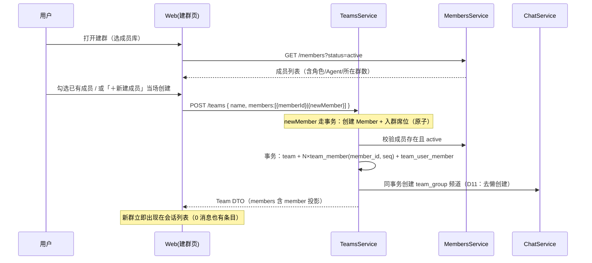

# 37 成员与群聊解耦设计（含微信式会话页）

> 编写日期：2026-11-06 · 范围：成员（Member）从群聊/团队（Team）中解耦、建群改为"从成员库选人"、会话页改微信式布局
> 状态：**方案稿（未实施）** · 关联：`10-群聊与消息机制.md`、`14-Agent配置与虚拟团队模型.md`（§5/§6）、`15-数据模型细化（ER图）.md`、`28-团队模型与排队设计.md`、`29-团队化改造需求说明.md`、`36-私聊渲染对齐DSH实现方案.md`
> 原型：`docs/agent-platform/prototypes/wechat-chat`（会话页）、`member-manage`（成员库）、`group-create`（建群）

**阅读路径。** 只看结论 → §0；模型与迁移 → §3/§4；API → §5；页面改版 → §6；权限 → §7；排期与验收 → §8/§9；需要拍板的事项 → §10；原型与本地查看 → §6.7/附录 C。

**文档关系：**

| 相关文档 | 关系 |
|---------|------|
| 03 篇 FR-02/09/14/25 | **功能依据**：团队组建、群聊、私聊与团队权限边界 |
| 06 篇 §2.5/§2.6 | **交互依据**：群聊四段式、私聊页；本方案改其左列与右栏 |
| 14 篇 §5/§6 | **模型依据**：团队域、成员、主 Agent、会话分区 |
| 15 篇 §3.2/§3.5/§3.6/§4 | **落库依据**：表定义、唯一约束、主键前缀；本文新增 `members` 表以本文为准 |
| 28 篇 §2/§4/§5 | **流程依据**：团队创建、群频道、私聊复用、实时双广播 |
| 31/32/33 篇 | **回执/幂等/评审**：运行时身份键仍用席位 `tmm_`，见 §9.3 |
| 36 篇 | **私聊渲染**：渲染层复用，容器位置改变 |

---

## 0 结论摘要

### 0.1 一句话方案

**把「成员」提升为平台级一等公民（成员库 `members`），把现在表里的 `team_members` 降级为「成员在某群聊里的席位」；群聊仍是团队（Team）的会话呈现，一个成员通过多个席位加入多个群聊；同一个成员在全局只有一条会话（Session），跨群/跨任务共享同一上下文，群聊/私聊/任务只是这条会话的"轮次上下文"；私聊收敛为每成员一条的全局频道；会话页从"团队页 + 成员面板"改为微信式左侧会话列表 + 右侧消息区；建群/加成员支持"从成员库选择已有成员"或"当场新建成员"（新建即入成员库，D17）；并支持通知渠道绑定成员（渠道归属唯一：团队或成员二选一，§11）。**

### 0.2 十七条设计决定（本方案的骨架）

| # | 决定 | 理由 / 影响 |
|---|------|------------|
| D1 | **群聊 = 团队（Team）的会话呈现**，不新造独立 Group 实体 | 任务、队列、会话、主 Agent、权限都以 Team 为边界；另造 Group 会与团队域双轨 |
| D2 | 新增 `members`（成员库，主键前缀 **`mbr_`**）；`team_members` **保留表名与 `tmm_` 主键**，语义改为「席位（membership）」，新增 `member_id` | 保留表名/主键 = 所有现有外键（`chat_channels.team_member_id`、`sessions.team_member_id`、`teams.main_agent_member_id`…）零改动，爆炸半径最小；前缀避开消息 `m_`/`me_`、回执 `mr_` |
| D3 | **配置分层**：身份归 Member（displayName、绑定 Agent、默认模型/worker、状态、`defaultRoleId` 预填）；**工作目录双目录、默认私有**：会话 cwd = 成员私有目录（`member.private_work_dir`），团队/席位目录（`team_members.work_dir`，保持现状）作为**可按需切换的授权目录**；群内角色与展示归席位（**roleId 权威**、alias、seq、模型/worker 覆盖、opencodeAgentName）。读写优先级 `席位 ?? 成员 ?? 系统默认` | 一条 session 只有一个 cwd，默认放私有目录最稳定；团队任务需要团队仓库现场，由模型按需切换，服务端**按本轮席位**授予该团队目录的读写权限（§7.3） |
| D4 | **配置共享、会话全局**：一个成员在全局只有**一条 Session**（`member_key = member_id` 唯一），跨群、跨任务共享同一上下文；席位只是"在哪、以什么岗位"，不再是会话分区键 | 产品明确要求"一个成员只有一个 session，否则跨群复用没有意义"；这是本方案与旧设计（FR-37 / 14 篇 §6.1 会话按席位分区）最大的偏离，运行时与迁移改动最重 |
| D5 | **私聊 = 成员维度单频道**：每个成员全局一条 private 频道（`uk_channels_dm(member_id)`），`team_id` 降级为"最近上下文团队"（只读展示，不再有"私聊锚定哪个群"） | 与 D4 一致：会话是成员的，私聊自然也是成员的；消除多群成员的上下文歧义 |
| D6 | 主 Agent 仍是**团队内的席位属性**（`teams.main_agent_member_id` → TeamMember），不是成员属性 | 同一个成员在 A 群是主 Agent、在 B 群可以不是，符合"群内角色"语义 |
| D7 | 人类用户（User）与 Agent 成员（Member）保持两个域：Member 是"岗位实例"，不是登录账号；`team_user_members` 不变 | 权限模型（User/Role）与协作模型（Member/AgentRole）不打穿 |
| D8 | 数据迁移走 **expand → backfill → dual-read → contract** 四段式，旧前端 API 至少保留一个版本 | 生产已有团队/频道/会话数据；禁止一次性 DROP/ALTER 破坏旧代码 |
| D9 | 权限新增 `members.view/create/edit/delete`（**点号风格**，与仓库 `channels.manage`/`agents.view` 一致）；成员库是全局资源，删除成员前必须无席位（或先停用） | 与 `agents`、`agent_roles` 的全局资源风格一致；后端已确认仓库权限键统一用点号 |
| D10 | 未读/置顶本期沿用**频道级**（`chat_channels.last_read_at/pinned`），会话列表按频道聚合；用户级未读列为后续优化，触发条件：出现 ≥2 个并发使用会话页的人类用户 | 现状已知简化（schema 注释已标注），不阻塞本期改版 |
| D11 | **建群即建群频道**（去掉 `team_group` 懒创建），并把频道创建放进建群事务 | 群聊成为左列表的一等会话项，0 消息群也必须出现；懒创建会让新群在列表里"消失" |
| D12 | 运行时身份键（派发/回执/评审/统计）**仍用席位 `tmm_`**，不改成 `mbr_` | 派发的落点是"哪个席位/哪条会话/哪个 worker"，席位是"在某群里干活的自己"；`mbr_` 是跨群身份。详见 §9.3 |
| D13 | **不做产品级排队/流控**：A/B 群都可以随时 @ 他，消息**一律接收、落库、进入成员会话**，由成员自行决定先处理什么；不设排队位次、优先级、队列深度、连续轮次限制 | 产品明确要求"不要堵在机制上让成员不能及时收到消息"；引擎一次执行一轮属于实现约束，不作为产品流控暴露给用户 |
| D14 | **跨群记忆是有意为之**：接受 A 群上下文可能出现在 B 群；用"来源提示/最近活跃群"降低误用，不做技术隔离 | 这是 D4 的直接代价；技术隔离等于回到会话隔离，与决策矛盾。风险与治理见 §9 R14 |
| D15 | **每条消息携带来源群，每条回复携带目标群**（`messages.team_id` + 派发/SSE/回复载荷 `teamId`） | 全局会话下一个成员会收到多个群的消息；没有来源群就无法正确注入上下文、回执与落点；回复必须回原群 |
| D17 | **建群/加成员支持双入口**：既能"从成员库选择已有成员"，也能"当场新建成员"；新建即**原子落库**（创建 Member + 入群席位同一事务），随后在成员库统一管理（编辑/停用/绑定通知渠道/加入其他群） | 满足"边建群边补人"的实际操作；内联新建不产生临时对象或孤儿配置，成员库始终是唯一事实来源 |
| D16 | **通知渠道支持绑定成员，且归属唯一**：新增 `member_notification_channels`（平台级、复合 PK、双 FK CASCADE）；一个渠道的归属只能是**团队或成员二选一**（跨归属绑定返回 409，需确认后"转移"）；`channel_send` 的解析集合收敛为"调用方可见渠道"（所属团队的渠道 ∪ 调用方成员拥有的渠道） | 产品明确"一个渠道不需要同时绑定团队和成员"；归属唯一让"谁的通知走哪个渠道"可解释；不收敛 `channel_send` 仍会构成越权（§11） |
| D18 | **性格与成员专属提示词归 Member**（2026-11-10 产品决策，反转早期"persona/prompt 不冗余进 Member"的判断）：`members.persona`（PERSONA_LIBRARY key）+ `members.prompt` + `members.prompt_mode`（`append` 追加 / `override` 覆盖 Agent 提示词段）；Agent 页性格配置下线（`agents.persona` 保留为存量回退，成员未配置时生效）。装配顺序：岗位职责（`AgentRole.rolePrompt`，框架）→ Agent 提示词（`Agent.prompt`，岗位职责范围）→ 成员专属提示词（特殊行为；append 以【成员专属要求】追加，override 取代 Agent 提示词段）→ 性格 | 成员是平台级"数字员工"，同一岗位/Agent 的多个成员职责常有细分（如多个开发者各管一块）；放进 Member 才能一处配置、跨群生效，且不污染 Agent 这一"岗位模板"。岗位职责（框架）不被成员提示词覆盖，保证职责边界不因个人配置丢失 |

### 0.3 改造规模（估）

| 层 | 改动 | 量级 |
|----|------|------|
| DB | 新增 3 表（`members`、`session_turns`、`member_notification_channels`）+ 映射表；`team_members`/`chat_channels`/`sessions` 加列；唯一键替换；2 个回填/合并脚本 | 中高（分 8 步，逐步骤可回滚；会话合并与唯一键切换后基本只能向前） |
| server | 新增 members 模块（CRUD/权限/事件）、teams 建群改选 Member、chat 私聊按 member 收敛、conversations 聚合接口；**五处级联补 `teamId` 过滤** | 中高（约 6 个模块；`tmm_` 全仓 432 处非测试引用 / 42 个 spec，本方案刻意保留 `tmm_` 以控制回归面） |
| web | 新增 `/chat` 会话页（微信式）与成员库页、建群页；旧 `teams/[id]/session` 保留一个版本后下线 | 高（会话页 2000+ 行需拆分） |
| 兼容 | 旧 `/teams` 建群接口形状、旧 DM 接口、旧实时事件 | 低（保留一层适配） |

---

## 1 背景与问题

### 1.1 现状（代码事实）

| 维度 | 现状 | 出处 |
|------|------|------|
| 成员实体 | `TeamMember` = `team_id + agent_id + seq`，建团队时按 `members[]` 批量生成；唯一键 `uk_team_members_team_agent_seq` | `server/prisma/schema.prisma:181-213`、`server/src/teams/teams.service.ts:113-200` |
| 成员配置 | alias / workDir / overrideModelId / preferredWorkerId / roleId / opencodeAgentName 全在席位上 | `server/prisma/schema.prisma:181-213` |
| Agent 与成员 | `Agent` 是执行体（prompt/model/policy/skills），`AgentRole` 是岗位；成员 = 岗位 × 执行体 × 团队的一次实例化 | `server/prisma/schema.prisma:131-180, 653-692`、`docs/agent-platform/14-...md` §2/§5.1 |
| 群聊 | `ChatChannel(type=team_group)` 每团队一条单例（`uk_channels_team_group_single`），懒创建 | `server/prisma/schema.prisma:356-384`、`server/src/chat/chat.service.ts:296-330` |
| 私聊 | `ChatChannel(type=private)` 按 `(team_id, team_member_id)` 幂等（`uk_channels_team_member`），必须带 teamId | `server/src/chat/chat.service.ts:1680-1710`、`server/src/chat/dto/create-dm-channel.dto.ts` |
| 会话 | `Session.team_member_key = team_id\|team_member_id`（task 为空时的生成列唯一键），一席位一会话，跨任务可复用 | `server/prisma/schema.prisma:317-355`、`docs/agent-platform/14-...md` §6.1 |
| 页面 | 会话入口是 `/teams/[id]/session`（2027 行单文件）：左侧成员面板 + 中间消息 + 右侧任务/配置/产出三 Tab + 私聊 Tab | `web/app/(main)/teams/[id]/session/page.tsx` |

### 1.2 问题

1. **成员不可复用**：每建一个群（团队）都要重新配一遍人；同一个"架构师"在 4 个群里是 4 条互不相关的记录，改名/换模型/换 worker 要改 4 次。
2. **成员被群绑架**：想给大任务配一个"常驻架构师"，只能每个群各加一次；跨群协作只能靠人肉搬运。
3. **会话入口不像 IM**：左侧是团队列表 + 团队内成员面板，找不到"我有哪些对话"；私聊被包在团队页的 Tab 里，离开团队就没有私聊入口。
4. **信息架构倒置**：微信式心智是"先选会话（群/人），再看消息"；现状是"先选团队，再选成员/私聊 Tab"。

### 1.3 目标 / 非目标

**目标**
- G1 成员库：成员可独立创建、编辑、停用，跨群复用；建群时从成员库选人。
- G2 一个成员可加入多个群聊，**且跨群共享同一条会话与上下文**（上下文连续是核心价值）。
- G3 会话页微信式：左侧平铺"群聊 + 成员"会话列表（类型标识），点击切换消息区。
- G4 群聊：顶部成员切换条保留；私聊：无成员切换，只展示当前成员；右侧栏私聊展示该成员信息。
- G5 迁移安全：存量数据无损，可分阶段上线、可回滚。

**非目标（本期不做）**
- N1 不引入独立于 Team 的"群聊"实体（见 D1；若产品后续需要"跨团队群聊"，另立方案）。
- N2 ~~不做成员跨群共享记忆/上下文~~（已被产品决策推翻：D4 改为全局会话，跨群记忆是目标而非禁区）。
- N3 不做用户级未读/已读回执（见 D10）。
- N4 不改变任务-团队-队列、@ 触发、派发回执、主 Agent 的既有语义。
- N5 不实现本文档（本阶段只出方案 + 原型）。

---

## 2 术语对齐

| 术语 | 本方案定义 | 与旧文档的关系 |
|------|-----------|---------------|
| **成员 Member** | 平台级"数字员工"：一个执行 Agent + 默认岗位/模型/worker 偏好；可加入 0..N 个群聊 | 新概念；旧文档里的"团队成员/Agent 实例"中的"成员"部分 |
| **席位 TeamMember** | 成员在某个群聊（团队）里的座位：**群内岗位 roleId（权威）**、昵称、seq、workDir、覆盖配置、冻结态；`tmm_` 前缀不变 | 旧 `team_members` 行，语义收窄 |
| **群聊** | 团队的会话呈现（`team_group` 频道）；建群 = 建团队 + 选成员 + 即时创建频道（D11） | 沿用 28 篇"一团队一群"，创建时机前移 |
| **私聊** | 与某个成员的 1:1 会话；**每成员全局一条** private 频道，`team_id` 仅表示最近上下文团队 | 10 篇 §3.1 `private` 的成员维度重定义 |
| **会话 Session** | **成员级全局执行上下文：一成员一条**（`member_key = member_id`）；当前 `team/channel/task` 只是本轮参数，不再作为分区键 | 推翻 14 篇 §6.1 / FR-37 的"按席位分区"，见 §3.5 |
| **主 Agent** | 群内被指定为主协调者的席位 | 沿用 FR-08 / 28 篇 §5.4 |
| **工作目录** | 双目录：**默认**成员私有目录（`members.private_work_dir`，会话 cwd）+ 团队/席位目录（`team_members.work_dir`，按需切换的授权目录） | 私有目录为默认；团队目录口径不变，但不再默认作为 cwd |
| **来源群** | 每条消息所属的团队（`messages.team_id`）；回复必须带目标群 id | 新增（D15）；无群上下文的消息为 NULL |
| **通知渠道** | 出站通知通道（`NotificationChannel`，企微群机器人/Webhook 等）；归属**唯一**（团队或成员二选一），任务可额外订阅 | 27 篇；新增成员归属（D16/§11） |

> 关键澄清（**v1.1 反转**）：**"成员加入多个群聊"就是"共享同一套会话"**——配置共享，上下文也共享（一成员一条 Session）。这是产品明确决策（D4）；旧文档"每席位一 session / 跨群不串味"的口径全部作废，见 §3.5 与附录 B。

---

## 3 领域模型设计

### 3.1 目标 ER（改动部分加粗）



### 3.2 `members`（新增）

| 字段 | 类型 | 约束 | 说明 |
|------|------|------|------|
| id | VARCHAR(64) | PK | **`mbr_`** 前缀，沿用 `IdGeneratorService` 域前缀策略（15 篇 §2.2）；避开消息 `m_`/`me_`、回执 `mr_` |
| name | VARCHAR(64) | UNIQUE | 成员名（如"架构师-老周"），@ 与私聊列表展示用；全局唯一便于寻址 |
| default_role_id | VARCHAR(64) | FK `agent_roles` RESTRICT | **默认岗位**，仅在加入群聊时预填 `team_members.role_id`；能力矩阵仍按席位 roleId 解析 |
| agent_id | VARCHAR(64) | FK `agents` RESTRICT | 执行 Agent（prompt/policy/skills 来源） |
| default_model_id | VARCHAR(64) | FK `models` SET NULL | 默认模型；席位可覆盖 |
| preferred_worker_id | VARCHAR(64) | FK `workers` SET NULL | 默认 worker 偏好；席位可覆盖 |
| private_work_dir | VARCHAR(255) | NULL | **成员私有工作目录**（跨团队个人工作台）；团队上下文执行时以 `team_members.work_dir` 为准（D3） |
| persona | VARCHAR(32) | NULL | **成员性格**（PERSONA_LIBRARY key：steady/strict/aggressive/conservative/innovative）；非空时优先于 `agents.persona`（D18）；影响表达与协作风格，不改变权限/工具边界 |
| prompt | TEXT | NULL | **成员专属提示词**：成员的特殊行为描述（如同一岗位多个开发者各自负责范围不同）；与 `Agent.prompt`（岗位职责范围）组合（D18） |
| prompt_mode | VARCHAR(16) | NOT NULL default 'append' | 成员提示词与 Agent 提示词的关系：`append`（在 Agent 提示词之上追加【成员专属要求】）/ `override`（用成员提示词取代 Agent 提示词段；岗位职责 `rolePrompt` 不受影响） |
| status | VARCHAR(16) | NOT NULL default 'active' | `active` / `disabled`（停用后不可加群、不可派发） |
| description | TEXT | NULL | 备注 |
| created_by | VARCHAR(64) | FK `users` RESTRICT | |
| created_at / updated_at | DATETIME | | |

索引：`uk_members_name`、`idx_members_default_role`、`idx_members_agent`、`idx_members_status`、`uk_members_origin_tmm`（回填溯源，见 §4.2）。

> **性格/成员专属提示词归 Member（D18，2026-11-10 决策反转）**：早期判断"persona/prompt 冗余进 Member"在成员平台化后被推翻——成员是"数字员工实例"，同一岗位/Agent 的多个成员职责常有细分（多个开发者各管一块），性格与特殊行为必须能按成员单独配置、跨群生效。故：① `persona`/`prompt`/`prompt_mode` 落在 `members`；② Agent 页性格配置下线，`agents.persona` 保留为存量回退（成员未配置时生效）；③ `Agent.prompt` 仍是岗位职责范围，不被整体替换——`override` 只取代【职责】Agent 段，岗位职责 `AgentRole.rolePrompt`（框架/边界）始终注入。技能/工具矩阵仍属 `Agent`/`AgentRole`，不进 Member。

### 3.3 `team_members`（语义收窄为席位）

- 新增 `member_id VARCHAR(64) NULL → NOT NULL`（expand 阶段可空），FK `members(id)` RESTRICT。
- **保留** `agent_id / role_id`：`agent_id` 作为"入群时的执行体快照"（历史任务归因用），`role_id` 是**群内岗位的权威字段**（权限门读它，`platform-tool-permission.service.ts:53-66`），二者都由服务层在入群时从 Member 预填、之后可独立修改；`role_id` 本次**不删除**。
- 唯一键调整：
  - 旧 `uk_team_members_team_agent_seq (team_id, agent_id, seq)` → 新 **`uk_team_members_team_member (team_id, member_id)`**。
  - 语义：**一个成员在一个群里只有一个席位**（与微信"一人一群一个身份"一致，左列表/切换条可唯一映射）；**"同岗位多实例"改为建两个成员**（`POST /members/:id/clone`），不再靠同群多席位表达。
  - 过渡期注意：存量里"同一 Agent 同团队多实例"回填后变成多条 Member（S1 1:1），因此新唯一键天然满足；若启用 S2 合并策略，合并前必须先检查目标成员是否已在该群有席位。
- `seq` 保留但**只作群内显示序号**（不再参与唯一键）：`SELECT MAX(seq) FROM team_members WHERE team_id=? FOR UPDATE`。
- 删除成员 = 删席位（不影响 Member）；删除 Member 前校验 `COUNT(team_members WHERE member_id=?) = 0`，否则 409 `MEMBER_IN_USE`。
- **M:N 安全不变量（P0，必须与本次改造同批修）**：所有以 `member_id` 为条件的**写操作必须同时带 `team_id` 过滤**。现有五处级联只按 `team_member_id` 操作、无 `teamId` 条件（`teams.service.ts:838/1174/1283/1306`、`tasks.service.ts:825`）；今天因"成员只属一群"无害，M:N 后会跨群误删会话/频道（数据丢失级）。

### 3.4 `chat_channels`（私聊 = 成员全局单频道）

| 场景 | team_id | team_member_id | member_id | 唯一键 |
|------|---------|----------------|-----------|--------|
| 群聊 `team_group` | 群 | NULL | NULL | `uk_channels_team_group_single(team_group_key)` 不变 |
| 私聊 `private` | **最近上下文团队**（可变、非空） | 最近席位（兼容/只读） | **成员** | **`uk_channels_dm (member_id)`**（仅未删除行参与，用 `dm_member_key` 生成列或服务层幂等） |

- **每成员只有一条私聊频道**（与 D4 的"一成员一 session"对齐）：不再按 `(team, member)` 建多条，也不再需要"进哪条私聊"的规则。
- `team_id` 降级为**最近上下文团队**：每次私聊消息落库时更新为"该成员最近一次活跃的群"（只读展示，不支持切换）；新建私聊时取成员的主群聊（无群则置空并禁止私聊，见 §6.4.4）。
- `team_member_id` 保留为兼容锚点（旧查询/派发/回执仍可能读），写入时同步为"最近上下文团队对应的席位"。
- **可见性**：频道不再天然属于某个团队，规则改为"**与该成员共享至少一个团队的登录用户可见**"（`teamUserMember` 交集）；`GET /conversations` 与 `resolveChannelAccess` 共用同一判定，禁止先全量查再过滤。
- **实时**：私聊消息仍双广播 `channel:<channelId>`（打开该私聊的客户端必订阅）；会话列表更新用 `conversation.updated`，按 `member:<memberId>` 或沿用 `channel:` scope（详见 §5.4 与 backend notes 的定论）。
- **迁移**：同一成员的多条 private 频道合并为一条（canonical 选择见 §4.1 M4），历史消息 `messages.channel_id` 搬到 canonical 并落 `dm_channel_merge_map(old_id,new_id)` 以便回滚。
- **退群/再入群不再影响私聊**：频道是成员级的，不随群创建/删除；原"退群后槽位被占、重入撞 P2002"的问题随之消失。

### 3.5 运行时语义：配置共享、会话全局

| 维度 | 跨群行为 | 实现 |
|------|---------|------|
| 身份/显示名/绑定 Agent/默认模型/worker 默认 | **共享**：改 Member 即所有群生效 | 席位读 Member，不复制；优先级 `席位 ?? 成员 ?? 系统默认` |
| 群内岗位 roleId | **按席位**（可不同群不同岗位） | 席位权威列；权限门读它（`platform-tool-permission.service.ts:53-66`） |
| 群内昵称/seq | **按席位独立** | 席位列 |
| **会话上下文** | **全局共享**：一成员一条 `Session`，跨群、跨任务连续 | `sessions.member_key = member_id` 唯一；当前 team/channel/task 按轮次注入（§3.6） |
| 群聊消息的上下文注入 | 每轮注入**本群**历史（按 `teamId` 分区）+ 文档库 + 任务上下文 | 与旧的"会话隔离"不同：注入是"本轮看到什么"，不是"记得什么" |
| 任务 | 任务启动/推进把任务上下文注入该成员会话；任务之间共享记忆 | 旧 FR-37"任务间会话隔离"被 D4 覆盖（文档需同步修订） |
| worker / opencode 实例 | **每成员一个执行实例**（绑定该 session），跨群复用 | 相较旧模型（每席位一实例）实例数显著下降；执行 scope 改 `session:<id>` |
| **引擎 preset / 角色** | 锁定为成员**主岗位**（DSH 按角色分池，一会话只能有一个引擎角色） | 群内岗位差异只影响服务端能力门 + 每轮提示 + 审计归属（§3.6.4/R19） |
| 并发/接收 | **不做产品级排队**：A/B 群都可随时 @，消息一律接收；执行按引擎能力自然串行（D13） | 不设队列位次/上限/优先级；见 §3.6.3 |
| 工作目录 | **双目录、默认私有**：cwd = `member.private_work_dir`；`team_members.work_dir` 作为可切换的授权目录（按本轮席位授权） | 默认放私有目录最稳定；团队目录按需切换，服务端按轮授读写权限（§7.3/R23） |
| 消息来源群 | **每条消息带 `team_id`，每条回复带目标群 id**（D15） | 全局会话下多群消息必须可区分；注入/回执/落点都依赖它（§3.6.7） |
| 技能（AgentSkill） | 共享（Agent 级） | 同一 Agent = 同一套技能 |
| 记忆 | 全局共享；角色级记忆按"当前轮的席位岗位"注入 | 注入集合每轮按本轮 `seat_id` 的 roleId 重算（`memories.service.ts:243-276`） |
| 统计 | 成员维度总账可行（同一 session/实例跨群） | 需 `model_usages.member_id`（可选，见 Q13） |

> **与旧模型最关键的三处反转**：① 会话从"席位分区"变"成员全局"；② 任务从"每任务/每席位独立上下文"变"成员连续上下文"；③ 工作目录变成**双目录**（团队目录保持现状、团队上下文优先；新增成员私有目录作为个人工作台）。这三点必须在评审时明确告知使用方。

### 3.6 全局会话机制（D4/D13 的落地设计）

> 本节结论来自 `notes-session-global.md` 的实测核对：**不能只把 `team_member_key` 换成 `member_key`**。现有代码有 4 处假设"一个 session 只属于一个群"（派发归属校验、执行 scope、回流落点、权限身份），必须先补"每轮不可变上下文"和"提示词分层"两块，否则必然串台。

#### 3.6.1 Session 字段（v2）

| 字段 | 变化 | 说明 |
|------|------|------|
| `member_id` | **新增** | FK `members`；一成员一条 |
| `seat_id` | **新增** | 最近使用的席位（`tmm_`），仅展示/兼容，**不作鉴权依据** |
| `current_team_id / current_task_id / current_channel_id` | **新增** | 当前上下文，**仅供展示与兼容读**；鉴权/落库一律以 `SessionTurn` 为准 |
| `turn_seq` | **新增** | 每轮 +1，轮次序号（执行台账排序，不是产品队列） |
| `busy_state / busy_since / last_turn_outcome` | **新增** | `idle/running`；`ok/error/timeout/cancelled` |
| `member_key` | **新增（生成列）** | `CASE WHEN task_id IS NULL AND member_id IS NOT NULL THEN member_id ELSE NULL END`；**不能依赖 `team_id`**（可空后 `CONCAT` 为 NULL 会让唯一键静默失效） |
| `team_id / team_member_id / task_id` | **语义降级** | 过渡期兼容列（最近上下文/最近席位/最近任务），contract 后停写 |
| 唯一键 | **替换** | `uk_sessions_member(member_key)`；旧 `uk_sessions_team_member` 保留一版后删除 |

#### 3.6.2 新增 `session_turns`（每轮不可变上下文，`st_`）

**为什么必须有**：`Session` 没有 `channelId`，现状的落点确定性完全来自 `(team, member)` 唯一；会话全局后若"完成回流时读 `session.current_channel_id`"，会被下一轮改写 ⇒ 回复/回执/中止/审计四处同时错。**每轮上下文必须冻结在 turn 行上。**

> 注意：它是**执行台账**，不是产品排队设施——不设优先级、上限、公平性；消息到达即落库，是否立刻执行由引擎空忙自然决定（§3.6.3）。

| 字段 | 说明 |
|------|------|
| id / session_id / seq | `st_`；`seq` 为轮次序号；唯一 `(session_id, seq)` |
| member_id / seat_id | 本轮身份；`seat_id` 决定能力矩阵与审计归属 |
| team_id / channel_id / task_id / message_id | 本轮群、来源频道（回复落点，冻结）、任务、触发消息 |
| source | `user_mention` / `agent_notify` / `hook_wake` / `task_start` / `manual` |
| status | `pending / running / done / failed / cancelled / expired`（`pending` = 待执行，不是排队位次） |
| running_key | **生成列**：`status='running' ? session_id : NULL`，唯一 ⇒ **每会话至多一轮在飞**（多副本/重启下的并发仲裁） |
| 时间戳 | requested_at / started_at / ended_at / error / engine_message_id |

索引：`(session_id, status, seq)` 取队首；`(status, enqueued_at)` 兜底扫描；`(team_id, status)` 团队视图。

#### 3.6.3 接收即达（无流控）与执行台账

产品明确：**不做排队/限流/优先级**，A、B 两群都可以随时 @ 他，由成员自行决定做什么。因此：

```
接收：POST /channels/:id/messages → 落库 → 广播 → 会话收到一条待处理轮次（SessionTurn.status=pending）
执行：会话空闲 → 取最早 pending 执行（status=running，running_key 唯一保证至多一轮在飞）
回流：done/failed（写 ended_at/engine_message_id/last_turn_outcome）→ busy_state=idle → 若有 pending 继续
超时/中断：单轮超时或用户停止 → abort 该轮（failed/cancelled），不拒绝新消息、不影响会话
重置：待处理轮次 → cancelled；当前轮 → abort+expired；Session 归档重建
```

| 不做 | 说明 |
|------|------|
| 不拒收/不降级 | 成员忙、跨群同时 @、高频消息都**不拒绝**，也不返回 `429`/流控错误码 |
| 不暴露队列位次 | UI 只显示"处理中"（信息态），不显示"排队第 N 位" |
| 不设上限/优先级 | 不设每群/每成员队列深度、不做"任务 > @ > 私聊"或"连续轮次让出" |
| 不做公平性调度 | 引擎按到达顺序自然处理；"哪个群先被回复"由成员（模型）在内容层自行判断 |

> 唯一保留的机制性约束是**引擎一次只能执行一轮**（实现约束，不是产品限流）：执行完毕自动处理下一条，消息在到达时已落库并可见，因此不会"收不到"。响应延迟与上下文膨胀的治理放在产品侧（提示词/成员自律/手动重置），不做硬闸（§9 R22）。

#### 3.6.4 提示词分层（关键约束）

| 层 | 内容 | 是否随群变化 |
|----|------|-------------|
| 引擎 system（建会话时一次注入，之后锁定） | **只放成员身份 + 岗位/角色框架 + 成员级配置 + 通用协作规约**；不含群名册/群岗位/主 Agent 职责/工作目录（工作目录按轮注入） | **否**（去群化） |
| 每轮 user 块 | **来源群标识（teamId + 群名）**、本轮群名册、当前岗位、是否主 Agent、任务上下文、群历史（按 team 过滤）、文档库、**团队工作目录 + 成员私有工作目录**、`【上下文分界】`提示 | 是 |
| 服务端能力门 | 按本轮 `seat_id.roleId` 判定（工具/权限） | 是 |

**工作目录选择规则（D3）**：① **默认 cwd = 成员私有目录**（`members.private_work_dir`），会话创建时固定；② 群聊/任务轮次在用户块里声明**本轮可用的团队目录**（`team_members.work_dir`）与"可切换"提示，**模型可自行 `cd`/指定目录**到团队目录执行；③ 服务端按本轮席位下发该团队目录的读写授权（§7.3），轮次结束不持久化额外授权；④ 模型切换目录属于工具调用参数，worker 必须校验目标目录 ⊆ 本轮允许目录。

**提示词分层与成员级配置（D18）**：引擎 system 中职责相关段按固定顺序装配——①【岗位职责】`AgentRole.rolePrompt`（岗位框架，任何成员配置都不覆盖它）；②【职责】`Agent.prompt`（岗位职责范围）；③【成员专属要求】`members.prompt`（`append` 模式追加；`override` 模式用③取代② 的 Agent 段，① 始终保留）；④【性格】`members.persona ?? agents.persona`（成员级优先，Agent 值为存量回退，均空则无性格段）。四者都是成员级/岗位级、不随群变化，因此可随会话创建一次性注入并锁定；同一成员跨群提示词语义一致（与 D4「配置共享」一致）。

> **必须提前承认**：DSH 按角色分池、persona 只在建会话注入一次；opencode v2 逐消息 system 要求逐字节稳定，否则每轮击穿 prompt 缓存。因此**引擎 preset 锁定为成员主岗位**，群内岗位差异只影响"服务端能力门 + 每轮提示 + 审计归属"。这是"引擎能力"而非"安全边界"（安全边界在服务端门），但必须在评审与文档中写明（R19）。

#### 3.6.5 任务与重置

| 旧语义 | 新语义 |
|--------|--------|
| `teams.reuseSession` | 恒成立且不可关闭（换会话=换成员全局上下文）；**标 deprecated**，DTO 保留一版后删除 |
| `tasks.resetAfterComplete` | **任务完成不再重置**（产品选择共享上下文即接受跨任务连续记忆）；改为在下一轮写 `【上下文分界】` 系统提示 |
| `POST /teams/:id/reset-sessions` | 会重置成员在所有群的上下文 ⇒ 必须二次确认 + 返回受影响成员/群数 + 广播；建议改名或下线，只推成员级 |
| `POST .../members/:memberId/reset-session` | **唯一推荐入口**：待处理轮次置 cancelled + abort 当前轮 + 归档重建 Session + 广播 `session.reset` |
| 任务 archive 时"按 taskId 把 session 置 archived" | 全局会话下 `task_id` 恒空（no-op），但**必须删掉该分支**，否则一旦命中会把成员会话打进 archived → `ensureMemberSession` 复用归档会话 = 永久失能 |

#### 3.6.6 权限身份（每轮显式携带）

- 鉴权以**席位**为准：`callerId = seat_id`，且必须校验 seat 属于该 session 的 member（防跨成员冒充）。
- 上下文以**轮**为准：任何"当前在哪个群"只读 `SessionTurn`，**禁止读 `Session.current_*` 做鉴权/落库**。
- worker 下发必须带 `sessionId`（`x-vteam-session` 或 `instanceRef`）；`swagger-mcp` 只带 `x-worker-id`、靠 `findFirst({workerId,status:'running'})` 反查身份的做法**必错**（一 worker 多成员会话）。
- **执行 scope 改 `session:<sessionId>`**（现有 `team:<teamId>` 的看门狗/登记/幂等键全部随之改）；`TaskGroupInstance` 建议加 `sessionId`，否则按 `(teamId, teamMemberId)` 解绑在上下文切换后会漏（实例行泄漏）。

#### 3.6.7 消息来源群与回复路由（D15）

全局会话下，一个成员同时收到来自多个群/私聊的消息。**每条消息必须自带来源群，每条回复必须带目标群**，否则无法正确注入上下文、写回执、做审计。

| 层 | 变化 |
|----|------|
| `messages` | **新增 `team_id`**（来源群，可空：无群上下文的私聊/任务消息）。群聊 = `channel.team_id`；私聊 = 消息发送时的"最近上下文团队"；Agent 回复 = 本轮 `SessionTurn.team_id` |
| 索引 | `idx_messages_team_created (team_id, created_at)`，用于按群注入历史/统计 |
| 发消息 DTO | `POST /channels/:id/messages` 响应与消息 DTO 增加 `teamId`；服务端以 channel 反查为准，客户端不必传（防伪造） |
| 派发信封 | `SessionTurn` 已冻结 `team_id/channel_id`；worker 每轮 user 块写明"来源群：⟨群名⟩（teamId）" |
| 回复载荷 | worker 回流必须带 `turnId` + `teamId` + `channelId`；服务端按 turn 校验三者一致，回复消息落 `messages.team_id = turn.team_id`、`channel_id = turn.channel_id` |
| SSE | `chat.message.new` payload 增加 `teamId`/`channelId`（现有 `channelId` 保留）；**仅供前端路由/缓存与审计，不在气泡上展示** |
| 审计/回执 | `MessageReceipt.teamId` 已有；按 turn 取值，不再依赖"会话当前团队" |

**注入规则**：每轮只注入 **本群**（`turn.team_id`）的群历史 + 文档库 + 任务；成员跨群"记得"的内容来自会话上下文本身，而不是把其他群的历史消息再灌一遍（避免重复与串味扩大）。

**展示原则（产品确认）**：以上来源群/回复群、上下文分界、工作目录等**自动注入提示只进入模型上下文，不在用户界面展示**。用户群聊/私聊窗口只渲染用户与 Agent 的实际内容。

| 落点 | 做法 |
|------|------|
| 存储 | 注入块**不写入 `messages.content`**；作为当轮 prompt 附加（或写入 `session_turns` 的上下文快照，仅供审计/排障） |
| 渲染 | 前端消息气泡只渲染 `content`；若历史实现把注入块拼进正文，用 `web/lib/strip-injected-context.ts` 剥离后再渲染 |
| 审计 | 需要追查"这条回复来自哪个群"时读 `messages.team_id` / `session_turns`，而不是让用户从界面去猜 |
| 例外 | 系统消息（如"会话已重置""成员已加入/退出群"）属于用户可见内容，不受此限制 |

### 3.7 建群流程（改造后）



**双入口与成员库管理**：建群页与团队"添加成员"都提供两个入口——**从成员库选择**（搜索/角色筛选/已在其他群的提示）与**新建成员**（精简表单：名称、岗位、绑定 Agent、可选模型/worker/私有工作目录）。内联新建成功后：① 自动勾选/入群；② 立刻出现在成员库，可继续编辑、停用、绑定通知渠道、加入其他群；③ 广播 `member.created` 让成员库/其他页面实时刷新。只有 `teams.edit`、没有 `members.create` 的用户看到"新建"按钮禁用（只能选已有成员）。

**兼容**：`POST /teams` 的 `members[]` 同时接受 `{ memberId }`（新）、`{ newMember }`（内联新建）与 `{ roleId | agentId }`（旧）。旧形状在过渡期由服务端**隐式查找或创建 Member**（按 `roleId+agentId+alias` 去重）——上线开关 `MEMBER_LEGACY_TEAM_CREATE=true`，下个版本关闭。

---

### 3.8 DTO 双 id 契约

改造后每个成员在群内会同时出现两个 id，必须约定清楚谁可持久化：

| 字段 | 含义 | 可持久化 | 用途 |
|------|------|---------|------|
| `id`（`tmm_`） | 席位 id = 执行身份 | 仅本群内使用 | 派发/回执/评审/统计/会话键（D12）；`PATCH /teams/:id/members/:memberId` 的路径参数（历史命名，实际是席位 id） |
| `memberId`（`mbr_`） | 平台成员 id | ✅ 跨群引用 | 建群/加群/私聊/成员库；会话列表 `dm:<memberId>` |

- `GET /teams/:id` 的 `members[]` 同时返回 `id` 与 `memberId`（并附 `member` 投影）；旧前端只读 `id` 不受影响。
- 新前端**不允许**把 `tmm_` 写进跨群 URL/收藏；URL 只出现 `group:<teamId>` / `dm:<memberId>`。

---

## 4 数据迁移（expand → backfill → dual-read → contract）

### 4.1 八个迁移步骤

| 步骤 | 内容 | 可回滚 | 开关 |
|------|------|--------|------|
| M1 expand | `CREATE TABLE members`（含 `private_work_dir`）；`team_members ADD member_id`；`chat_channels ADD member_id`（+ `dm_member_key` 生成列）；`sessions ADD member_id / seat_id / current_team_id / current_task_id / current_channel_id / turn_seq / busy_state / busy_since / last_turn_outcome`（+ `member_key` 生成列）；**`CREATE TABLE session_turns`**（+ `running_key` 生成列）；**`CREATE TABLE member_notification_channels`**（与 `members` 同批，FK 依赖）；**`messages ADD team_id`** + `idx_messages_team_created`；映射表 `session_merge_map`、`dm_channel_merge_map` | ✅ 纯加表/加列，旧代码无感 | — |
| M2 backfill | 为每个 `team_members` 行建 1 条 Member；写回 `member_id`（席位/私聊频道/session）；**补 `messages.team_id`**（群聊取 `channel.team_id`，私聊取频道最近上下文团队）；**为缺频道的老群补建 `team_group`**（幂等） | ✅ 置 NULL 即可；补建频道可 `deletedAt` 回滚 | `MEMBER_BACKFILL_DRY_RUN` |
| M3 dual-write | 发版：成员/席位写入同时维护新旧列；会话读路径按 `SESSION_SCOPE=seat`（默认）运行；DM 解析按 `member_id` 幂等 | ✅ 回滚应用版本 | `SESSION_SCOPE=seat\|member` |
| M4 **会话合并** | 每成员挑选一条 survivor（`status` 优先级 `running > active > created > idle > frozen > archived > failed`，同级取 `updated_at` 最新）；其余置 `archived` 并写 `session_merge_map`；回填 `member_id/seat_id/current_*`；**running 的旧会话先 abort 再归档**（避免孤儿引擎会话） | ⚠️ 可回滚（映射表恢复原行状态）；S4 换唯一键后基本只能向前 | `SESSION_MERGE_DRY_RUN` |
| M5 **私聊合并（不搬消息）** | 每成员挑一条 survivor private 频道（最近有消息优先）承载新消息；其余 `deleted_at=now` 并写 `dm_channel_merge_map`；**私聊视图跨 channelId 聚合读**（旧频道消息不搬家，零丢失、零回滚风险） | ✅ 回滚只需恢复 `deleted_at`（无消息搬家） | `DM_MERGE_DRY_RUN` |
| M6 unique | 唯一键切换：`uk_team_members_team_member (team_id, member_id)`；`uk_channels_dm(member_id)`（生成列）；`uk_sessions_member(member_key)`；旧键保留一版 | ⚠️ 先加新键、后删旧键 | — |
| M7 contract | `team_members.member_id NOT NULL` + FK；`SESSION_SCOPE=member` 全量；停写旧列 | ⚠️ 不可逆（需备份） | — |
| M8 cleanup | 删旧唯一键/旧列/旧接口；下线 `/teams/[id]/session`；成员合并工具；**DROP `task_notification_channels` 并下线任务绑定端点/UI**（§11.10） | ⚠️ 不可逆 | — |

> **M4/M5 是本轮最大的数据操作**：它们把"每席位一条"合并成"每成员一条"。M4 把非存活会话置 `archived`（活动上下文归并，历史消息不挂在 session 上，不受影响）；M5 **不搬消息**，只软删旧私聊频道、私聊视图跨 channelId 聚合读（零丢失、零回滚风险）。上线前必须：① 全量备份；② dry-run 输出"合并前后行数/消息数"对比；③ 灰度团队试跑。
>
> **M4 的注意点（唯一键语义）**：`uk_team_members_team_agent_seq` 目前承载"同 Agent 多实例"语义；切到 `(team_id, member_id)` 后语义不变（1:1 回填后每条席位对应独立 Member），先加新键、保留旧键一个版本。

### 4.2 回填规则

新建 `server/prisma/backfill-members.ts`（对齐既有 `server/prisma/backfill-skill-versions.ts` 的脚本模式，幂等、可 dry-run、可重复执行）：

```
for tm in team_members where member_id IS NULL (batch 500):
    member = members.create({
      id: 'mbr_' + tm.id.slice(4),            // 由 tmm_ 数字后缀派生，幂等、可续号、无需窗口函数
      name: tm.alias ?? `${role名}-${tm.seq}`,
      default_role_id: tm.role_id,            // 岗位预填；席位 role_id 保留为权威
      agent_id: tm.agent_id,
      default_model_id: tm.override_model_id,
      preferred_worker_id: tm.preferred_worker_id,
      origin_team_member_id: tm.id,           // 溯源键（唯一），回滚/重跑精确配对
      status: 'active',
      description: `由团队 ${team.name} 的席位 #${tm.seq} 回填`,
      created_by: team.created_by,
    })
    update team_members set member_id = member.id where id = tm.id
    update chat_channels set member_id = member.id
        where team_member_id = tm.id and type = 'private'
    // 会话：每成员选 survivor，其余归档（见 §4.3）
    update sessions set member_id = member.id, seat_id = <survivor 的席位>
        where id = <survivor>
```

> **存量群的频道补齐**：`team_group` 原本懒创建（首个任务才建），改成一等会话后必须保证"每个 team 恰有一条未删除的 `team_group` 频道"。回填脚本对 `teams` 全表做一次 `upsert` 式补建（已有未删除频道则跳过；只有软删频道则复活），幂等可重跑。否则老群在会话列表里会缺席，或首个任务时被重复创建撞唯一键。
>
> **ID 生成器注意**：`mbr_` 号段由 `tmm_` 后缀派生后，必须在新 `MembersService.onModuleInit` 里执行一次 `resyncIdPrefix(prisma.member, 'mbr')`，否则重启后序号归零撞主键（历史事故见 `common/id-resync.ts` 头注释）。回填脚本用 `WHERE NOT EXISTS (origin_team_member_id = tm.id)` 保证可重跑。

**去重策略（重要权衡）**

| 策略 | 做法 | 优点 | 缺点 |
|------|------|------|------|
| S1 1:1 回填（推荐默认） | 每个席位建一条 Member | 确定性、无损、可回滚 | 同一人 N 个群 = N 条成员，成员库初始偏"胖" |
| S2 启发式合并 | 按 `(agent_id, role_id, 规范化 alias)` 合并成一条，席位指向同一条 | 成员库干净 | 误合并会改变历史语义（跨群共享配置），不可自动回滚 |
| S3 1:1 + 合并工具 | S1 上线，成员库提供"合并重复成员"入口（把 B 的席位指向 A，删除 B） | 安全 + 可运营 | 需要多做一个工具页 |

**建议：S1 上线 + S3 作为 P4 运营工具**。回填后成员库首次打开时给出"检测到 N 组疑似重复成员，是否合并"的提示，人工确认后执行（`POST /members/:id/merge`）。
### 4.3 合并规则（会话 / 私聊）

**会话合并（M4）**

```
for member in members:
    sessions = sessions where member_id = member.id order by lastActivityAt desc
    canonical = sessions[0]                      // 活跃优先；同活跃取 running/active
    for s in sessions[1:]:
        session_merge_map.create(old_session_id = s.id, new_session_id = canonical.id)
        update sessions set status='archived', member_key=NULL where id = s.id   // 释放唯一键
    update sessions set member_key = member.id, current_team_id = s.team_id?? ... where id = canonical.id
```

- 被合并 session 的 `instanceRef/workerId` 不再使用；canonical 沿用自己（或最新）的绑定。
- `messages` 不挂 session（挂在 channel），所以历史不受影响；`TaskGroupInstance` 里对旧 session 的引用置空/归档（待 backend 确认字段）。
- **回滚**：按 `session_merge_map` 把 archived 行恢复 `status/member_key`，canonical 回退到原 `current_*`。

**私聊合并（M5）：不搬消息**

```
for member in members:
    chans = chat_channels where member_id = member.id and type='private' and deletedAt is null
    survivor = chans 中最近有消息的一条（否则最近创建）
    for c in chans[1:]:
        dm_channel_merge_map.create(old_channel_id = c.id, new_channel_id = survivor.id)
        update chat_channels set deletedAt = now() where id = c.id
    update chat_channels set team_id = <最近活跃团队>, team_member_id = <对应席位>, dm_member_key = member.id where id = survivor.id
```

- **私聊视图跨 channelId 聚合读**：`GET /conversations/dm:<memberId>/messages` 读取该成员所有 private 频道（含已软删）的消息，按时间合并、游标分页；新消息只写 survivor。
- 为什么不像原方案那样搬家：`messages.channel_id` 是 RESTRICT，混流后无法按时间窗逆操作，回滚不可靠；聚合读把风险降到零（旧频道只加 `deleted_at`，回滚即恢复）。
- 代价：私聊历史查询要跨 N 个 channelId（N = 成员曾加入过的群数，通常 ≤5），一次 `IN` 查询可接受。

> **M4 的风险**：被归档的 session 若仍在 running，必须先 abort（否则留下孤儿引擎会话）；映射表需保留至少一个大版本。M5 因不搬消息，风险主要在"聚合读"的实现与前端游标，建议先灰度一个团队。


### 4.4 上线顺序（release 切分）

| Release | 内容 | 验收 |
|---------|------|------|
| R1 | M1+M2 + members CRUD API + 权限 + 成员库页 | 回填后 `member_id` 全量非空；成员库可增删改查；旧链路零回归 |
| R2 | M3 双写 + 建群改选 Member（双形状）+ 会话页群聊态（新 `/chat`）+ 建群即建频道 | 新群出现在会话列表；旧页仍可用 |
| R3 | **全局会话改造**：M4/M5 数据合并 + `SESSION_SCOPE=member` + 接收即达（无流控）+ 执行台账 + 私聊全局频道 + 会话页私聊态 + 会话列表聚合/SSE | 一个成员跨群共享上下文；多群消息不拦截；私聊一条；旧会话数据不丢 |
| R4 | M6/M7/M8 + 旧接口/旧页下线 + 成员合并工具 | 门禁全绿；无旧形状调用；统计/回执口径核对通过 |

### 4.5 回滚点

| 出问题 | 回滚动作 |
|--------|---------|
| M2 回填错误 | `UPDATE team_members SET member_id=NULL` + 删除本次创建的 Member（脚本按 `createdAt` 批次标记） |
| M3 双写导致数据不一致 | 开关 `MEMBER_MODEL=legacy`，读路径回退，双写保留（幂等） |
| M4 会话合并错误 | 按 `session_merge_map` 恢复 archived 行；`SESSION_SCOPE=seat` 回退运行时 |
| M5 私聊合并错误 | 按 `dm_channel_merge_map` 把旧频道 `deletedAt=NULL`、清 survivor 的 `member_id`（**无消息搬家，零丢失**） |
| M6 唯一键冲突 | 删除新唯一键、恢复旧键（DDL 可逆）；注意 `uk_sessions_member` 建立后回退需先按席位拆分会话，**基本只能向前**，务必在 M4 后观察足够再切 |
| 全局会话导致阻塞/串台 | `SESSION_SCOPE=seat` 回退 + 关闭 `MEMBER_QUEUE` 开关（队列退化为"忙则拒"） |
| 会话页上线异常 | 路由层开关 `CHAT_UI=classic` 重定向回 `/teams/[id]/session` |

### 4.6 双库兼容

- 迁移文件按 MySQL 写（仓库既有迁移全部面向 MySQL），**回填与数据搬运一律放 TS 脚本**，避免 `UPDATE ... JOIN` 这类 SQLite 不支持的语法（SQLite 只用 `db push` 跑测试，不执行历史迁移）。
- 新列一律可空 + 应用层约束，避免 `ALTER ... NOT NULL` 在 MySQL 大表上的长锁（`members` 为空表，`team_members` 需按批次回填后再收紧）。
- 不使用 Prisma enum / `@db.VarChar` 之外的 MySQL 专属类型（沿用 15 篇 §2 约定）。

---

## 5 API 设计

### 5.1 成员库（新增 `members` 模块）

| 方法 | 路径 | 权限 | 说明 |
|------|------|------|------|
| GET | `/members` | `members.view` | 列表：`keyword`（名称/Agent）、`roleId`、`status`、`groupId`（某群内/外）、`page/pageSize`、`sort` |
| POST | `/members` | `members.create` | `{ name, roleId, agentId?, defaultModelId?, preferredWorkerId?, privateWorkDir?, description? }`；`agentId` 缺省取 `role.defaultAgentId` |
| GET | `/members/:id` | `members.view` | 详情 + `teams[]`（所在群聊摘要） |
| PATCH | `/members/:id` | `members.edit` | 改名称/岗位/Agent/默认模型/worker/**私有工作目录**/描述/status |
| DELETE | `/members/:id` | `members.delete` | 无席位时物理删除；有席位 409 `MEMBER_IN_USE`（提示先"停用"） |
| POST | `/members/:id/clone` | `members.create` | 复制一份成员（常用于"同岗位再来一个"） |
| GET | `/members/:id/teams` | `members.view` | 所在群聊列表（含 seq/别名/是否主 Agent） |
| POST | `/members/:id/merge` | `members.edit` | `{ targetMemberId }` 合并重复成员（席位改挂 + 删源） |
| GET | `/members/:id/session` | `members.view` | 全局会话状态：`{ sessionId, status(idle/running), pendingCount, contextUsage, activeTeamId, activeTeamName, lastActivityAt }` |
| POST | `/members/:id/reset-session` | `members.edit` | **重置该成员全局会话**（影响所有群）；返回 `{ affectedTeams: [...], cancelledTurns, abortedTurn }`；`{ broadcast: true }` 时向全部相关群发系统消息 |
| PATCH | `/members/:id/session-policy` | `members.edit` | 可选（Q15）：`{ resetAfterTask: boolean }` 成员级重置策略 |
| GET | `/members/:id/notification-channels` | `members.view` 或 `channels.manage` | 成员绑定的通知渠道（secrets 掩码）；敏感绑定关系不放进通用渠道列表 |
| POST | `/members/:id/notification-channels` | `channels.manage` | **replace-all**：`{ notificationChannelIds: string[], replaceExisting?: boolean }`，语义对齐团队绑定（含 409 归属冲突） |
| DELETE | `/members/:id/notification-channels/:channelId` | `channels.manage` | 单条解绑（UI 行内删除） |
| GET | `/notification-channels/:id/members` | `channels.manage` | 反查"该渠道被哪些成员绑定"（删除前提示影响面） |

**响应形状（MemberView，前端与团队 DTO 共用）**；`privateWorkDir` 为**默认 cwd**，成员在群内的**团队工作目录**随席位返回（`teamMember.workDir`，可切换·需授权），成员卡同时展示两者。

```jsonc
{
  "id": "mbr_0000000042",
  "name": "架构师-老周",
  "status": "active",
  "role": { "id": "ar_architect", "key": "architect", "name": "架构师" },
  "agent": { "id": "ag_000...", "name": "架构师" },
  "defaultModelId": null,
  "preferredWorkerId": "wk_001",
  "privateWorkDir": "~/work/personal/laozhou",
  "groupCount": 3,
  "session": { "id": "mes_0001", "status": "idle", "contextUsage": 0.42, "activeTeamName": "通知中心迭代" },
  "createdAt": "2026-11-06T06:00:00.000Z"
}
```

### 5.2 团队/群聊接口改动

| 方法 | 路径 | 变化 |
|------|------|------|
| POST | `/teams` | `members[]` 新增形状 `{ memberId, alias?, workDir?, seq? }` 或 `{ newMember: { name, roleId, agentId?, defaultModelId?, privateWorkDir? } }`（**原子创建成员+席位**）；旧形状 `{ roleId, agentId, alias, workDir }` 兼容一个版本；**同事务创建 `team_group` 频道**（D11） |
| GET | `/teams/:id` | `members[]` 增加 `member` 投影与 `memberId`；席位字段不变 |
| POST | `/teams/:id/members` | body `{ memberId, alias?, workDir?, seq? }` **或** `{ newMember: {...} }`（内联新建并加入，原子）；旧 `{ roleId | agentId }` 兼容；重复加入 409 `MEMBER_ALREADY_IN_TEAM`，重名 409 `MEMBER_NAME_CONFLICT` |
| PATCH | `/teams/:id/members/:memberId` | 仍改席位级字段（alias/workDir/覆盖模型/worker） |
| DELETE | `/teams/:id/members/:memberId` | 语义明确为"移出席位"，不删除 Member |
| POST | `/teams/:id/main-agent` | 不变（团队内席位） |

### 5.3 会话聚合（新增 `conversations` 视图接口）

微信式左列表需要"一次拿到我所有会话"，不能按团队逐个拉。

| 方法 | 路径 | 说明 |
|------|------|------|
| GET | `/conversations` | 聚合列表（群聊 + 私聊），按置顶→最后消息时间排序；支持 `type=group\|dm`、`keyword`、`unreadOnly` |
| GET | `/conversations/:convId` | 单条会话元信息（含目标 `channelId`；私聊含成员全局会话状态） |
| GET | `/conversations/:convId/messages` | 群聊：解析为 `channelId` 复用现有分页；**私聊：跨该成员全部 private 频道聚合读**（含已软删，按时间合并 + 游标），不搬消息 |
| POST | `/conversations/:convId/read` | 等价 `/channels/:id/read`（频道级） |
| PATCH | `/conversations/:convId/pin` | 等价 `/channels/:id` `{pinned}` |
| POST | `/dm-channels` | **入参只保留 `memberId`**（旧 `{teamId, teamMemberId}` 兼容一个版本，内部解析为成员级频道）；幂等返回全局私聊频道 |

**conversation id 约定**：`group:<teamId>` / `dm:<memberId>`，前端路由直接复用；**每个成员只有一条私聊会话**（D5），不再需要折叠。

> `teamId`（来源群/回复群）只用于服务端路由、注入与审计：**不要求也不建议在消息气泡上展示**；用户界面只渲染实际内容（§3.6.7）。

**聚合返回（示例）**

```jsonc
{
  "items": [
    {
      "id": "group:team_0001",
      "type": "group",
      "title": "vteam 平台迭代",
      "badge": "群",
      "memberCount": 5,
      "onlineCount": 3,
      "lastMessage": { "text": "需求清单已更新，请评审", "senderName": "产品经理-小美", "createdAt": "..." },
      "unreadCount": 3,
      "pinned": true,
      "busyMembers": 1,
      "contextTeamId": "team_0001"
    },
    {
      "id": "dm:mbr_0042",
      "type": "dm",
      "title": "架构师-老周",
      "badge": "成员",
      "roleName": "架构师",
      "status": "online",
      "lastMessage": { "text": "存储方案我倾向 B", "senderName": "架构师-老周", "createdAt": "..." },
      "unreadCount": 0,
      "pinned": false,
      "sessionScope": "global",
      "session": { "status": "running", "activeTeamName": "客户端重构二期", "pendingCount": 1 }
    }
  ]
}
```

**性能**：列表页 N 条会话 → 禁止逐条查 lastMessage。实现用一次批量查询：
- 群聊频道按 `team_id IN (...)` 取 `team_group` 频道 + `messages` 按 `(channel_id, id)` 索引取每频道最新一条（`idx_messages_channel_id` 覆盖）；
- 私聊按 `member_id IN (...)` 取唯一频道 + 最新消息（每成员一条）；
- 未读数：`COUNT(messages WHERE channel_id=? AND created_at > last_read_at)` ——数据量可控时直接 count；大于阈值改为 `last_read_at` 之后的近似值/缓存。
- P3 若成为瓶颈，再引入 `conversation_summary` 物化表（P4 可选，不进本期）。

**发送即送达（D13 落地）**：`POST /channels/:id/messages` **永远成功落库**，不因成员忙/跨群冲突拒绝或降级。返回消息本体（含来源群）：

```jsonc
{ "message": { "id": "me_0000012345", "status": "sent", "teamId": "tm_0001" } }
```

- 成员当前是否在处理**不影响发送结果**；前端只展示信息态的"该成员处理中"（来自 `member.busy`），不显示排队位次、不提供"发送失败/稍后重试"的流控语义。
- `TURN_TIMEOUT` 只作为**执行结果**出现（消息可能失败，但不是"被排队拒绝"），前端按普通错误提示。

### 5.4 实时事件

| 事件 | 载荷 | 用途 |
|------|------|------|
| `member.created/updated/deleted` | `{ member }` | 成员库页实时刷新、建群页候选项同步 |
| `conversation.updated` | `{ convId, lastMessage, unreadCount, updatedAt }` | 会话列表排序/红点（新增；现有 `chat.message.new` 保留） |
| `chat.message.new` | 增加 `teamId`（来源群）与 `channelId` | 消息流；用于路由/缓存/审计，**不展示** |
| `team.queue.changed` / `team.updated` | 不变 | 右侧栏 |
| `dm.channel.updated` | 不变 | 私聊频道状态 |
| `member.busy` | `{ memberId, status: idle\|running, activeTeamId, activeTeamName, pendingCount }` | **信息态**：成员正在某群处理（不表示消息被拦截） |
| `member.session.reset` | `{ memberId, sessionId, byUserId, at }` | 全局会话重置广播（所有相关群显示系统消息） |
| `turn.started` / `turn.ended` | `{ turnId, memberId, teamId, channelId, outcome }` | 执行台账事件（可选，供"会话流"/运维） |

> 事件命名沿用现有 `domain.action` 风格；不允许前端轮询会话列表（列表是高频页）。

### 5.5 兼容矩阵

| 旧调用 | 过渡期行为 | 下线版本 |
|--------|-----------|---------|
| `POST /teams {members:[{roleId}]}` | 隐式创建/复用 Member | R4 |
| `POST /dm-channels {teamId, teamMemberId}` | 仍可用（解析到成员级频道） | R4 |
| `GET /sessions/...`（按 teamMemberId 查） | 返回成员全局会话 + 兼容字段 | R4 |
| `POST /teams/:id/reset-sessions` | 改为"涉及的成员全局重置"，带 `broadcast` | R4 |
| `POST /tasks/:id/notification-channels` | 返回 `410 TASK_NOTIFICATION_BINDING_REMOVED`（改用团队/成员绑定） | 下个大版本删除路由 |
| `GET /channels?type=team_group` | 仍可用 | R4 |
| 旧会话页 `/teams/[id]/session` | 重定向到 `/chat?c=group:<teamId>` | R4 |
| SSE `channel:*` / `team:*` | 不变（新增 conversation 事件并行） | 长期保留 |

---


## 6 会话页：微信式布局设计

### 6.1 信息架构

```
会话（新增一级入口 /chat）
├─ 左侧：会话列表（成员 + 群聊平铺，类型标识）
│   ├─ 搜索 / 筛选（全部 / 群聊 / 成员）
│   └─ 会话项：头像 + 名称 + 类型徽章 + 摘要 + 时间 + 未读
├─ 中间：消息区
│   ├─ 群聊：群信息头 + 成员切换条 + 消息流 + 输入框
│   └─ 私聊：成员信息头（无切换条） + 消息流 + 输入框
└─ 右侧：属性栏
    ├─ 群聊：任务 / 成员 / 产出（复用 TaskRightTabs）
    └─ 私聊：成员信息卡（MemberInfoPanel）
```

### 6.2 线框图

**群聊态**

```
+------+----------------------------------+---------------------------------+---------------------+
| Dock | 会话                ＋建群       | vteam 平台迭代  群 · 5 人       | 任务｜成员｜产出    |
| ##   | ------------------------------   | - 3 人在线 · 当前任务：解耦     | 当前任务 进行中     |
|      | [搜索] 会话 / 成员               | -----------------------------   | ------------------- |
|      | 全部 | 群聊 | 成员               | [全部] [产品-小美] [架构-老周]  | 参与成员 4          |
|      | ------------------------------   | [开发-小陈] [测试-阿May]        | ------------------- |
|      | # vteam 平台迭代   3 分钟 [3]    | ! 陈默 正在「重构二期」处理     | 最近产出 3 份       |
|      | * 架构师-老周   10:05 [1]        |   消息照常送达，由成员安排      |                     |
|      |   成员 · 架构师 [存储方案…]      | -----------------------------   |                     |
|      | # 数据平台二期       昨天        | 产品-小美  10:02                |                     |
|      |   群 · 4 人  * 1 人处理中        | 需求清单已更新，请评审          |                     |
|      | * 产品经理-小美      昨天        | 架构师-老周  10:06              |                     |
|      |   成员 · 产品 [好，我看下]       | 倾向 B 方案，附对比表           |                     |
|      | ------------------------------   | ...                             |                     |
|      | 成员库 4 位成员       管理 >     | -----------------------------   |                     |
|      |                                  | @ 成员 | 输入消息…        [发送]|                     |
+------+----------------------------------+---------------------------------+---------------------+
        ↑ 会话列表 ~300px（可拖拽）        ↑ 消息区（flex:1）               ↑ 属性栏 ~300px（可折叠）
```

**私聊态（无成员切换条；右栏 = 成员信息 + 全局会话 + 默认私有目录）**

```
+------+----------------------------------+---------------------------------+---------------------+
| Dock | 会话                ＋建群       | * 架构师-老周                   | 成员信息            |
| ##   | ------------------------------   | 架构师 · 在线 · 全局会话        | ------------------- |
|      | [搜索] 会话 / 成员               | 跨 3 个群共享上下文             | (头像) 老周         |
|      | 全部 | 群聊 | 成员               | 最近活跃：客户端重构二期        | 架构师 · 在线       |
|      | ------------------------------   | -----------------------------   | ------------------- |
|      | # vteam 平台迭代   3 分钟 [3]    | 老周  10:05                     | 会话 mes_0001       |
|      | * 架构师-老周   10:05 [1]        | 存储方案我倾向 B，原因…         | 处理中 · 待处理 1   |
|      |   成员 · 架构师 [存储方案…]      | 我  10:07                       | 上下文 42% · 18.6k  |
|      | # 数据平台二期       昨天        | 那就按 B 做，注意迁移窗口       | 最近 客户端重构二期 |
|      |   群 · 4 人                      | ...                             | ------------------- |
|      | * 产品经理-小美      昨天        | -----------------------------   | 工作目录            |
|      |   成员 · 产品                    | 输入消息（1:1，只显示内容）     | 私有 ~/work/laozhou |
|      | ------------------------------   |                                 | ^ 默认 cwd          |
|      | 成员库 4 位成员       管理 >     |                                 | 团队 /data/team 可切|
|      |                                  |                                 | ------------------- |
|      |                                  |                                 | [发任务] [重置]     |
+------+----------------------------------+---------------------------------+---------------------+
```

> 私聊头部是**只读的全局会话信息**（跨群共享上下文、最近活跃群）。群内的 `!` 提示只表示"该成员正在其他群处理消息，**消息照常送达**、由成员自行安排先后"（D13）。右栏工作目录区：**私有目录为默认 cwd**，团队目录是"可切换（需授权）"；来源群/分界/目录等**注入提示不在用户消息里展示**（§3.6.7）。

### 6.3 组件树与复用

```
web/app/(main)/chat/                       ← 新增（左列表常驻）
├─ layout.tsx                              ← 左列表 + <main>，列表宽度持久化
└─ page.tsx                                ← 容器（目标 ≤300 行，大部分逻辑外移）

src/components/conversations/              ← 新增
├─ conversation-list-pane.tsx              左列表容器（搜索 + 筛选 + 分组 + 虚拟滚动可选）
│  ├─ conversation-search.tsx
│  ├─ conversation-filter-tabs.tsx         复用 ui SegmentedTabs
│  └─ conversation-item.tsx                头像/类型徽章/摘要/时间/未读/忙碌态
├─ conversation-type-badge.tsx             「群聊」/「成员」
├─ group-avatar.tsx                        群头像 = 成员头像堆叠
├─ unread-badge.tsx
├─ member-switcher.tsx                     群聊顶部成员切换条（吸收旧 DM Tabs 的角色；成员忙碌态）
├─ busy-banner.tsx                         群聊"成员正在其他群处理消息"信息条（不阻断发送）
├─ message-render.tsx                     消息渲染前剥离注入上下文（复用 web/lib/strip-injected-context.ts）
└─ member-info-panel.tsx                   私聊右栏（成员信息 + 全局会话区；母本 dm-chat AgentInfoBar）

src/components/chat/                       ← 复用（渲染层零改动）
├─ ChatBubble / MsgParts / MsgError / LoadingIndicator / SystemMarker / QuestionModal
└─ MessageInput                            ← 复用

src/components/teams/
├─ TeamRightPanel(TaskRightTabs)            ← 复用（群聊右栏）
├─ ResizeHandle / useResizableWidth         ← 复用
└─ TeamSwitcher                             ← 复用（跳转目标改为 /chat?c=group:）

web/src/api/conversations.ts               ← 新增（list/get/read/pin/ensureDmChannel/resetMemberSession）
web/src/components/conversations/use-conversations.ts ← 新增（query hooks + SSE 局部更新）
```

**职责迁移对照**

| 旧 | 新 | 说明 |
|----|----|------|
| `TeamMembersPanel`（1181 行，成员管理） | 群聊头部"成员管理"抽屉 / 成员详情页 | 管理能力保留，不再占 224px 常驻 |
| DM Tabs（群聊 + N 个私聊 Tab） | 左列表会话项 + `MemberSwitcher` | 私聊从 Tab 变列表项；群内"看谁在说"由切换条承担 |
| `privateChannelMap` 内存态 | `ensureDmChannel(memberId)` 查询层 | 每成员一条全局频道；幂等结果进 React Query 缓存 |
| `unreadByInstance` 内存红点 | 服务端 `unreadCount` | 多端一致 |
| `activeTab` state | URL `?c=` | 可刷新/分享/后退 |
| 团队轮询切团队 | 列表项切换 | 不再需要"切团队"这个动作 |

### 6.4 交互细节

#### 6.4.1 路由与状态

- `/chat?c=group:<teamId>`、`/chat?c=dm:<memberId>`；筛选 `?type=all|group|dm`，搜索 `?q=`（300ms 防抖，服务端搜索）。
- 会话 key **用成员/团队 id，不用 channelId**：成员首次私聊时频道可能尚未创建，而成员 id 一定存在；频道 id 只作为解析产物进入消息缓存。
- 兼容：`/teams/[id]/session` 307 重定向到 `/chat?c=group:<teamId>`（保留一个迭代，保住既有 e2e 与书签）。
- 导航：Dock 新增"会话"入口；同步 `KEY_TO_PATH` / `PAGE_TITLE` / `CMDK_NAV_PATH`，否则 `/chat` 会回落成"任务看板"标题。

#### 6.4.2 群聊态

- 顶部：群名称 + 人数/在线数 + 当前任务胶囊 + "成员管理"入口。
- **成员切换条**：横向头像列，首项"全部"，点击单人 = 只看该成员的消息（前端过滤，不新开频道）；当前选中高亮；成员头像带忙碌态（`member.busy`）；支持键盘左右切换。
- **处理中提示条（D13）**：若本群有成员正在其他群处理消息，消息区上方出现非阻塞信息条——"陈默 正在「客户端重构二期」处理消息，消息照常送达、由他自行安排先后"；**发送不拦截**，不显示排队位次，也不出现"发送失败/稍后重试"。
- 消息流：复用现有 `MsgParts` 渲染；`@` 输入提示复用现有 mention 解析。
- 右栏：`TaskRightTabs` 原样复用（任务/成员/产出）。
- 空态：群无消息时显示"@ 一位成员开始协作"。

#### 6.4.3 私聊态

- 顶部：仅"当前成员信息"（头像、名称、角色、在线状态）+ **全局会话行**（"跨 3 个群聊共享上下文 · 最近活跃：客户端重构二期"），**不出现成员切换条**，也不再有"上下文 chip"。
- 消息流：1:1 频道消息（每成员全局一条），无 `@` 提示；若该成员正在其他群处理消息，输入区上方显示信息态提示"正在其他群处理，消息照常送达"，**不影响发送**。
- 右栏：`MemberInfoPanel`——头像/名称/岗位/绑定 Agent/默认模型/worker/**双工作目录（私有目录=默认 cwd、团队目录=可切换·需授权）**/技能/所在群聊/最近任务，**新增"会话"分区**：会话 ID、状态（空闲/处理中）、上下文规模（`contextUsage`）、最近活跃群（只读）。
- 操作：**发任务**（跳到建任务页并预选该成员）、**重置全局会话**（`POST /members/:id/reset-session`，二次确认"影响该成员在所有群聊的上下文"）、**查看会话流**（按需订阅内部过程）。
- 首次进入自动 `ensureDmChannel`（`POST /dm-channels { memberId }`，幂等）。

#### 6.4.4 全局会话的展示与边界（D4/D5/D14 落地）

| 场景 | UI 行为 |
|------|---------|
| 成员空闲 | 会话列表/成员卡显示「全局会话 · 空闲」；群聊切换条无忙碌标记 |
| 成员正在其他群处理 | 群聊顶部/私聊输入区提示"正在「某群」处理消息，**消息照常送达**、由成员自行安排"；成员卡状态=处理中；不显示排队位次 |
| 成员在本群处理 | 同上，但"最近活跃群"= 本群 |
| 私聊 | 头部展示全局会话信息（跨 N 群共享上下文、最近活跃群），**只读、不可切换**；右栏会话分区展示会话 ID/状态/上下文规模 |
| 成员未加入任何群 | 私聊不可用（列表项置灰，提示"先加入一个群聊"）；已有私聊历史仍可只读查看 |
| 重置会话 | 只能在成员级发起（右栏/成员库），二次确认"影响所有群"，成功后所有相关群收到系统消息 |
| 跨群内容出现在回复里 | 预期行为（D14）；不阻止；成员卡"最近活跃群"让用户能判断上下文来源；安全边界见 R14 |

> 与上一版设计的差异：上一版是"私聊锚定某个上下文团队 + 可切换"；产品确认"一成员一 session"后，该机制整体删除（没有第二条会话可锚定）。

#### 6.4.5 未读、置顶、排序

- 排序契约（服务端保证，前端不排）：`pinned desc → lastActivityAt desc → 无消息项按成员名/群名`。
- 未读：`COUNT(messages WHERE created_at > last_read_at)`（频道级，D10）；点开会话即 `PATCH /channels/:id/read` 并本地清零。
- 置顶：`PATCH /channels/:id {pinned}`；列表中置顶项独立分组，分隔线"置顶"。
- 收到新消息：SSE `conversation.updated` → **局部替换列表行并重排**（不要整表 invalidate，避免每条消息全量重拉），200-500ms 节流合并。
- 处理中：`member.busy` 只更新对应行与当前会话的状态徽标，不触发列表重排；**不影响消息发送与列表红点**。
- **注入提示不展示**：来源群/回复群、上下文分界、目录提示等只进入模型上下文；用户界面只显示实际内容（§3.6.7）。

#### 6.4.6 成员库与建群入口

- `/chat` 左列表顶部"＋建群"→ `/teams/new`（改造为"从成员库选人"）。
- 成员管理：`/members`（成员库列表/新建/编辑/停用/合并）；成员详情可看"所在群聊"并可"加入群聊"。
- **建群/加成员双入口**：成员选择器顶部两个动作——「从成员库选择」与「＋新建成员」；新建表单只填必要项（名称/岗位/绑定 Agent），创建后自动入群并提示"已保存到成员库，可继续管理"；团队详情页的"添加成员"同样双入口。
- **列表收录口径**：左侧默认收录"我可见的群聊 + 与我共享至少一个群的成员（含零消息、按最近活跃排序）"；平台全部成员通过成员库/搜索发起私聊（`GET /members`），避免成员库很大时左列表被"从没聊过的人"淹没。
- 群聊信息/成员管理仍可从 `/teams/[id]` 进入（团队管理页保留：名称/记忆开关/首选 worker/队列/统计）。
- **通知渠道绑定**：成员库/成员详情新增"通知渠道"区块（多选 + 测试发送 + 已绑定 chips），复用团队渠道 Tab 的 `BindingCard` 并**保留独占冲突 409 + 确认转移**；已被团队或他人成员占用的渠道在列表里禁用并标注归属；成员卡（私聊右栏）只读展示；集成页渠道卡片显示"归属：团队 X / 成员 Y"；团队渠道 Tab 注明"渠道归属唯一，转为成员归属需确认"（§11）。

### 6.5 边界与降级

| 场景 | 处理 |
|------|------|
| 无任何群聊/成员 | 空态引导："先建一个成员，再建群聊" |
| 成员所在群可见但无权限 | 列表不展示该群（沿用 `teamUserMember` 可见性口径，避免泄漏团队存在性） |
| 群被删除/成员被移出 | SSE `conversation.removed` → 列表项移除，若当前选中则回退到第一个会话 |
| 窄屏（<1100px） | 左列表可折叠成抽屉；右栏默认折叠（沿用现有可折叠思路） |
| 旧书签/旧 e2e | `/teams/[id]/session` 重定向 + 保留关键 `data-testid` 一个版本 |
| 会话列表性能 | 首屏 ≤50 条；超过用游标分页；单消息高频更新只改行不重查 |
| **成员会话卡死/超时** | 单轮上限 + 看门狗；超时置 `error` 并放行队列；用户可在任一群点"停止"中断该成员当前轮 |
| **跨群同时被 @** | **不拦截、不排队、不丢消息**：两条消息都落库并进入成员会话；执行顺序由引擎空闲与成员判断决定，UI 只显示"处理中" |
| **同一成员被多群同时停止** | 停止作用于当前轮，所有相关群收到"已中断"系统消息（避免其他群以为还在处理） |
| **重置会话时正在处理** | 禁止或在当前轮结束后执行（推荐后者，返回"将在当前轮结束后重置"） |
| **消息洪泛/上下文膨胀** | 不做硬限（D13）；依赖可见的上下文占用、成员自律与手动重置；达到阈值时提示"建议重置"（R22） |

### 6.6 验收口径（UI）

1. 左列表首屏同时出现"群聊"与"成员"两类条目，且有明确类型徽章；与我有共享群的零消息成员也出现。
2. 点群聊 → 头部出现成员切换条、右栏为任务/成员/产出；点成员 → 头部无切换条、右栏为成员信息卡 + 全局会话分区（无"上下文 chip"）。
3. 刷新/前进后退后，会话选择与筛选状态保持（URL 驱动）。
4. 新消息到达：对应列表项摘要更新、时间更新、未读数 +1 并置顶（非置顶组内）。
5. 打开会话：未读清零，且多标签页同步（服务端 `lastReadAt`）。
6. `/teams/[id]/session` 旧链接不 404（307 到新页）。
7. 深色模式下无硬编码色值（全部走 `var(--color-*)`）。
8. 成员在 A 群处理消息时，在 B 群 @ 他：**发送成功**、消息立即可见，只显示"正在其他群处理"的信息提示；不出现排队位次/失败重试；A 群处理完后 B 群消息会被处理。
9. **注入提示不出现在用户消息里**：消息气泡只显示用户/Agent 实际内容；来源群、上下文分界、目录提示不展示（可由内部审计查 `messages.team_id`/`session_turns` 验证回复落到正确群）。
10. 成员卡同时展示私有目录（默认 cwd）与团队目录（可切换·需授权）；模型切换到团队目录时 worker 校验目录在白名单内。
11. 私聊右栏"重置全局会话"有二次确认，确认后该成员所有群收到系统消息。
12. 一个成员在 N 个群里看到的上下文是连续的（同一会话 ID），会话列表与其成员条目只存在一条。
13. 成员详情可绑定/解绑通知渠道并回显（测试发送可用）；**同一渠道不会同时归属团队和成员**——冲突时返回 409 并要求确认"转移归属"；未授权用户看不到他人成员渠道绑定。

### 6.7 原型

| 原型 | 路径 | 覆盖 |
|------|------|------|
| 微信式会话页 | `docs/agent-platform/prototypes/wechat-chat` | 左列表（群/成员混排、类型徽章、未读、置顶）、群聊态（成员切换条/处理中提示/右栏任务）、私聊态（无切换条/全局会话信息/默认私有目录/右栏成员信息/通知渠道只读行）、点击切换 |
| 成员库管理 | `docs/agent-platform/prototypes/member-manage` | 成员列表、新建成员抽屉、加入群聊、跨群复用、全局会话列与重置入口、**通知渠道绑定（多选/测试发送/解绑/统计）** |
| 建群选成员 | `docs/agent-platform/prototypes/group-create` | 从成员库多选、角色分布、主 Agent 指定、已在其他群的提示、全局会话语义说明 |

> 原型为 md-docs 静态可交互稿（`#/p/agent-platform/protos/<id>`），与生产代码无耦合；本机查看命令见附录 C。

**会话页原型（内嵌，可交互）：**

```prototype
id: wechat-chat
title: 微信式会话页（群聊态 / 私聊态可切换）
device: desktop
height: 620
```

---


## 7 权限与安全

### 7.1 新增资源点

| 资源点 | 说明 | 默认授予 |
|--------|------|---------|
| `members.view` | 查看成员库 / 成员详情 / 所在群聊 | 全部登录用户（成员库是协作基础资源） |
| `members.create` | 新建 / 克隆成员 | 管理员、团队负责人 |
| `members.edit` | 编辑成员配置 / 停用 / 合并 | 管理员、团队负责人 |
| `members.delete` | 删除无席位成员 | 管理员 |
| `channels.manage` | 通知渠道 CRUD / 绑定（团队、任务、成员）/ 测试发送（**沿用现有权限键**） | 管理员、集成管理员 |

- 资源点进 `roles.permissions`（15 篇 §3.1），与 `agents`、`agent_roles` 的全局资源同风格；前端 `NAV_VISIBLE` 据此控制"成员"导航项。
- 群内成员管理（加/移除席位、改别名、设主 Agent）仍走 `teams.edit`，不因成员平台化放开。
- **内联新建成员**要求同时具备 `teams.edit`（加群）与 `members.create`（建人）；缺后者时只能选已有成员。创建动作与入群在同一事务，任一失败整体回滚（避免"人建了但没进群"的半成品）。
- 成员绑定通知渠道属于"渠道授权"动作：**读**允许 `members.view`（用于成员详情只读展示），**写**要求 `channels.manage`（与团队绑定一致，含归属转移）。成员是 Agent 不是登录账号，**不提供成员自助绑定**。

### 7.2 可见性与越权

| 场景 | 规则 |
|------|------|
| 会话列表 | 群聊仅列 `teamUserMember` 可见的团队；私聊仅列"与我共享至少一个群"的成员（沿用 `POST /dm-channels` 的可见性口径，`chat.service.ts:231-261`） |
| 私聊频道 | 每个成员一条全局频道；可见性 = 与该成员共享至少一个团队的登录用户；无共同团队则不可见（不提示存在性） |
| 每轮身份（D12） | 权限按**本轮席位** roleId 判定：同一个全局会话在 A 群以 A 群岗位说话、在 B 群以 B 群岗位说话；禁止用"会话主人"身份绕过群权限 |
| 跨群数据边界（可执行条款） | **可接受**：模型记得在其他群参与过的内容；**不可接受**：工具调用主动拉取该成员无席位的群的数据。所有带 `teamId/taskId` 的 `vteam_*` 工具必须先校验 `该 member 在该 team 有席位`，否则 403；查询类工具同样按席位过滤 |
| 成员库详情 | 可看"所在群聊"名称，但不可看无权群的成员/消息 |
| 成员停用 | 停用后不可加入新群、不可被 @、不可派发；已有席位保留只读 |
| 删除成员 | 有席位 409 `MEMBER_IN_USE`；建议先"停用"再择期删除 |
| 跨群信息泄漏 | `GET /conversations` 必须先在应用层按可见团队过滤，**不做"先全量查再过滤"**，避免 count/排序侧信道 |
| 渠道绑定关系 | 通用 `GET /notification-channels` **不返回**"谁绑给了谁"；绑定关系只在成员详情（`members.view`）或渠道反查（`channels.manage`）出现，避免泄露"某成员有个人企微群" |
| `channel_send` 越权 | 解析集合收敛为"调用方所属团队拥有的渠道 ∪ **调用方本人拥有**的渠道"；**不加 `memberId` 入参**（模型不得自选身份）；错误文案的可用渠道清单也只含可见集合 |

> 工具授权边界不变：工具白名单仍由 `ROLE_BOUNDARIES[*].toolAllows`（worker guard）判定（16 篇 §2.1.2），**不引入按成员身份的授权**（16 篇明确已移除该机制）。
>
> 权限链路保持 `callerId(tmm_) → team_members.role_id → AgentRole.capabilities`（`platform-tool-permission.service.ts:48-91`）——这正是 D3 把 roleId 留在席位的原因：**权限零改动**，且"同成员在不同群不同岗位"天然成立。`members.default_role_id` 只在入群时预填，不参与鉴权。
>
> **全局会话下的必改项**：`swagger-mcp.auth.ts:57-88` 目前用"worker → running session → `teamMemberId` 的 findFirst"反查身份；一成员一会话后同一 worker 上不再有"多席位多 running 会话"，但**同一会话会服务多个群**，因此 caller 身份必须来自**本轮显式携带的 `seatId`**，禁止从 session 反推（R12）。
>
> **引擎侧无法跟随席位**：DSH 按角色分池、persona 仅在建会话时注入一次，一会话只能有一个引擎角色。因此会话的引擎 preset 锁定为成员主岗位；「群内岗位」只影响①服务端能力门 ②每轮提示词 ③审计归属。这是"引擎能力"而非"安全边界"（安全边界在服务端门），必须在评审中显式说明，否则会被误判为越权（R19）。

### 7.3 工作目录权限（默认私有 + 团队目录按需授权）

| 项 | 约定 |
|----|------|
| 默认 cwd | 成员私有目录（`members.private_work_dir`），会话创建时固定 |
| 团队目录 | `team_members.work_dir`；**不作为默认 cwd**，按需切换 |
| 授权粒度 | **按轮**：派发信封携带 `allowedDirs: [privateDir, currentTeamDir]`；worker 只能把 cwd/工具目录切到白名单内 |
| 授权来源 | 服务端按 `turn.seat_id` 校验"该成员在该团队有席位"后才加入团队目录；无席位/已退出团队 ⇒ 不授权 |
| 权限内容 | 团队目录 = 读写（团队任务需要改代码/文档）；私有目录 = 读写；**不授予**其他团队目录 |
| 撤销 | 轮次结束即失效（不做持久授权）；成员退群后不再授权该目录；进程重启后重新按轮下发 |
| 工具侧校验 | `bash`/`edit`/`write` 等带 `directory` 参数的工具必须校验目标路径 ⊆ 本轮 `allowedDirs`；路径规范化（`realpath`）后再比较，防 `../`/符号链接逃逸 |
| 审计 | `session_turns` 记录本轮 `seat_id/team_id` 与 `allowedDirs` 快照，事后可追查"谁在哪个目录干了什么" |
| 引擎差异 | opencode v2 支持每轮 `directory`；DSH 需实测（可能只能建会话固定 cwd）——若只支持固定 cwd，则默认私有目录 + 通过 shell `cd`/绝对路径访问团队目录，仍按轮校验（Q22 已定） |

> 与旧模型差异：原来团队目录就是 cwd（每任务一实例），现在默认私有目录、团队目录按轮授权。好处是"一个人一个工作台"；代价是团队任务的产物需要显式落到团队仓库（R23）。

---

## 8 分阶段实施计划

> 本节只是**实施排期建议**；本轮交付为方案 + 原型，不含生产代码。

| 阶段 | 范围 | 关键交付 | 验收 | 预估（1 人） |
|------|------|---------|------|-------------|
| **P0 模型 expand** | M1+M2 迁移、`members` 模块与 CRUD、权限点、成员库页 | 回填脚本报告（全量非空）、`/members` API、成员库页 | 回填幂等可重跑；成员库可增删改查；旧链路零回归 | 4-5 天 |
| **P1 建群改造** | M3 双写、`POST /teams` 选成员（双形状）、建群即建频道、建群页 | 建群页（选成员/指定主 Agent）、团队 DTO 增 `member` 投影 | 新群出现在会话列表；同成员可入多群；旧建群接口仍可用 | 4-5 天 |
| **P2 会话页（群聊态）** | `GET /conversations`（先群聊）、`/chat` 骨架 + 左列表 + 群聊态（成员切换条/右栏任务）、导航、旧页 307 | 可用的群聊体验 | UI 验收 §6.6 的 1/2/3/6 项 | 6-8 天 |
| **P3 全局会话运行时** | Session 成员级改造（`member_key`/`current_*`/`SESSION_SCOPE=member`）、`session_turns` 执行台账、**接收即达（无流控）**、abort/超时/看门狗、重置语义、`messages.team_id`（仅路由/审计，不展示）+ 默认私有 cwd + 团队目录按轮授权（`allowedDirs`）、`member.busy`/`turn.*` 事件 | 一成员一轮次执行；多群消息不拦截；回复按来源群落点；重置全局生效 | 成员在 A 群处理时 B 群消息照常送达并最终处理；中断/超时不卡死；回复 `teamId` 正确 | 8-10 天 |
| **P4 私聊与会话合并** | M4/M5 数据合并（session 合并、私聊合并）+ 私聊全局频道 + 会话页私聊态 + `conversations` 补齐私聊 + 未读服务端化 | 每成员一条私聊；历史消息搬家验证 | 合并后消息数守恒；回滚演练通过；UI 验收 4/5/9/10 项 | 6-8 天 |
| **P5 通知渠道成员绑定** | `member_notification_channels`（依赖 members 同批）、绑定 API（含 409 归属冲突 + `replaceExisting` 转移）、dispatcher owner 渠道解析（团队/成员二选一）、`channel_send` 作用域收敛（与 dispatcher 同批，防越权）、`agent.question` payload 补成员维度、投递 `meta` 补维度、**下线任务绑定**（端点/UI/表） | 成员详情绑定区块、集成页反查、MCP 工具描述更新 | 成员渠道可绑可解；同渠道不重复投递；A 成员推不到 B 成员渠道 | 3-4 天 |
| **P6 收口** | M6/M7/M8、旧接口/旧页下线、成员合并工具、统计口径核对 | contract 迁移、清理清单 | 门禁全绿；无旧形状调用；文档同步完成 | 3-4 天 |

**并行策略**：P0/P1 后端主导，前端可先做成员库页与 `/chat` 静态骨架（原型已给）；P3（全局会话运行时）是改造核心，建议由最熟悉 dispatcher 的同学主责、独立分支 + feature flag；P4 数据合并需要维护窗口，与 P3 代码上线分开。

**测试策略**：
- 迁移：生产快照 dry-run + 回填幂等重跑 + 行数/抽样校验（成员数 = 席位数，`member_id` 非空率 100%）；**会话/私聊合并前后消息数守恒、映射表可回滚**（演练必须跑）。
- 单测：`teams.service`（建群形状兼容）、`chat.service`（DM 解析 member）、`conversations` 聚合排序/未读口径。
- e2e：保留旧 testid 一个版本；新增"会话列表切换 / 私聊无成员切换条 / 未读清零 / 旧链接重定向 / 跨群同时 @ 不拦截（处理中提示）/ 全局会话重置"六条。
- 性能：会话列表 100 条 P95 < 300ms；单消息事件只更新一行（不整表 invalidate）。

---

## 9 风险与对策

| # | 风险 | 触发条件 / 证据 | 影响 | 对策 |
|---|------|----------------|------|------|
| R1 | 回填产生大量重复成员 | 同一 Agent 在多个团队各有一条席位（`teams.service.ts:169-200`） | 成员库初期"胖"、认人困难 | S1 1:1 回填 + P4 合并工具 + 首次打开提示"疑似重复" |
| R2 | **单会话的响应延迟**：一条会话一次只能执行一轮（引擎实现约束） | 全局会话 + 无产品排队（D13）；A 群一轮跑很久时，B 群消息已送达但回复会晚 | B 群用户体感"回得慢"，但**不会收不到/发不出** | 产品已明确接受、不设机制闸；单轮超时+看门狗+可中断；UI 只展示"处理中"；成员自律/提示词约定优先级；跨成员仍并行 |
| R3 | 上下文串群（有意为之的另一面） | A 群讨论的内容在 B 群回复里出现 | 用户预期落差、信息边界模糊 | 明示"跨群共享上下文"；成员卡展示最近活跃群；Agent 提示词约束"不主动复述其他群内容"；敏感群可用"独立成员"规避（见 R14） |
| R4 | 会话列表性能 | 每会话 lastMessage + unread 的 N+1 | 列表卡顿 | 批量查询 + 索引（`idx_messages_channel_id`）；超出再上 `conversation_summary` 物化表 |
| R5 | 旧 e2e 大面积断言旧 testid | `dm-tabs`/`members-panel`/`team-session-root` 被多个 spec 引用 | CI 红 | 旧页保留一个迭代 + 307 重定向；新页补等价 testid；批量迁移 spec |
| R6 | 会话页 2027 行拆分走形 | `session/page.tsx` 单文件 30+ hooks | 回归难定位 | 逻辑逐行搬迁（先消息区再头部/右栏）；每步跑冒烟；新页容器 ≤300 行 |
| R7 | 实时事件被静默丢弃 | `matchesScope` 无新 scope 分支直接 false（`web/hooks/use-sse.ts:125`） | 列表不刷新 | 同步加 `conversation`/`user` 分支；事件白名单同步登记 |
| R8 | 消息缓存键被改名导致流式回复不显示 | `upsertMessage` 硬编码 `["channel", channelId, "messages"]` | agent 回复不出现 | **键名保持不变**；列表只消费 `["conversations"]` |
| R9 | 文档二次漂移 | 08/13/18 篇仍写"每任务一群" | 新人误读 | 按附录 B 清单批量修订，先落 P0 篇 |
| R10 | 多人场景未读数不准 | `chat_channels.last_read_at` 是频道级（`schema.prisma:365-366` 注释已承认） | 两个用户看同一群，一人已读会把另一人的红点清掉 | 本期接受并在 UI 标注"频道级已读"；≥2 人并发使用时升级 `channel_reads(user_id, channel_id, last_read_message_id)`（Q6） |
| R11 | **跨群误删/误解绑会话与频道（数据丢失级）** | 五处级联只按 `team_member_id`、无 `teamId` 过滤（`teams.service.ts:838/1174/1283/1306`、`tasks.service.ts:825`） | M:N 后一次"退群/重置"会打到该成员在其他群的会话/频道 | 把 §3.3 的"member_id 写操作必须带 team_id"作为 P0 同批修复项；补回归 spec（同一成员两群，退 A 群后 B 群数据完整） |
| R12 | 身份解析可能取错 | `swagger-mcp.auth.ts:57-88` 用"worker → running session → teamMemberId"的 `findFirst` 且无排序；跨群后同一 worker 可能有该成员的多个 running 会话 | MCP 调用以错误席位鉴权/记账 | 改为按请求显式携带的 session/instance 解析；无则拒绝，不猜 |
| R13 | 统计/用量口径断裂 | `model_usages` 只有 `team_id/team_member_id`（无 `member_id`；`team_id` 非空，`model-usage.migration.spec.ts` 钉死列集合） | 全局会话上线后"成员跨群总账"仍不可用；会话时长/轮次统计也需重算 | 本期明确"统计到席位"；跨群总账加 `model_usages.member_id`（可选，Q13）+ 同步契约 spec；会话时长改按 member 聚合 |
| R14 | **跨群信息泄漏（安全/合规）** | 全局会话使 A 群内容进入 B 群成为可能（D14 有意接受） | 不该看到 A 群信息的人从 B 群回复中间接获知 | 产品已确认接受；落地要求：① 高风险群建议为独立成员；② Agent 提示词约束"不主动引用其他群消息"；③ 审计：回复可标注"参考了其他群上下文"（可选）；④ 文档与用户协议写明 |
| R15 | 上下文膨胀 / token 成本 | 一条会话跨群、跨任务、**无流控**地持续接收消息 | 成本上升、模型上下文溢出、回复变慢 | 成员级"上下文规模"展示；达阈值提示重置；自动压缩/摘要（Q17）；重置策略（Q15） |
| R16 | 团队目录默认不再是 cwd，产物可能落在私有目录 | 默认 cwd 改为私有目录；模型忘记切换到团队目录 | 团队仓库拿不到改动、产物错位 | 每轮声明团队目录与"可切换"；提示词要求团队任务先切目录；产物提交按任务目录校验；审计 `allowedDirs` |
| R17 | 会话/私聊合并迁移不可逆 | M4/M5 移动 `messages.channel_id`、归档 session | 迁移失败会丢历史归属，回滚依赖映射表 | 先备份 + dry-run + 灰度团队；映射表保留至少一个大版本；维护窗口内执行 |
| R18 | 任务隔离口径失效 | FR-37/14 §6.1/10 §9 写的是"任务间会话隔离/跨群不串味" | 验收与文档冲突 | 附录 B 修订 03/10/14/29；把"会话连续"写入新验收口径（§6.6-10）；旧测试用例标注废弃 |
| R19 | **引擎 preset 锁定主岗位**：群内岗位 ≠ 引擎角色 | DSH 按角色分池、persona 只注入一次（`dsh-role-pool.ts:61-105`、`dsh-driver.ts:516-590`） | 用户以为"B 群岗位是 reviewer"但引擎 preset 仍是主岗位 → 被误判为越权/漏配 | 在 §3.6.4/§7.2 写明"引擎能力≠安全边界"；能力门在服务端；成员换绑 Agent/主岗位需重建会话（Q21） |
| R20 | **大量按团队/席位定位会话的调用点会误判** | 全仓 `session.*` 非测试引用 84 处/13 文件（hook `all_idle`、看门狗、plan-docs、external MCP、abort 等，`notes-session-global` §1） | 跨群时"静默判定错误/唤醒丢失/误 403/停止打不中" | 逐个改为按 `SessionTurn`/`memberId` 定位；P3 设专项回归清单（7 条必测场景）；执行 scope 统一改 `session:<id>` |
| R21 | `TaskGroupInstance` 解绑漏删 | `session-lifecycle.service.ts:244-255` 按 `(teamId, teamMemberId)` 软删 | 实例行泄漏、worker 资源残留 | 实例表加 `sessionId` 并按它解绑；迁移期双写两键 |
| R22 | **消息洪泛/上下文过载**（无流控的代价） | D13 明确不设队列深度/公平性；多群同时刷屏 | 成员被大量消息淹没、回复质量下降、token 飙升 | 产品接受"由成员自行处理"；提供可见的上下文占用与"建议重置"；运维可手动中断/重置；**不新增硬闸** |
| R23 | 工作目录授权与引擎能力不匹配 | 默认私有 cwd；团队目录按轮授权；DSH 可能只支持建会话固定 cwd | 模型切不过去/越权访问其他团队目录 | 派发 `allowedDirs` + 工具侧路径校验；DSH 若只能固定 cwd，则默认私有 + shell `cd`/绝对路径访问团队目录（仍需白名单校验）；退群即撤销 |
| R24 | **注入提示泄漏到用户界面** | 历史消息可能把上下文块拼进正文；前端未剥离就会让用户看到"来源群/分界/目录"等系统提示 | 体验脏、用户误以为是自己发的内容 | 注入块不写 `messages.content`；渲染前用 `web/lib/strip-injected-context.ts` 剥离；e2e 断言气泡文本 == 用户输入 |
| R25 | **通知重复推送** | 归属唯一后同渠道不会被团队+成员同时绑定；`NotificationDelivery` 唯一键仍对 `externalId=NULL` 不生效（webhook） | 同一事件推两次 | 解析后按 `notificationChannelId` 去重（防御）；e2e/单测断言只投一次 |
| R26 | **`channel_send` 越权**（最高） | 现在用 `session.findFirst({workerId})` 反查团队，拿不到调用方成员 | A 成员可推到 B 成员的个人渠道 | ctx 补 `callerId` → 席位 → 成员；集合收敛为"所属团队渠道 ∪ 本人拥有的渠道"；**不加 memberId 入参**；错误清单只含可见渠道 |
| R27 | 成员事件缺成员维度 | `agent.question` payload 只有 agentId/sessionId/teamId（ingress 内部已有 `requesterMemberId`） | 成员绑定对问答事件完全无效 | 同批补 `seatId/memberId` 到 payload；`agent.reply` 由 `senderInstanceId` 反查 |
| R28 | 任务级绑定是"死绑定" | `resolveChannelsForTask` 只取 teamId，`TaskNotificationChannel` 派发路径从未读 | 任务页绑定选项无效，成员绑定上线后更显不一致 | **产品已裁决：通知渠道只与团队/成员绑定，移除任务绑定**（下线端点/UI，迁移 DROP 表；见 §11.10） |
| R29 | 投递审计缺成员维度 | `NotificationDelivery` 只有 channelId+payload/meta | 出问题无法回答"谁触发的" | 一期零 DDL：`meta` 写 `{memberId,teamId,taskId,source}`；需要筛选再加列+契约 spec |

### 9.3 为什么运行时身份键仍是 `tmm_`（D12）

"会话"上提到成员后，运行时仍需要区分"这一轮以哪个群、哪个岗位的身份在说话"：
- `MessageReceipt.fromInstanceId/toInstanceId`、评审轮次 `expected: tmm_...`、`model_usages.team_member_id` 都是以**席位**为粒度记录"谁派发给谁、以什么岗位被评审"；
- 一轮派发的权威身份是**本轮信封里的 `seatId`**（§3.6.2），`Session` 只记录"最近上下文"，不再承担身份分区。

因此本方案明确：**`mbr_` 是身份（谁），`tmm_` 是"在某群里干活的自己"（哪一轮、什么岗位、什么权限）**；会话列表/成员库用 `mbr_`，派发/回执/评审/统计继续用 `tmm_`。这样既满足"一成员一 session"，又不把权限与回执链路推倒重来。

### 9.4 与旧文档口径冲突时的仲裁

- 表结构/唯一约束：以本文档 + 15 篇修订版为准；
- 频道与会话语义：以 10 篇修订版为准；
- 团队/成员/建群流程：以 28 篇修订版为准；
- 交互：以本文档 §6 为准（06 篇同步修订）。

---

## 10 待决问题（需产品/架构拍板）

| # | 问题 | 本方案倾向 | 备选 / 触发条件 |
|---|------|-----------|----------------|
| Q1 | 群聊是否永远等于团队（1:1）？ | **是**（D1） | 若需"一个群跨多个团队"或"无团队的群"，需引入独立 Group 实体，成本 +30% |
| Q2 | 私聊存储：每群一条 vs 全局一条 | **已定：全局一条**（D5，产品确认一成员一 session） | 迁移需合并历史私聊（M5），映射表可回滚 |
| Q3 | 成员名唯一性与身份合并 | 全局唯一 + 回填后提供合并工具 | 若允许同名，需改用 `mbr_` + 角色后缀展示 |
| Q4 | `workDir` 归属 | **已定：成员级**（= session cwd，D3）；席位 workDir 降级为"本群建议目录" | 跨群长任务可能串仓（R16），后续可评估"按任务切 cwd" |
| Q5 | 同一成员并发参与多群任务的上限 | **已定：1（串行）**（D13） | 若业务要求并行，需回到"多会话"，与 D4 冲突 |
| Q6 | 未读/置顶是否本期做用户级 | 本期频道级（D10） | ≥2 个人类用户并发使用会话页时升级 `channel_reads` |
| Q7 | 成员删除 vs 停用 | 停用优先；删除仅限无席位 | 若要求"删人即删历史"，需级联策略（与 RESTRICT 冲突） |
| Q8 | 旧文档修订的批次 | 新文档落定后按附录 B 批量修订 P0 篇 | 若不修订，第三轮漂移（08/13/18 已漂移过一次） |
| Q9 | 窄屏/移动端左列表形态 | 抽屉折叠（<1100px） | 若要求移动端一级体验，需单独交互稿 |
| Q10 | 会话列表分页 | 首屏 50 + 游标 | 成员数百时需虚拟滚动 + 服务端搜索 |
| Q11 | 岗位 roleId 是否允许按群不同 | **允许**（席位权威，D3） | 若产品要求"成员岗位全局唯一"，把 roleId 上提到 Member，同时改权限门（回归面 +42 spec） |
| Q12 | 技能/记忆作用域 | **已定：技能跟 Agent 共享；记忆随全局会话共享**，角色级记忆按当前轮岗位注入 | 若要求"同一成员在不同群技能不同"，需把技能实例化到席位（成本高） |
| Q13 | 是否要"成员跨群总账"统计 | 本期不做（只到席位） | 需要时加 `model_usages.member_id` 并同步契约 spec |
| Q14 | DTO 双 id 的对外契约 | `memberId` 可跨群持久化，`id` 仅本群操作（§3.8） | 若有第三方集成直接存了 `tmm_`，需提供 `tmm_ → mbr_` 查询接口 |
| Q15 | 重置策略放哪层 | **建议上提到成员级**（`member.resetAfterTask`），团队/任务级开关只决定"是否触发"并明示全局影响 | 保留现状则"改 A 群开关会清掉该成员 B 群上下文"，易误解 |
| Q16 | 私聊可见性 | 与该成员共享 ≥1 团队的用户可见 | 若某群是敏感群，可能过宽 → 可加"仅本人/仅管理员"或 DM 参与者表 |
| Q17 | 上下文压缩/裁剪 | 达阈值提示重置；后续加自动摘要/裁剪 | 不做会触模型上限（R15）；做则要设计摘要落库与可追溯性 |
| Q18 | 动/插队与打断 | 保留"停止当前轮"；不做插队（队列有序） | 若任务启动被私聊挤占，需优先级或强制打断（Q 级紧急） |
| Q19 | 无流控的边界确认 | **已定：不做产品级排队/限流**（D13） | 若后续出现"消息洪泛"，只做提示/手动干预，不加硬闸 |
| Q20 | 私聊历史：聚合读 vs 搬家 | **聚合读**（不搬消息，零回滚风险） | 若前端无法接受跨频道游标，再评估搬家 + 映射表 |
| Q21 | 成员换绑 Agent/主岗位 | 允许，但**必须重建会话**（上下文丢失，需二次确认） | 若要求不丢上下文，需引擎支持热切换角色（当前不支持） |
| Q22 | 双工作目录的 cwd 落点 | **已定**：默认私有目录；团队目录按轮授权、模型可按需切换 | DSH 若只能固定 cwd，则默认私有 + 绝对路径访问团队目录（仍需白名单校验） |
| Q23 | 注入提示的 UI 呈现 | **已定：不展示**；只显示用户/Agent 实际内容 | 审计场景另做排障视图，不在主界面暴露 |
| Q24 | 团队目录授权的读写粒度 | 团队任务默认读写；可按团队配置只读 | 若要求"成员只能读团队仓库、产物由主 Agent 提交"，改为只读 + 产物通道 |
| Q25 | 成员绑定与团队绑定是否叠加 | **已定：独占**（渠道归属唯一，团队或成员二选一，D16/§11.4） | 跨归属绑定返回 409，确认 `replaceExisting=true` 后转移归属 |
| Q26 | 成员渠道命中哪些事件 | **已定**：`channel_send` + `agent.question/reply`；**任务状态不发成员渠道** | 若要任务负责人维度，等 issue/assignee 语义 |
| Q27 | 成员渠道是否需要独立事件过滤 | **已定：不做**。发不发、发给谁由 Agent（`channel_send`）决定；渠道只提供通道与自身 `config.events` | 若未来需要，加 `member_notification_channels.events` 覆盖列 |
| Q28 | 成员停用后的绑定 | **已定：保留配置、解析时过滤**（软状态可恢复） | 若要停用即删绑定，需改级联语义 |

---

## 11 通知渠道成员绑定（D16）

> 现状：通知渠道（`NotificationChannel`）只能通过 `team_notification_channels` 绑定团队；另有 `task_notification_channels`，但它在派发路径是死绑定（从未被读取）。产品裁决：**通知渠道只与团队或成员绑定，任务不再作为绑定维度**；一个渠道归属唯一（团队/成员二选一）。

### 11.1 一期真正生效的路径

| 路径 | 现状 | 成员绑定后 |
|------|------|-----------|
| 自动推送（`agent.question` / `agent.reply` / `task.status.changed`） | `NOTIFICATION_AUTO_PUSH` **默认关闭**（`notification-dispatcher.service.ts:171-172/207-211`），关闭时直接 return | 开启后：question/reply 命中"提问/回复席位所属成员"的绑定；task.status 不命中成员 |
| MCP `channel_send` | 按 `session.findFirst({workerId})` 反查 task/team，再取团队绑定 | **一期主收益**：集合 = 调用方所属团队渠道 ∪ **调用方本人拥有**的渠道；必须同步收敛作用域（R26） |
| `test-send` | 单渠道直发 | 不变 |

> 结论：**先做成员绑定表 + 绑定 UI 而不改 `channel_send`，用户感知不到任何效果**；只做 `channel_send` 而不收敛作用域，立刻构成越权。两者必须同批。

### 11.2 数据模型

```prisma
model MemberNotificationChannel {
  memberId              String    @map("member_id")
  notificationChannelId String    @unique(map: "uk_member_notif_channel") @map("notification_channel_id")  // 归属唯一：一个渠道至多属于一个成员
  /// 绑定人（userId，审计用；不建 FK：人删了绑定仍在）
  createdBy             String?   @map("created_by")
  createdAt             DateTime  @default(now()) @map("created_at")

  member              Member              @relation(fields: [memberId], references: [id], onDelete: Cascade, onUpdate: Restrict)
  notificationChannel NotificationChannel @relation(fields: [notificationChannelId], references: [id], onDelete: Cascade, onUpdate: Restrict)

  @@id([memberId, notificationChannelId])
  @@map("member_notification_channels")
}
```

- **归属唯一（D16）**：`notification_channel_id` 唯一 ⇒ 一个渠道最多属于一个成员；「是否已属某团队」由服务层查 `team_notification_channels` 判定（跨表唯一无法用 DB 约束，必须服务层事务内校验）。
- **为什么不用多态 `ownerType/ownerId`**：要重建现有两张绑定表的复合 PK、`ownerType/ownerId` 无法建 FK（丢完整性）、4 处查询/3 处端点全改，只为省一张表。独占性用"服务层校验 + 单表唯一"实现，不改既有表。
- **为什么不用席位级**：成员跨群是同一个成员，个人渠道不应按群复制；席位级会得到"每群一份绑定"的假象。
- 与既有 join 表风格一致（无自增 id、复合 PK、Cascade），额外 `createdBy/createdAt` 用于"谁给成员配了个人渠道"的审计。

### 11.3 归属唯一下的解析语义

**前提**：渠道的归属只有三种状态——**属于某个团队** / **属于某个成员** / **未归属**；不存在同时属于团队和成员。**任务不是归属维度**（`task_notification_channels` 下线，见 §11.10）。

| 触发 | 解析集合 |
|------|---------|
| `channel_send`（MCP，一期主收益） | 调用方**可见渠道**：① 调用方所属团队拥有的渠道；② 调用方成员**本人拥有**的渠道。按 `channelId` 去重（防御性，独占下不应出现重叠） |
| `agent.question`（自动推送，默认关） | 提问席位所属成员**拥有**的渠道；该成员无渠道时回退到团队拥有的渠道 |
| `agent.reply`（自动推送，默认关） | 同上（`senderInstanceId → 席位 → 成员`） |
| `task.status.changed` | 团队拥有的渠道（**不命中成员**，Q26 已定） |
| `test-send` | 单渠道直发，不解析 |

规则：
1. **不做 task > member > team 覆盖**：归属唯一后不存在"同渠道双归属"；解析只是"取该上下文对应的 owner 渠道"。
2. **谁是 owner 谁收**：团队渠道只收团队维度事件；成员渠道只收与该成员相关的事件。**一个成员在群聊里被 @，不会因为"团队有渠道"就推到他的个人渠道**；反之亦然。
3. **渠道自身 `config.events` 仍是唯一事件过滤**：`channel_send` 的"发不发、发给谁"由 Agent 决定（产品确认），成员渠道不引入第二套过滤（Q27 已定）。
4. **去重键仍按 `notificationChannelId`**（防守；同一事件可能命中多个渠道，但同一渠道只投一次）。`NotificationDelivery` 的 `@@unique([channelId, externalId])` 挡不住 webhook 的 `externalId=NULL`，去重必须在应用层（R25）。
5. **成员渠道的文案要带上下文**：命中成员渠道时，消息前缀补 `【<团队名>/<任务标题>】`，否则个人企微群里看不出是哪个群/任务。
6. **停用成员过滤**：解析时 join `members.status`，`disabled` 成员不投递（绑定保留，Q28 已定）。

### 11.4 独占冲突、权限与越权收敛

**绑定/转移规则**（对齐现有团队独占的 409 + 确认模式）：

| 目标渠道当前归属 | 绑给成员时的行为 |
|-----------------|-----------------|
| 未归属 | 直接绑定 |
| 已属其他成员 | 409 `CHANNEL_OWNED_BY_MEMBER`（返回占用的成员名）；带 `replaceExisting=true` 确认后"转移"，原成员解绑 |
| 已属某团队 | 409 `CHANNEL_OWNED_BY_TEAM`（返回团队名）；带 `replaceExisting=true` 确认后"转移"，团队解绑（**会改变团队通知**，UI 必须二次确认） |
| 已属当前成员 | 幂等成功 |

| 动作 | 权限 |
|------|------|
| 读成员绑定列表 | `members.view` 或 `channels.manage`（成员详情只读） |
| 绑定/解绑/转移 | **`channels.manage`**（与团队绑定一致；渠道是平台级资源，绑定=授权） |
| 渠道 CRUD / test-send / 反查成员 | `channels.manage` |
| 成员自助绑定 | **不提供**（成员是 Agent 不是登录账号，D7） |

越权收敛（R26）：
- `channel_send` 的 ctx 必须带 `callerId`（controller 已算出，未传入），由 `callerId → team_members → member_id` 得到"调用方成员"。
- 解析集合 = 调用方所属团队的渠道 ∪ **调用方本人拥有**的渠道；**不得**并入"其他成员的渠道"。
- **不给 `channel_send` 增加 `memberId` 入参**（模型不得自选身份）；代发需求走独立受门控工具。
- `NotificationChannelNotBoundError.available` 的可用渠道清单只含可见集合。
- 通用 `GET /notification-channels` 不返回归属关系（避免泄露"某成员有个人企微群"）。

### 11.5 API

```
GET    /members/:id/notification-channels          // channels.manage | members.view
POST   /members/:id/notification-channels          // channels.manage
       body { notificationChannelIds: string[], replaceExisting?: boolean }
       → 200 { memberId, notificationChannelIds }
       → 409 CHANNEL_OWNED_BY_TEAM|CHANNEL_OWNED_BY_MEMBER { channelId, ownerName }
DELETE /members/:id/notification-channels/:channelId  // 单条解绑
GET    /notification-channels/:id/members          // 反查归属（删除前提示影响面）
```

- replace-all 语义（`deleteMany + createMany`），额外提供单条 DELETE 便于行内解绑。
- 校验：成员存在（404 `MEMBER_NOT_FOUND`）；渠道存在（400 `CHANNEL_NOT_FOUND`）；`notificationChannelIds` 去重；**跨归属冲突必须带 `replaceExisting=true` 才转移**。
- **MCP 工具描述同步更新**：`channel_send` 的说明从"团队已绑定"扩成"你所属团队 / 你本人拥有的渠道"（归属唯一，不再提"团队或个人叠加"）。

### 11.6 迁移与回滚

- 纯加表：`CREATE TABLE member_notification_channels` + **`UNIQUE(notification_channel_id)`**（归属唯一，同时承担"按渠道反查归属"）；**无回填**。
- **依赖 `members` 表**：两者必须在同一批迁移（FK 依赖）；`members` 尚未落地时不能先建表后补 FK。
- 双库：纯 varchar + datetime，无生成列/Json，MySQL/SQLite 行为一致；单测可测复合 PK 冲突（P2002）。
- 回滚：无数据直接 `DROP TABLE`；已有绑定先导出 JSON 再 DROP（配置价值 > 回滚成本）；应用回滚后旧代码不认识该表，无副作用。
- 建议新增 `member-notification-channel.migration.spec.ts` 契约测试（双向断言 schema/DDL）。

### 11.7 前端

| 位置 | 改动 |
|------|------|
| 成员库 / 成员详情 | 新增"通知渠道"绑定区块（多选 + 测试发送 + 已绑定 chips）；**已被团队/其他成员占用的渠道禁用并标注归属**，用户确认后带 `replaceExisting=true` 转移；保存走 replace-all |
| 私聊右栏成员卡 | 只读展示"成员专属渠道 N 个"，入口跳成员库 |
| 集成页 `/integrations` | 渠道卡片显示"归属：团队 X / 成员 Y / 未归属"；删除前提示"会同时删除投递日志与绑定" |
| 团队详情渠道 Tab | 文案明确"渠道归属唯一：团队或成员二选一；转为成员归属会移除团队绑定" |
| 任务新建页 | **移除"通知渠道"选择**（渠道不再与任务绑定）；任务相关通知走"任务所属团队"的渠道 |

### 11.8 测试影响

- `notifications/*.spec.ts`（约 700 行）：`resolveChannelsFor*` 扩成员维度；补"团队渠道只走团队、成员渠道只走成员""同 channelId 不重复投递"用例。
- `channel_send` 相关 spec（26 处）：补"ctx 无 callerId 时退回旧行为""A 成员推不到 B 成员渠道"。
- 绑定端点 spec：补"已属团队的渠道 → 409；带 replaceExisting 才转移""已属其他成员 → 409""停用成员不投递"。
- 任务绑定下线：删除/改写 `TaskNotificationChannel` 相关 spec 与任务页 e2e；断言 `POST /tasks/:id/notification-channels` 已下线（404/410）。
- 迁移契约 spec：新增。
- e2e：成员详情绑定 2 个渠道 → 保存 → 重进回显 → 解绑；集成页显示"1 成员"。

### 11.9 风险与待决

| 风险 | 对策 |
|------|------|
| 重复推送（R25） | 归属唯一后重复风险大幅降低；仍按 channelId 去重（防守）+ 单测断言 |
| `channel_send` 越权（R26） | ctx 加 callerId、集合收敛、不加 memberId 入参、错误清单收敛 |
| 事件 payload 缺成员（R27） | ingress 补 `requesterMemberId`/`seatId` |
| task 层死绑定（R28） | **移除任务绑定**：下线端点/UI，迁移 DROP `task_notification_channels`，解析只认团队/成员 owner（§11.10） |
| 审计缺维度（R29） | `NotificationDelivery.meta` 写 `{memberId,teamId,taskId,source}` |
| **归属转移副作用（R30）**：把团队渠道转给成员后，团队将收不到通知 | UI 二次确认 + 409 明确提示原 owner 与影响面；转移写审计（谁在何时从团队转给成员） |
| R31 | **内联新建成员的半成品/重复**：创建成功但入群失败、连续点击产生重复成员、成员库与群内视图不一致 | 创建 Member + 席位放同一事务（失败整体回滚）；名称唯一约束 + 前端防重复提交；成功后广播 `member.created` 并刷新成员库/选择器；重名/重复入群返回明确 409 |

已定：Q25 独占（团队/成员二选一）、Q26 只做 channel_send + question/reply（任务状态不发成员）、Q27 不做成员级事件过滤（发不发、发给谁由 Agent 决定）、Q28 停用保留绑定、解析时过滤。

### 11.10 任务绑定的下线（R28）

产品裁决：**通知渠道只与团队或成员绑定，不再支持任务绑定**。

| 下线项 | 处理 |
|--------|------|
| `TaskNotificationChannel` 表 | M8 清理阶段 `DROP TABLE task_notification_channels`（先停写/停读一个版本） |
| `POST /tasks/:id/notification-channels`（及 GET） | 先返回 `410 TASK_NOTIFICATION_BINDING_REMOVED`（提示改用团队/成员绑定），一个大版本后删除路由 |
| 任务新建页「通知渠道（出站）」选择 | 移除；任务相关通知走"任务所属团队"的渠道 |
| dispatcher 的 task 层 | 本来就没被读（死绑定），无需改逻辑；删除残留注释/常量 |
| 历史绑定数据 | 不迁移（任务订阅与团队/成员归属语义不同），导出 JSON 留档后随表删除 |

> 为什么不做"任务订阅"：归属唯一（团队/成员）已经把"谁的通知走哪个渠道"解释清楚；再加任务订阅会让同一渠道的触发来源变成三层，既难解释又与"渠道只归属一方"冲突。任务需要更细通知时，用"任务状态 → 所属团队渠道"即可。

---

## 附录 A 既有约束对齐（C1~C15）

| # | 约束（出处） | 本方案是否触碰 | 对策 |
|---|-------------|---------------|------|
| C1 | 消息主键兼作 SSE id/游标（15 §2.2/§4.3） | 否 | `members` 独立序列，不动 `messages` |
| C2 | 外键一律 RESTRICT（15 §2.3） | 是（新增 FK） | 成员删除/席位解绑全部服务层编排 |
| C3 | 任务-团队-会话绑定（15 §3.4） | 否 | `tasks.team_id` 不变 |
| C4 | 队列 FIFO（28 §3） | 否（但成员跨群受影响） | 见 R2 / Q5 |
| C5 | 每团队单 `team_group`（15 §3.6） | 是（建群即建） | 唯一键不变，仅创建时机提前 |
| C6 | 主 Agent 唯一（03 FR-08） | 否 | D6 保持席位属性 |
| C7 | worker guard 是工具授权唯一来源（16 §2.1.2） | 否 | §7.2 明确不按成员授权 |
| C8 | @ 触发状态机/互 @ 轮次（10 §4） | 否 | 解析源改为群席位，语义不变 |
| C9 | 派发-回执配对幂等（31/32） | 否 | D12 保留席位键 |
| C10 | 内部过程不广播（FR-18） | 否 | 列表摘要不读 reasoning/tool 片段 |
| C11 | 消息全量持久化 + 按 `teamId` 注入（10 §9） | **是** | 注入改为"每轮按 current team 过滤 + 会话记忆跨群共享"；历史消息仍按频道/团队归属，不搬家（除私聊合并 M5） |
| C12 | 产出物 append 不可变（15 §3.7） | 否 | 不受影响 |
| C13 | 双库兼容 / 无生成列（15 §2.1/§6.4） | 是（新表/新列） | 类型同规；拼接键沿用应用层列写法 |
| C14 | SSE 双广播（28 §5.2） | 是（新增事件） | 复用 `team:`/`channel:` scope，不新增 user scope（除非 Q6 升级） |
| C15 | `[team]` 端点基于 `teamUserMember`（09 §2.3） | 是（新资源点） | §7.1 新增 `members.*` |
| **C16** | FR-37 / 14 §6.1 "任务/席位会话隔离"、10 §9 "跨群不串味" | **是（被 D4 覆盖）** | 明确废弃并修订文档；新验收口径见 §6.6；风险 R14/R18 |
| **C17** | 通知/消息渠道的绑定独占语义（`team-channel-bindings.controller.ts:76-80`） | **是（新增成员维度）** | 归属唯一扩展到成员：渠道只能属于团队或成员之一；跨归属需 409 + 确认转移（§11.4/R30） |

---

## 附录 B 旧文档同步修订清单（摘要）

| 文件 | 章节 | 修订要点 | 优先级 |
|------|------|---------|--------|
| 03 功能需求 | FR-02/09/14/25/37 | 团队组建改"从成员库选人"；FR-14 重定义（私聊 = 成员全局单频道）；**FR-37 任务间会话隔离作废**；FR-25 加"Agent 成员平台化"例外 | P0 |
| 06 交互与页面 | §1/§2.5/§2.6/§4/§5 | 新增会话列表页/成员库页；群聊四段式 → 左列表+消息+右栏；私聊升为一级会话并展示全局会话信息/处理中提示 | P0 |
| 27 外部渠道集成 | 「通知渠道」「渠道绑定」相关章节 | 通知渠道归属改为"团队或成员二选一"；**删除任务绑定章节**；写明独占冲突与转移、`channel_send` 作用域收敛 | P0 |
| 09 API | §2.3/§3.3/§3.5/§4.2 | 新增 `/members`、`/conversations`、`/members/:id/session`、`/members/:id/reset-session`；`POST /dm-channels` 改 `memberId`；**移除任务绑定通知渠道的端点**；**消息 DTO/SSE 增加 `teamId`（仅路由/审计，不展示）**；**明确不做排队/限流**（无 429/队列位次）；事件补 `member.*`/`conversation.*`/`turn.*` | P0 |
| 10 群聊与消息 | §3.1/§3.2/§3.3/§4.1/§6/§9 | 频道类型补私聊成员维度（全局单频道）；@ 解析源改群席位；**§9 "跨群不串味" 作废**，改为"会话跨群共享、注入按轮"；**消息带来源群 `team_id`、回复带回目标群（注入提示不展示）** | P0 |
| 14 Agent配置 | §5.1/§5.3/§5.4/§6.1/§6.3 | 成员两表化；私聊复用键改成员维度；**§6.1 会话键改为成员级全局（一成员一 session）**；任务隔离口径作废；主 Agent 双字段落定 | P0 |
| 15 数据模型 | §2.2/§2.4/§3.2/§3.5/§3.6/§4/§7.1/§8 | 新增 `members` 表与 `mbr_` 前缀（并注明 `tmm_`=席位、`mbr_`=成员）；**`sessions` 表重定义**（member_id/member_key/current_*、唯一键改 `uk_sessions_member`）；`chat_channels` 私聊唯一键改 `uk_channels_dm(member_id)`；**新增 `session_turns`**、`messages.team_id`、`members.private_work_dir`、`member_notification_channels`；唯一约束总表重写；ER 图重画；追加本轮 expand-contract（含会话/私聊合并）；**补上缺失列定义**：`teams.main_agent_member_id` 与 `tasks.main_agent_member_id`（14 §5.4 / 15 §4.1 / 33 §6.3 引用但 15 §3.2/§3.4 表里没有，属既有漂移，落库前必须补） | P0 |
| 16 角色与提示词 | §2.1/§2.1.2 | 说明"角色在成员上表达，工具授权仍由 guard 判定" | P0 |
| 28 团队模型 | §2/§4.1/§4.3/§5.3 | 建群选成员（支持选已有/内联新建）；建群即建频道；私聊键改成员维度；会话入口改全局；**工作目录明确"默认私有 + 团队目录按轮授权"双目录** | P0 |
| 29 团队化改造 | §3.3/§5.3/§7 | "每团队一群"补"由成员库组建"；**§7 边界反转**：成员可跨群且共享上下文 | P1 |
| 31/32/33 | 回执/幂等/评审字段 | 字段名保留 `tmm_` 但补 `memberId` 冗余列与说明（与 D12 一致） | P1 |
| 35 统计看板 | §3/§6 | 成员产能可从"席位"升级为"成员 × 团队"双口径（全局会话下成员总账才成立，需 `model_usages.member_id`） | P1 |
| 36 私聊渲染 | §1.1/§5.4/§5.6/P5 | 私聊容器从团队页迁出为全局私聊；渲染层方案整体复用；去"与群聊共用会话"旧表述 | P1 |
| 08/13/18 | 表清单/状态机/计划 | 清理"每任务一群"陈旧口径 | P1 |
| `_meta.md` | 全文 | 追加本文件索引 | P0 |

---

## 附录 C 原型与验证

| 原型 | 目录 | 查看方式 | 覆盖点 |
|------|------|---------|--------|
| 微信式会话页 | `docs/agent-platform/prototypes/wechat-chat/index.tsx` | `md-docs` → `#/p/agent-platform/protos/wechat-chat` | 左列表群/成员混排、类型徽章、未读、置顶；群聊态成员切换条 + 处理中提示（不拦截发送）；私聊态无切换条、全局会话信息（只读）、默认私有目录、右栏会话分区/通知渠道只读行；重置全局会话二次确认 |
| 成员库管理 | `docs/agent-platform/prototypes/member-manage/index.tsx` | `#/p/agent-platform/protos/member-manage` | 成员列表、新建成员抽屉、加入群聊、跨群复用计数、全局会话列与重置入口（二次确认）、通知渠道绑定（多选/测试发送/解绑/统计） |
| 建群选成员 | `docs/agent-platform/prototypes/group-create/index.tsx` | `#/p/agent-platform/protos/group-create` | 从成员库多选、角色分布、主 Agent 指定（席位级）、跨群提示、全局会话语义说明 |

**内嵌原型（可交互）：**

```prototype
id: member-manage
title: 成员库管理（先建成员，再建群）
device: desktop
height: 600
```

```prototype
id: group-create
title: 建群（从成员库选成员）
device: desktop
height: 600
```

**本地查看**（仓库根）：

```bash
node md-docs/dist-cli/index.mjs --docs docs --port 5199 --no-open
# 打开 http://localhost:5199/#/p/agent-platform/protos/wechat-chat
```

**与生产代码的关系**：原型是 md-docs 的独立 React 页面（复用 `prototypes/_shared` 的 token 与基础组件），不引用 `web/` 代码，也不构成实现承诺。

---

## 与既有文档的衔接

本文档是「成员模型上提 + 会话页改版」的落地依据：15 篇为表清单与唯一约束的母文档，本文新增的 `members` 表与 `team_members.member_id`、`chat_channels.member_id` 以本文为准，落地后由 15 篇修订版吸收；10 篇的频道模型、28 篇的团队/私聊流程、06 篇的交互规格同步按附录 B 修订；36 篇的私聊渲染方案不变，仅容器位置随 §6 调整。

**仲裁句**：既有文档字段/约束口径与本文冲突时，**以本文对 `members`/`member_id`/`conversations` 的定义为准**，其余仍以各专章（15/10/28）为准，并在下一轮文档修订中同步修正。

---

## 变更记录

| 日期 | 版本 | 变更 |
|------|------|------|
| 2026-11-06 | v1.0 | 首版方案稿：模型解耦、迁移、API、微信式会话页、分阶段实施、原型 |
| 2026-11-06 | **v1.1** | 产品拍板四项：①群聊=团队；②**一成员全局一个 session（D4 反转：从"会话隔离"改为"全局共享"）**；③岗位允许按群不同；④成员删除停用优先。随之重写：D4/D5/D14、§3.4 私聊全局单频道、§3.5 运行时语义、**新增 §3.6 全局会话机制（轮次信封/串行队列/重置）**、§4 迁移（新增会话合并 M4 与私聊合并 M5）、§5 API（队列反馈/会话状态/重置）、§6 会话页（去上下文 chip、忙碌提示、全局会话区）、§8 阶段、§9 风险（R14-R18）、§10 问题（Q15-Q18）；原型同步更新。补充后端实测结论：新增 `session_turns`（每轮不可变上下文）、`member_key`/`running_key` 生成列、提示词分层（system 去群化、群内岗位只到服务端门）、执行 scope 改 session、私聊合并改为"不搬消息 + 聚合读"、风险 R19-R21 与问题 Q19-Q21。 |
| 2026-11-06 | **v1.2** | 三项新决策：①**双工作目录**（成员私有 + 团队/席位，团队上下文以团队为准，D3）；②**取消产品级排队/流控**（消息一律接收、成员自行安排，D13/§3.6.3/§5.3/§6.4/§9 R2/R22 相应重写）；③**消息带来源群、回复带目标群**（`messages.team_id` + 派发/SSE/回复载荷，D15/§3.6.7）。同步更新迁移、API、会话页文案、风险与待决问题（Q19/Q22/Q23），原型待同步。 |
| 2026-11-06 | **v1.7** | 新增需求：**建群/加成员支持"从成员库选择已有成员"与"当场新建成员"双入口**（D17）；内联新建走"创建 Member + 入群席位"同一事务（原子），新建后立即在成员库可管理；补 `POST /teams`、`POST /teams/:id/members` 的 `newMember` 形状、重名/重复入群 409、权限组合（`teams.edit` + `members.create`）、R31 与前端交互。 |
| 2026-11-06 | **v1.6** | 产品确认：①渠道归属唯一按"一个渠道只属于一个团队或一个成员"实现；②**通知渠道不再支持任务绑定**——下线 `POST /tasks/:id/notification-channels`、任务新建页通知渠道选择与 `task_notification_channels` 表（M8 清理，§11.10），解析只认团队/成员 owner。 |
| 2026-11-06 | **v1.5** | 产品裁决通知渠道：**归属唯一（团队或成员二选一，Q25 选独占）**；成员渠道只命中 `channel_send` 与 question/reply（任务状态不发成员，Q26）；**不做成员级事件过滤**（发不发/发给谁由 Agent 决定，Q27）；停用成员保留绑定但解析过滤（Q28）。相应重写 §11.2-11.9（跨归属 409 + `replaceExisting` 转移、`UNIQUE(notification_channel_id)`、R25/R30、前端冲突提示），原型需同步"已被团队占用"的冲突交互。 |
| 2026-11-06 | **v1.4** | 新增需求：**通知渠道支持绑定成员**（D16/§11）。新增 `member_notification_channels`（平台级、复合 PK、双 FK CASCADE）；成员绑定与团队绑定为叠加关系（并集 + 按 channelId 去重）；`channel_send` 作用域收敛为"task ∪ 调用方成员 ∪ 当前团队"（防越权）；补 `agent.question` 成员维度、task 层死绑定、投递 meta 审计；权限键统一点号风格（`members.view/edit`、`channels.manage`）；新增风险 R25-R29、问题 Q25-Q28；原型同步（成员库绑定区块、成员卡只读行）。 |
| 2026-11-06 | **v1.3** | 两项澄清：①**默认 cwd = 成员私有目录**，团队目录改为"按轮授权、可按需切换"（D3/§3.6.4/§7.3，新增 `allowedDirs` 与工具路径校验、R16/R23/Q22/Q24）；②**注入提示不在 UI 展示**，用户消息只显示实际内容（§3.6.7/§6.4.5/§6.6-9，新增 R24）；原型同步移除来源群标签、改为默认私有目录文案。 |
