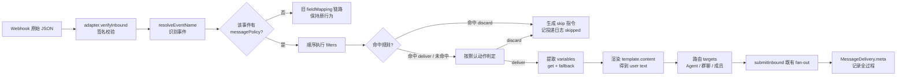

# 38 Webhook 消息过滤与消息模板设计

> 状态：设计稿（展示方案）
> 关联：`27-外部渠道集成设计.md`、`web/app/(main)/integrations/page.tsx`、`server/src/message-channels/`

## 1. 背景与目标

Gitee / GitHub 等平台的 Webhook 载荷字段多、嵌套深、事件类型杂。当前入站侧只有
`fieldMapping` 的 `content / source / user` 三个固定字段映射，能力边界明显：

- **不能过滤**：所有事件都会进入群聊/私聊并被 Agent 消费，噪音大；
- **不能编排正文**：只能拼 `[source] user: content`，无法按事件定制成一条完整的用户消息；
- **不能指定接收方**：投递目标完全由渠道的团队/成员绑定决定，无法按事件路由到指定 Agent 或群聊。

本次设计目标：为 Webhook 类入站渠道增加三项能力，并使其**可配置、可测试、可追溯**：

1. **过滤**：按条件决定某条消息是「处理」还是「丢弃」；
2. **模板**：从复杂 JSON 中提取字段，组合成一条完整的用户消息；
3. **路由**：按事件把消息投递到指定 Agent / 群聊 / 成员私聊。

## 2. 设计原则

| 原则 | 说明 |
|---|---|
| 零迁移 | 全部配置存入 `MessageChannel.config` 的新键 `messagePolicies`，沿用现有 per-event 模式，不动 Prisma |
| 向后兼容 | 旧 `config.fieldMapping` / `config.fieldMappings` 继续生效；新策略缺省时行为不变 |
| 三段可测 | 过滤、提取、渲染各自可独立预览；配置页提供「用示例消息测试」一键跑通全链路 |
| 可观测 | 命中规则、提取变量、渲染正文、路由目标写入 `MessageDelivery.meta`，投递日志可展开查看 |
| 安全 | 模板只做纯字符串插值（复用 `renderFieldTemplate`），不执行表达式/脚本；丢弃的消息也记日志 |

## 3. 配置模型

```ts
// MessageChannel.config.messagePolicies（per-event，与现有 fieldMappings 同构）
interface MessagePolicy {
  enabled: boolean;                 // 该事件是否启用策略
  defaultAction: "deliver" | "discard"; // 无规则命中时的兜底动作
  filters: FilterRule[];            // 按数组顺序匹配，首条命中即生效
  template: {
    variables: Array<{ name: string; path: string; fallback?: string }>;
    content: string;                // 正文模板，{{name}} 插值
  };
  targets: Array<{
    mode: "teams" | "member";    // 渠道级绑定类型（互斥：团队群聊 / 成员私聊）
    teams: string[];             // 团队群聊列表（多选，每团队一个群）；空 = 沿用渠道现有绑定
    member?: string;             // 成员私聊（唯一成员）
    route: "main" | "mention";   // 群聊模式下的消息接入方式
  }>;
}

interface FilterRule {
  id: string;
  name: string;
  enabled: boolean;
  logic: "and" | "or";              // 条件间关系
  conditions: Array<{
    path: string;                   // 如 issue.state、commits[0].message
    op: "eq" | "neq" | "contains" | "regex" | "exists" | "in";
    value?: string;                 // in 用英文逗号分隔
  }>;
  action: "deliver" | "discard";
}

// 存储形态
config: {
  fieldMappings: { ... },           // 旧能力，保留
  messagePolicies: {
    issue_hooks:       { ... },
    pull_request_hooks:{ ... },
    _default:          { ... },     // 兜底事件
  }
}
```

**与旧 fieldMapping 的关系**：`messagePolicies[event].enabled = true` 时走新链路；
否则继续走旧 `resolveFieldMapping()`，保证存量渠道零影响。

## 4. 处理链路



落点建议：在三个 webhook adapter 的 `normalizeInbound()` 内、`resolveFieldMapping()` 之后
插入策略执行；或抽到 `server/src/message-channels/message-policy.util.ts` 统一复用。
`MessageDelivery.error` 写丢弃原因，`meta` 写 `{ event, matchedRuleId, action, variables, renderedText, targets }`。

## 5. 展示方案（UI）

### 5.1 入口

渠道列表每行的操作区，在「编辑」旁新增 **「消息规则」** 按钮，按钮上带规则数量徽标
（如 `消息规则 · 3`）。点击打开右侧配置抽屉「消息处理 · gitee-issue」。

### 5.2 配置抽屉布局

```
┌──────────────────────────────────────────────────────────────┐
│ 消息处理 · gitee-issue                                  [×]   │
├───────────┬──────────────────────────────────────────────────┤
│ 事件列表   │  ① 过滤规则                                       │
│           │     默认动作 [丢弃 ▾]   + 新增规则                 │
│ Issue 事件 │     ┌ 只处理打开的 Issue            [启用] ─────┐ │
│ PR 事件    │     │ 当 issue.state 等于 open  AND action 等于 opened│
│ Push 事件  │     │ 命中 → [放行]              [删除]         │
│ 默认       │     └──────────────────────────────────────────┘ │
│           │     ┌ 丢弃机器人创建的 Issue        [启用] ─────┐ │
│           │     │ 当 sender.type 等于 Bot                   │
│           │     │ 命中 → [丢弃]              [删除]         │
│           │     └──────────────────────────────────────────┘ │
│           │  ② 消息模板                                       │
│           │     变量提取：变量名 | JSON 路径 | 默认值 | 示例值   │
│           │       title   | issue.title      | (无标题)| 修复… │
│           │       repo    | repository.full… | -       | acme…│
│           │       author  | sender.login     | 未知     | alice│
│           │       url     | issue.html_url   | -       | http…│
│           │     [+ 添加变量]                                  │
│           │     正文模板：________________ {{title}} ______    │
│           │     预览：🐛 修复登录超时问题                       │
│           │           仓库：acme/web · 发起人：alice            │
│           │  ③ 投递目标                                       │
│           │     ● 团队群聊   ○ 成员私聊    ← 互斥切换         │
│           │     团队群聊列表（多选）：                         │
│           │       [✓] 产品研发群   team_group · 12 名成员      │
│           │       [✓] 运维值班群   team_group · 5 名成员        │
│           │     消息接入方式：                                 │
│           │       [●] 路由到主 Agent（群内默认触发主 Agent）   │
│           │       [ ] 消息带 @Agent名的 mention 路由           │
│           │     成员私聊模式（互斥）：[✓] 成员：郭龙            │
│           │  ④ 测试： [示例 JSON ▾]  [运行测试]                 │
│           │     输出：过滤结果 / 提取变量 / 正文 / 投递（群列表/│
│           │     成员/路由方式）                                 │
├───────────┴──────────────────────────────────────────────────┤
│                                      [取消]  [保存配置]        │
└──────────────────────────────────────────────────────────────┘
```

### 5.3 过滤规则编辑器

- **默认动作**：下拉选择「放行 / 丢弃」，决定无规则命中时的行为；
- **规则卡片**：每条规则独立启用开关、可拖拽排序（优先级）、删除；
- **条件构建器**：`当 [字段路径] [运算符] [值]`，多条之间选 AND / OR；
- **命中动作**：绿色「放行」/ 红色「丢弃」分段按钮；
- **字段路径辅助**：输入框旁提供「从示例 JSON 选择」——粘贴一条真实载荷后，
  列出可点选的字段树（`issue.title`、`sender.type` …），点击即填入路径，
  这是解决「复杂 JSON 不知道路径」痛点的关键交互；
- **运算符**：等于 / 不等于 / 包含 / 正则匹配 / 存在 / 属于（列表）。

### 5.4 消息模板编辑器

- **变量提取表**：`变量名 | JSON 路径 | 默认值 | 示例值`，示例值来自测试载荷实时解析；
- **正文模板**：多行文本框，支持 `{{变量名}}` 插值，工具栏点击变量名插入；
- **实时预览**：右侧/下方用消息卡片样式渲染结果，所见即所得；
- **兜底**：变量缺失时用默认值，仍缺失则渲染为空串（与现有 `renderFieldTemplate` 一致）。

### 5.5 投递目标

渠道绑定按「团队群聊（可多选）」或「成员私聊（唯一成员）」二选一，与渠道绑定互斥（实际约束见下文）：

- **团队群聊（多选）**：每团队一个群。`TeamMessageChannel` 复合主键 `[teamId, channelId]`，一个渠道可绑多个团队；入站在 `message-inbound.service.ts` 对 `boundTeamIds` 循环 fan-out，每团队发到该团队 `team_group` 频道。
- **消息接入方式（可选，群模式）**：「路由到主 Agent（群内默认触发主 Agent 响应）」或「消息带 @Agent名的 mention 路由」（模板里写 `@{{agent_name}}`，`chatService.resolveMentions` 触发指定 Agent 响应）。
- **成员私聊（单选）**：`MemberMessageChannel` + `MemberChannelBindingsController` 显式独占——同一渠道只能绑一个成员，冲突缺省 409 抢占；入站消息直达该成员私聊（全局一条 DM，与团队无关，`message-inbound.service.ts` 入口的 member 短路）。
- **空选**：团队群聊模式下不选 = 沿用渠道现有绑定（向下兼容）。

> **实际约束核对（2026-11-23）**：
> - 多团队群聊：**支持**（`TeamMessageChannel` 复合主键 `[teamId, messageChannelId]`，入站 `for (const teamId of boundTeamIds)` fan-out，每团队一个 `team_group`）
> - 多成员私聊：**不支持**（`member-channel-bindings.controller.ts` 注释：渠道是独占资源，`memberId: { not: memberId }` 冲突查询）
> - 渠道既绑团队又绑成员：**不支持**（member 绑定校验 `teamConflicts`，team 绑定抢占 `memberBindings`）

### 5.6 测试面板

- 粘贴/选择一条真实 Webhook 载荷，点「运行测试」，分步展示：
  1. 命中的过滤规则及动作（绿/红高亮）；
  2. 提取出的变量键值对；
  3. 渲染后的用户消息（Markdown 预览）；
  4. 投递模型：群聊列表（沿用绑定则显示空）/ 成员 / 路由方式（群模式下「主 Agent 默认触发」或「mention 路由」）。
- 测试**不产生真实投递**，仅用于配置校验；
- **开始监听**：点击后每 3 秒轮询投递日志，把真实 Webhook 的原始载荷（`meta.rawPayload`）采集为测试来源数据，可「载入」到示例 JSON 一键复现线上消息，用于调规则/模板——避免手工拼复杂 JSON。后端在 `deliveryMeta` 中记录 `rawPayload`（放行/丢弃链路都记录），仅作用于日志不影响投递。

### 5.7 投递日志增强

`DeliveryDrawer` 每条日志可展开，新增展示「事件 / 命中规则 / 提取变量 / 渲染正文 / 目标 / 结果」，
并提供「用这条消息建规则」快捷入口，形成 配置 → 测试 → 线上验证 的闭环。

## 6. 关键交互细节

| 细节 | 处理 |
|---|---|
| 规则优先级 | 数组顺序即优先级，首条命中即停止；UI 提供上移/下移 |
| 正则安全 | 后端 `regex` 运算需捕获异常，非法正则按不匹配处理，不让单条消息阻断进程 |
| 模板安全 | 仅 `{{path}}` 插值，不解析 JS 表达式；变量值做字符串化 |
| 事件来源 | 事件下拉 = 内置事件常量 ∪ 已有 messagePolicies 的 key ∪ 最近投递日志出现过的事件 |
| 空配置 | 未配置 messagePolicies 的渠道，UI 提示「当前走默认 fieldMapping 行为」并提供一键初始化 |

## 7. 落地步骤

**MVP（本次）**
1. 扩展 `field-template.util.ts`：抽公共 `get()`，新增 `evaluateFilter()` / `renderMessageTemplate()`；
2. 三个 webhook adapter 在 `normalizeInbound()` 中接入策略，丢弃时返回 skip 指令并记日志；
3. `integrations/page.tsx` 的 `MessageChannelModal` 增加「过滤规则 / 消息模板」两个 Tab 或独立抽屉；
4. `DeliveryDrawer` 展开区展示策略执行详情；
5. 补齐 `field-template.util.spec.ts` 与 E2E（data-testid 沿用 `integration-*` 前缀）。

**增强（后续）**
1. 前后端内置模板常量收敛为单一来源（接口下发或共享包）；
2. 过滤条件支持字段值之间比较、时间窗口；
3. 模板支持简单函数（截断、时间格式化），仍保持非图灵完备。

## 8. 验收要点

- Gitee `issue_hooks` 中 `issue.state=closed` 的消息被丢弃，且投递日志出现 `skipped` 及原因；
- `sender.type=Bot` 的消息被丢弃；
- 普通 issue 消息按模板渲染成完整正文，变量缺失时回退默认值；
- 同一事件路由到指定 Agent 与群聊，Agent 正常响应；
- 未配置新策略的渠道行为与改动前完全一致；
- 非法正则、缺失字段等异常不会导致入站接口 500；
- **规则优先级**：规则数组顺序即优先级、首条命中即停止，因此「丢弃」类规则必须排在「放行」类规则之前，否则宽泛放行规则会先命中使丢弃规则失效（UI 已加⚠提示）；
- **策略 targets 覆盖**：策略里显式配置的 team/member 会覆盖渠道绑定（`submitInbound` 在「no teams bound」检查之前应用覆盖），且仅作用于本次消息、不改写渠道绑定关系；未配置则沿用渠道绑定。

## 9. 交互原型

原型已按 md-docs 约定放在 `docs/agent-platform/prototypes/webhook-policy/index.tsx`，
项目内直达 URL：`#/p/agent-platform/protos/webhook-policy`。下方内嵌原型可切换 PC / 移动端查看，
支持点选事件、编辑规则/变量/模板/目标并运行测试（纯本地交互，不产生真实投递）。

```prototype
id: webhook-policy
title: Webhook 消息规则配置原型
device: desktop
height: 660
```
